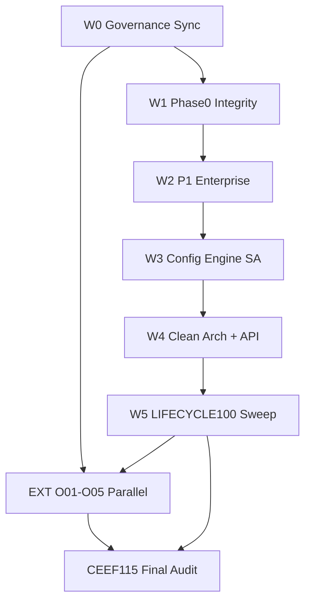
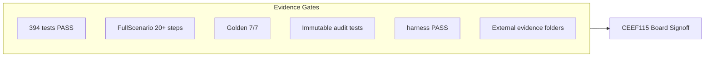
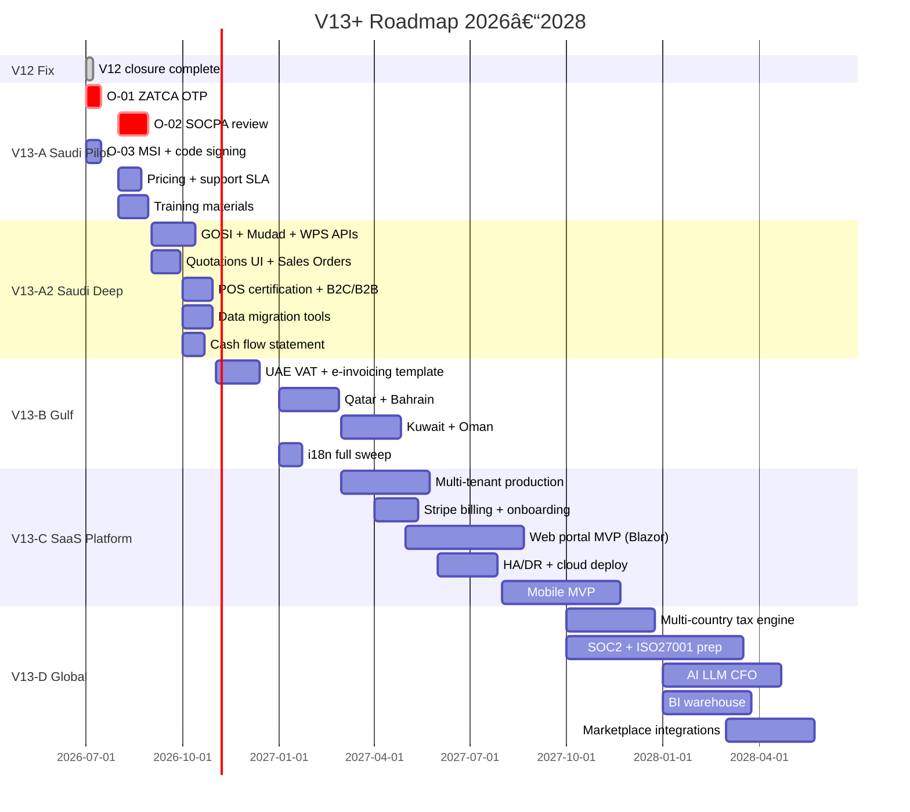
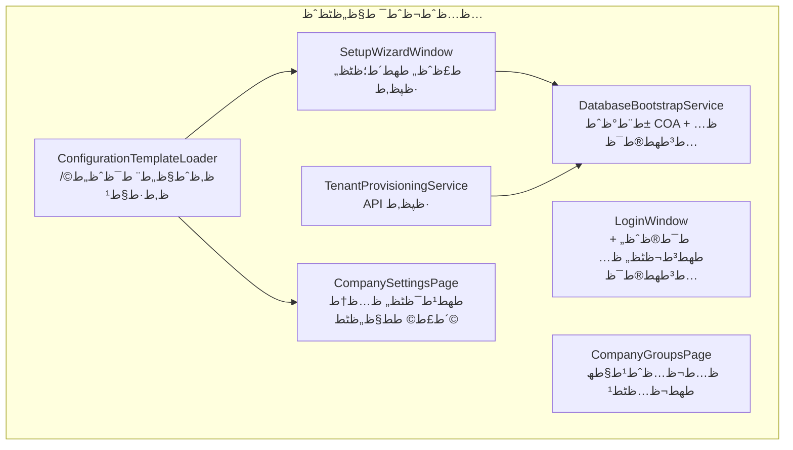
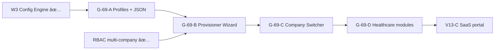

# ط®ط·ط© ط¥ط؛ظ„ط§ظ‚ BRQOSH ط§ظ„ط´ط§ظ…ظ„ — ظ…ظ‡ظ… v4.0 + ط¨ظˆط§ط¨ط§طھ ط®ط§ط±ط¬ظٹط©

> **✅ V12 ظ…ط؛ظ„ظ‚ ط¨ط§ظ„ظƒط§ظ…ظ„ ط¯ط§ط®ظ„ ط§ظ„ظ…ط³طھظˆط¯ط¹** — 2026-07-09 آ· CEEF-101…116  
> **âڈ­ ظ„ط§ ظٹظڈط؛ظ„ظ‚ ط¨ط§ظ„ظƒظˆط¯:** O-01…O-05 ط­ظٹ آ· O-08…O-13 آ· V13+ — [`OPEN_ITEMS.md`](docs/OPEN_ITEMS.md)

## ط­ظƒظ… ط§ظ„ظ…ط¬ظ„ط³ (ط¨ط¯ظˆظ† طھظ†ظ…ظٹظ‚)

| ط§ظ„ط§ط¯ط¹ط§ط، | ط§ظ„ط­ظƒظ… | ط§ظ„ط¯ظ„ظٹظ„ |
|---------|-------|--------|
| MASTER V1–V11 ظ…ط؛ظ„ظ‚ | ظ…ط؛ظ„ظ‚ ط¯ط§ط®ظ„ظٹط§ظ‹ | [CEEF-100](طھظ‚ط§ط±ظٹط±/CEEF-100_MASTER_Roadmap_Closure.md) |
| **V12 ظ…ظ‡ظ… ظ…ط±ط­ظ„ط© 0→5** | **✅ ظ…ط؛ظ„ظ‚ ط¯ط§ط®ظ„ ط§ظ„ظ…ط³طھظˆط¯ط¹** | [CEEF-115](طھظ‚ط§ط±ظٹط±/CEEF-115_ظ…ظ‡ظ…_V12_Final_Audit.md) آ· CEEF-102…114 |
| ظ…ظ‡ظ… ظ…ط±ط­ظ„ط© 0 (Integrity) | **✅ ظ…ط؛ظ„ظ‚** | PostingOrchestrator آ· ImmutableAudit آ· Golden 8/8 |
| ظ…ظ‡ظ… P1 (Workflow/MDM/Treasury) | **✅ ظ…ط؛ظ„ظ‚** | CEEF-105…107 |
| ظ…ظ‡ظ… P3 (Config Engine) | **✅ ظ…ط؛ظ„ظ‚** | CEEF-108 آ· ظ‚ظˆط§ظ„ط¨ SA/Construction |
| O-01…O-05 | **ط¬ط§ظ‡ط² طھط¬ظ‡ظٹط²ط§ظ‹ آ· âڈ­ ط؛ظٹط± ظ…ط؛ظ„ظ‚ ط­ظٹط§ظ‹** | `dist/evidence/O-0X-*/` آ· [run-external-gates.ps1](scripts/ops/run-external-gates.ps1) |
| ظ…ط±ط§ط­ظ„ 5–7 (SaaS/Cloud/LLM) | **ط®ط§ط±ط¬ ط§ظ„طµظ†ط¯ظˆظ‚ — V13+** | Stripe آ· HA geo آ· LLM — stubs ظپظ‚ط· |

**ظ‚ط±ط§ط± ط§ظ„ط­ظˆظƒظ…ط©:** ظپطھط­ **ظ…ظˆط¬ط© V12** (`CEEF-101` → `CEEF-115`) ظƒط§ظ…طھط¯ط§ط¯ ط±ط³ظ…ظٹ ظ„ظ€ MASTER — ظ„ط£ظ† ط§ظ„ظ…ط³طھط®ط¯ظ… ط·ظ„ط¨ آ«ظƒظ„ ط´ظٹط،آ» ظˆظ„ظٹط³ ظ…ط³ط§ط±ط§ظ‹ ظˆط§ط­ط¯ط§ظ‹ ظپظ‚ط·.

---

## طھط³ظ„ط³ظ„ ط§ظ„طھظ†ظپظٹط° (ظ„ط§ طھط®ط·ظچ ظ…ظˆط¬ط© ظ‚ط¨ظ„ ط¥ط؛ظ„ط§ظ‚ ط£ط¯ظ„طھظ‡ط§)



**ظ…ط³ط§ط± ط®ط§ط±ط¬ظٹ ظ…ظˆط§ط²ظچ ظ…ظ† ط§ظ„ظٹظˆظ…:** O-01…O-05 — ظٹظڈظ†ظپظ‘ظژط° ظپظˆط± طھظˆظپط± OTP/ظ…ط±ط§ط¬ط¹/VMط› ظ„ط§ ظٹظڈط¹ط·ظ‘ظ„ ط§ظ„ظƒظˆط¯ ط§ظ„ط¯ط§ط®ظ„ظٹ.

---

## W0 — ط­ظˆظƒظ…ط© ظˆطھظˆط­ظٹط¯ ط§ظ„ظ…ط±ط§ط¬ط¹ (ظٹظˆظ… 1)

**ط§ظ„ظ‡ط¯ظپ:** ط¥ط²ط§ظ„ط© ط§ظ„طھظ†ط§ظ‚ط¶ط§طھ C-01…C-05 ظ‚ط¨ظ„ ط£ظٹ ظƒظˆط¯.

| ط§ظ„ظ…ظ‡ظ…ط© | ط§ظ„ظ…ظ„ظپط§طھ | ظ…ط¹ظٹط§ط± ط§ظ„ط¥ط؛ظ„ط§ظ‚ |
|--------|---------|---------------|
| طھظˆط­ظٹط¯ ط£ط±ظ‚ط§ظ… ط§ظ„ط§ط®طھط¨ط§ط±ط§طھ | [WAKE_UP_CHECKLIST.md](docs/ops/WAKE_UP_CHECKLIST.md) | 333/333 ظپظٹ ظƒظ„ ط§ظ„ظˆط«ط§ط¦ظ‚ |
| طھط¹ط±ظٹظپ آ«ظ…ط؛ظ„ظ‚آ» ط±ط³ظ…ظٹط§ظ‹ | [OPEN_ITEMS.md](docs/OPEN_ITEMS.md) + ظ‚ط³ظ… ط¬ط¯ظٹط¯ ظپظٹ [ظ…ظ‡ظ…](docs/ظ…ظ‡ظ…) | 4 ظ…ط³طھظˆظٹط§طھ: ظƒظˆط¯ آ· ط§ط®طھط¨ط§ط± آ· طھط´ط؛ظٹظ„ ط­ظٹ آ· ط®ط§ط±ط¬ظٹ |
| طھطµط­ظٹط­ ظ†ط³ط¨ ط§ظ„ط¬ط§ظ‡ط²ظٹط© | [ظ…ظ‡ظ…](docs/ظ…ظ‡ظ…) آ§ظ…ط¤ط´ط±ط§طھ | ط±ط¨ط· ط¨ظ€ CEEF-041 (~52–58%) + ط£ط¹ظ…ط¯ط© آ«ظƒظˆط¯/ط­ظٹآ» |
| ظپطھط­ V12 ظپظٹ MASTER | [EXECUTION_ROADMAP_MASTER.md](docs/EXECUTION_ROADMAP_MASTER.md) | ط¬ط¯ظˆظ„ V12-1…V12-7 |
| طھط­ط¯ظٹط« DOMAIN_MAP | [DOMAIN_MAP.md](docs/DOMAIN_MAP.md) | Workflow: ظ…ظ† âڈ­ ط¥ظ„ظ‰ ًں”¶â†’✅ ط¹ظ†ط¯ ط§ظ„ط¥ط؛ظ„ط§ظ‚ |

**ط¯ظ„ظٹظ„:** طھظ‚ط±ظٹط± CEEF-101 (ط­ظˆظƒظ…ط© ظپظ‚ط· — ظ„ط§ ط§ط¯ط¹ط§ط، ظ…ظٹط²ط§طھ).

---

## ظ‚ط§ظ†ظˆظ† ظ…ظ†ط¹ ط£ط®ط·ط§ط، PostgreSQL ط§ظ„ظ…طھظƒط±ط±ط© (Schema Governance)

**ط§ظ„ظ‚ط§ظ†ظˆظ† ط§ظ„ط¯ط§ط¦ظ…:** `.cursor/rules/brqosh-schema-governance.mdc` آ· **ط§ظ„ظˆط«ظٹظ‚ط©:** [docs/SCHEMA_GOVERNANCE.md](docs/SCHEMA_GOVERNANCE.md)

| ط§ظ„ط¹ظژط±ظژط¶ | ط§ظ„ط³ط¨ط¨ | ط§ظ„ط¥طµظ„ط§ط­ |
|--------|-------|---------|
| `Unsupported PostgreSQL column type: character varying(128)` | ظ†ظˆط¹ PG ظپظٹ `BrqoshSchemaUpdater` ط؛ظٹط± ظ…ظڈط³ط¬ظ‘ظژظ„ ظپظٹ `SchemaSqlGuard.AllowedPgTypes` | طھط³ط¬ظٹظ„ ط§ظ„ظ†ظˆط¹ ط§ظ„ظƒط§ظ…ظ„ + `SchemaSqlGuardTests` |
| V12 ظٹظ…ط±ظ‘ SQLite ظˆظٹظپط´ظ„ Desktop ط¹ظ„ظ‰ PG | CI ط§ظپطھط±ط§ط¶ظٹ = SQLite in-memoryط› `PostgreSqlStartupTests` ظٹطھط®ط·ظ‘ظ‰ ط¨ط¯ظˆظ† `database.json` | ط¨ظˆط§ط¨ط© PG ظٹط¯ظˆظٹط© ط¥ظ„ط²ط§ظ…ظٹط© ظ‚ط¨ظ„ ✅ schema |
| RBAC: آ«ظ„ط§ ظٹظˆط¬ط¯ ظ…ط³طھط®ط¯ظ… ظ…ط³ط¬ظ‘ظ„آ» ط±ط؛ظ… طھط³ط¬ظٹظ„ ط§ظ„ط¯ط®ظˆظ„ | `SecurityContext` ط¹ظ„ظ‰ `AsyncLocal` — ظٹظڈظپظ‚ط¯ ط¹ط¨ط± ط³ظٹط§ظ‚ط§طھ WPF | `AppServices.CreateDb()` ظٹط¹ظٹط¯ ط§ظ„ط±ط¨ط· ظ…ظ† `_currentUser` |

**ظ…ط¹ظٹط§ط± ط§ظ„ط¥ط؛ظ„ط§ظ‚ (4 ظ…ط³طھظˆظٹط§طھ):** ظƒظˆط¯ (Entity + SchemaUpdater + Guard) آ· SQLite `dotnet test` آ· PG `PostgreSqlStartupTests` آ· Desktop smoke ط¹ظ„ظ‰ PG.

**ط¨ظ†ظˆط¯ V12 hotfix (ظ…ظƒطھظ…ظ„ ط¨ط§ظ„ظƒظˆط¯):**
- `schema-pg-varchar-fix` — `character varying(128|512) NULL` ظپظٹ `SchemaSqlGuard` — CEEF-103 schema gate
- `rbac-admin-bootstrap-fix` — `BindSecurityContext()` ظپظٹ `CreateDb()` + `SecuritySessionBindingTests` — CEEF-040

---

## W1 — ظ…ط±ط­ظ„ط© 0: Financial Integrity Layer (ط£ظˆظ„ظˆظٹط© ظ‚طµظˆظ‰)

### W1-A — Accounting Rules Engine (طھط¯ط±ظٹط¬ظٹطŒ ظ„ط§ ط¥ط¹ط§ط¯ط© ظƒطھط§ط¨ط© 15 ط®ط¯ظ…ط©)

**ط§ظ„طھطµظ…ظٹظ…:** ظˆط§ط¬ظ‡ط© ظ…ط±ظƒط²ظٹط© + ط³ظٹط§ط³ط§طھ — ظ„ط§ ظ…ط­ط±ظƒ DSL ط¬ط¯ظٹط¯ ظپظٹ ط§ظ„ط¯ظˆط±ط© ط§ظ„ط£ظˆظ„ظ‰.

```
PostingOrchestrator
  → IPostingPolicy.ValidateBeforePost()
  → IPostingPolicy.ResolveDefaultAccounts()
  → existing *PostingService.PostAsync()
```

| ظ…ظƒظˆظ† ط¬ط¯ظٹط¯ | ط§ظ„ظ…ط³ط§ط± ط§ظ„ظ…ظ‚طھط±ط­ |
|-----------|----------------|
| `IPostingPolicy` | [src/Brqosh.Application/Accounting/](src/Brqosh.Application/) |
| `SaudiPostingPolicy` | [src/Brqosh.Infrastructure/Accounting/](src/Brqosh.Infrastructure/Accounting/) |
| `PostingOrchestrator` | ظٹط؛ظ„ظ‘ظپ [JournalPostingService.cs](src/Brqosh.Infrastructure/Accounting/JournalPostingService.cs) |
| طھط±ط­ظٹظ„ طھط¯ط±ظٹط¬ظٹ | SI آ· PI آ· CreditNote آ· DebitNote ط£ظˆظ„ط§ظ‹ (ط£ط¹ظ„ظ‰ ط­ط±ظƒط©) |

**ط§ظ„ط³ط¨ط¨:** ط£ظ‚ظ„ ظ…ط®ط§ط·ط±ط© ظ…ظ† ظ…ط­ط±ظƒ ط¬ط¯ظٹط¯ ظƒط§ظ…ظ„ط› ظٹط­ظ‚ظ‚ R-03/I-03 ط¯ظˆظ† ظƒط³ط± 333 ط§ط®طھط¨ط§ط±.

**ظ…ط¹ظٹط§ط± ط§ظ„ط¥ط؛ظ„ط§ظ‚:**
- ظƒظ„ ط®ط¯ظ…ط© ظ…ط±ط­ظ‘ظ„ط© طھط³طھط¯ط¹ظٹ `PostingOrchestrator`
- ط§ط®طھط¨ط§ط±ط§طھ `PostingPolicyTests` طھط؛ط·ظٹ: ظپطھط±ط© ظ…ط؛ظ„ظ‚ط© آ· ط­ط³ط§ط¨ ط؛ظٹط± ظ†ط´ط· آ· ط­ط³ط§ط¨ط§طھ ط§ظپطھط±ط§ط¶ظٹط©
- CEEF-102

### W1-B — Immutable Audit Ledger

**ط§ظ„ظˆط§ظ‚ط¹ ط§ظ„ط­ط§ظ„ظٹ:** [AuditLogEntry.cs](src/Brqosh.Domain/Security/AuditLogEntry.cs) private setters ظ„ظƒظ† EF ظٹط³ظ…ط­ UPDATE/DELETEط› [AuditService.cs](src/Brqosh.Infrastructure/Security/AuditService.cs) insert ظپظ‚ط·ط› طھط؛ط·ظٹط© طھط±ط­ظٹظ„ ط¬ط²ط¦ظٹط© (3/15 PostingService).

| ط®ط·ظˆط© | ط§ظ„طھظ†ظپظٹط° |
|------|---------|
| ط­ظ‚ظ„ `Reason` | ط¥ط¶ط§ظپط© ط¥ظ„ظ‰ `AuditLogEntry` + migration |
| ط­ط¸ط± DB | `AuditLogImmutabilityInterceptor` ظپظٹ [BrqoshDbContext.cs](src/Brqosh.Infrastructure/Persistence/BrqoshDbContext.cs) — ظٹط±ظپط¶ Update/Delete ط¹ظ„ظ‰ `AuditLogEntries` |
| طھط؛ط·ظٹط© طھط±ط­ظٹظ„ | `AuditPostingHook` ظٹظڈط³طھط¯ط¹ظ‰ ظ…ظ† ظƒظ„ `*PostingService` ط¹ط¨ط± decorator ط£ظˆ base helper |
| ط¥ط²ط§ظ„ط© طھط²ظٹظٹظپ FSA | ط­ط°ظپ seed ظٹط¯ظˆظٹ ظپظٹ [FullScenarioAudit/Program.cs](tools/FullScenarioAudit/Program.cs) — ط§ظ„ط§ط¹طھظ…ط§ط¯ ط¹ظ„ظ‰ طھط±ط­ظٹظ„ ط­ظ‚ظٹظ‚ظٹ |

**ظ…ط¹ظٹط§ط± ط§ظ„ط¥ط؛ظ„ط§ظ‚:**
- `ImmutableAuditTests`: ظ…ط­ط§ظˆظ„ط© Update/Delete طھظپط´ظ„
- FSA step 13 ظٹط¹طھظ…ط¯ ط¹ظ„ظ‰ ط³ط¬ظ„ط§طھ ظ…ظ† طھط±ط­ظٹظ„ ظپط¹ظ„ظٹ (≥ N entries ظ…ظ† Post)
- CEEF-103

### W1-C — Golden Accounting Tests (R-05 ظƒط§ظ…ظ„ط©)

**ظ…ظ„ظپ ط¬ط¯ظٹط¯:** `tests/Brqosh.Application.Tests/Accounting/GoldenAccountingIntegrityTests.cs`

| ط³ظٹظ†ط§ط±ظٹظˆ | ط§ظ„ط®ط¯ظ…ط§طھ | ط§ظ„طھط­ظ‚ظ‚ (ط§ظ„ظ‚ظٹط¯ + ط§ظ„طھظ‚ط±ظٹط± + ط§ظ„ط£ط«ط±) |
|---------|---------|-----------------------------------|
| ط´ط±ط§ط، ط£طµظ„ | `FixedAssetAcquisitionPostingService` | JE lines آ· BS asset ↑ |
| ط¨ظٹط¹ ط£طµظ„ | `FixedAssetDisposalPostingService` | JE آ· gain/loss آ· BS asset ↓ |
| ط¥ظ‡ظ„ط§ظƒ | `DepreciationService` | JE آ· accumulated dep |
| ط¬ط±ط¯ | `StockMovementPostingService` AdjustmentIn | JE آ· inventory آ· TB balanced |
| ظ…ط±طھط¬ط¹ | `CreditNotePostingService` | JE reversed VAT آ· AR ↓ |
| ط¶ط±ظٹط¨ط© | PI + SI + `VatReturnQuery` | output/input net |
| ظپط±ظˆظ‚ط§طھ ط¹ظ…ظ„ط© | `FxRevaluationService` | FX gain/loss JE آ· TB |

**طھظˆط³ظٹط¹ FSA:** ط¥ط¶ط§ظپط© ط®ط·ظˆط§طھ 14–20 ظ„ظ‡ط°ظ‡ ط§ظ„ط³ظٹظ†ط§ط±ظٹظˆظ‡ط§طھ (ط£ظˆ ط¯ظ…ط¬ ظپظٹ 13 ظ…ط¹ assertions ط£ظ‚ظˆظ‰).

**ظ…ط¹ظٹط§ط± ط§ظ„ط¥ط؛ظ„ط§ظ‚:** 7/7 PASS آ· FullScenario ظ…ط­ط¯ظ‘ط« آ· CEEF-104

---

## W2 — ظ…ط±ط­ظ„ط© 2: P1 Enterprise Foundation

### W2-A — Workflow Engine (طھظˆط³ظٹط¹طŒ ظ„ط§ ظ…ط­ط±ظƒ ط®ط§ط±ط¬ظٹ)

**ط§ظ„ظˆط§ظ‚ط¹:** [WorkflowEngine.cs](src/Brqosh.Infrastructure/Workflow/WorkflowEngine.cs) — `PurchaseRequest` ظپظ‚ط· آ· ظ„ط§ DI.

| طھظˆط³ظٹط¹ | `WorkflowDocumentKind` | ط³ظ„ط³ظ„ط© |
|-------|------------------------|-------|
| PO | `PurchaseOrder` | Manager → Finance |
| ط¯ظپط¹ | `PaymentVoucher` | Finance → Administrator |
| ظ‚ظٹط¯ ظٹط¯ظˆظٹ | `ManualJournalEntry` | Accountant → Administrator |

**ط¥طµظ„ط§ط­ط§طھ ط¥ظ„ط²ط§ظ…ظٹط©:**
- طھط³ط¬ظٹظ„ `IWorkflowEngine` ظپظٹ DI ([ApplicationServiceCollectionExtensions.cs](src/Brqosh.Application/ApplicationServiceCollectionExtensions.cs))
- ط¥ط²ط§ظ„ط© `new WorkflowEngine(db)` ظ…ظ† [PurchaseRequestsPage.xaml.cs](src/Brqosh.Desktop/Views/Pages/PurchaseRequestsPage.xaml.cs)
- UI ظ„ظ€ PO/Payment workflow (ظ†ظ…ط· PR ط§ظ„ظ…ظˆط¬ظˆط¯)

**ظ…ط¹ظٹط§ط± ط§ظ„ط¥ط؛ظ„ط§ظ‚:** `WorkflowEngineTests` ظ„ظƒظ„ ظ†ظˆط¹ آ· SoD: ظ„ط§ self-approval آ· CEEF-105

### W2-B — Master Data Governance

| ظ‚ط¯ط±ط© | ط§ظ„طھظ†ظپظٹط° |
|------|---------|
| ظ…ظ†ط¹ طھظƒط±ط§ط± VAT | Unique index `(CompanyId, VatNumber)` ظپظٹ [BrqoshDbContext.cs](src/Brqosh.Infrastructure/Persistence/BrqoshDbContext.cs) + validation |
| طھط­ط°ظٹط± طھظƒط±ط§ط± ط§ط³ظ… | `MasterDataGovernanceService` — fuzzy match ط¹ظ„ظ‰ NameAr/NameEn |
| طھط§ط±ظٹط® طھط¹ط¯ظٹظ„ | `Customer`/`Supplier` — `ModifiedAt`/`ModifiedBy` (ط¥ظ† ظ„ظ… ظٹظˆط¬ط¯) |
| ط¯ظˆط±ط© ط§ط¹طھظ…ط§ط¯ MDM | **ظ…ط¤ط¬ظ‘ظ„ V12.2** — ظٹطھط·ظ„ط¨ Workflow ط¹ط§ظ…ط› ظٹظڈظˆط«ظ‘ظژظ‚ âڈ­ ظپظٹ OPEN_ITEMS ط¥ظ† ظ„ظ… ظٹظڈظ†ط¬ط² ظپظٹ W2 |

**ظ…ط¹ظٹط§ط± ط§ظ„ط¥ط؛ظ„ط§ظ‚:** dedup tests آ· VAT unique constraint test آ· CEEF-106

### W2-C — Treasury ط§ظ„ظ…طھظ‚ط¯ظ…

| ظ‚ط¯ط±ط© | ظ…ظ„ظپ ط¬ط¯ظٹط¯ | ظ…ظ„ط§ط­ط¸ط© |
|------|----------|--------|
| طھظˆظ‚ط¹ ط³ظٹظˆظ„ط© 13 ط£ط³ط¨ظˆط¹ | `CashFlowForecastService.cs` | AR/AP due dates + recurring + opening cash |
| ط¥ط¯ط§ط±ط© ظ…ط¯ظپظˆط¹ط§طھ | `PaymentRunService.cs` | طھط¬ظ…ظٹط¹ ظپظˆط§طھظٹط± ظ…ط³طھط­ظ‚ط© → draft payment run |
| UI | طھظˆط³ظٹط¹ [bank-cash.md](design-system/pages/bank-cash.md) + `DashboardPage` | ط®ط· forecast |

**ظ…ط¹ظٹط§ط± ط§ظ„ط¥ط؛ظ„ط§ظ‚:** `CashFlowForecastTests` آ· `PaymentRunTests` آ· CEEF-107

---

## W3 — ظ…ط±ط­ظ„ط© 3: Configuration Engine v1 (ط³ط¹ظˆط¯ظٹ + ظ…ظ‚ط§ظˆظ„ط§طھ)

**ظ„ط§ طھط¹ط¯ظٹظ„ ظƒظˆط¯ ظ„ظƒظ„ ط¯ظˆظ„ط© — ظ‚ظˆط§ظ„ط¨ JSON:**

```
config/templates/
  countries/saudi-arabia.json    (VAT, ZATCA, COA seed ref, GOSI flags)
  industries/construction.json   (Retention, BOQ, IFRS15 modules)
```

| ظ…ظƒظˆظ† | ط§ظ„ظ…ط³ط§ط± |
|------|--------|
| `IConfigurationTemplate` | Application contracts |
| `ConfigurationTemplateLoader` | Infrastructure |
| `TemplatePicker` UI | [CompanySettingsPage](src/Brqosh.Desktop/Views/Pages/CompanySettingsPage.xaml) + SetupWizard |
| طھط·ط¨ظٹظ‚ ط¹ظ†ط¯ ط§ظ„ط¥ظ†ط´ط§ط، | [DatabaseInitializer.cs](src/Brqosh.Infrastructure/Persistence/DatabaseInitializer.cs) |

**ظ…ط¹ظٹط§ط± ط§ظ„ط¥ط؛ظ„ط§ظ‚:** ط´ط±ظƒط© ط¬ط¯ظٹط¯ط© ظ…ظ† ظ‚ط§ظ„ط¨ SA+Construction طھظڈظپط¹ظ‘ظ„ ط§ظ„ظˆط­ط¯ط§طھ ط§ظ„طµط­ظٹط­ط© ط¯ظˆظ† hardcode آ· CEEF-108

**ط®ط§ط±ط¬ ط§ظ„طµظ†ط¯ظˆظ‚:** SOCPA ط§ط¹طھظ…ط§ط¯ آ· GOSI API ط­ظٹ — ظٹط¨ظ‚ظ‰ O-02 / ط¨ظ†ط¯ ط¬ط¯ظٹط¯ O-16

---

## W4 — ظ…ط±ط­ظ„ط© 4: Enterprise ERP Maturity (ط¯ط§ط®ظ„ ط§ظ„ظ…ط³طھظˆط¯ط¹ ظپظ‚ط·)

### W4-A — طھظ‚ظ„ظٹظ„ Service Locator (طھط¯ط±ظٹط¬ظٹ)

**ظ„ط§ ط¥ط¹ط§ط¯ط© ظƒطھط§ط¨ط© 150 طµظپط­ط© ط¯ظپط¹ط© ظˆط§ط­ط¯ط©.**

| ظ…ط±ط­ظ„ط© | ط§ظ„ظ†ط·ط§ظ‚ |
|-------|--------|
| 4-A1 | طھط³ط¬ظٹظ„ Use Cases ط§ظ„ط­ط±ط¬ط© ظپظٹ DI |
| 4-A2 | طµظپط­ط§طھ Golden Path (SI, PI, Payment, JE) طھط³طھط®ط¯ظ… constructor injection ط¹ط¨ط± facade |
| 4-A3 | `AppServices` ظٹط¨ظ‚ظ‰ ظ„ظ„ظ€ CompanyId/Session ظپظ‚ط· |

**ظ…ط¹ظٹط§ط± ط§ظ„ط¥ط؛ظ„ط§ظ‚:** grep `new XxxService(db)` ظپظٹ Desktop pages ظ„ظ„طµظپط­ط§طھ ط§ظ„ط­ط±ط¬ط© = 0 آ· CEEF-109

### W4-B — API Platform ظƒظ…ط³ط§ط± طھظƒط§ظ…ظ„

- طھظˆط«ظٹظ‚ OpenAPI endpoints ط§ظ„ظ…ظˆط¬ظˆط¯ط© ظپظٹ [Brqosh.Api](src/Brqosh.Api/)
- Webhooks: طھظˆط³ظٹط¹ stub ظپظٹ CEEF-048 ط¥ظ† ظ„ط²ظ…
- **ط®ط§ط±ط¬ ط§ظ„طµظ†ط¯ظˆظ‚:** طھظƒط§ظ…ظ„ ط¨ظ†ظˆظƒ ط­ظٹ آ· ط­ظƒظˆظ…ط© — O-17 (ط¬ط¯ظٹط¯)

**ظ…ط¹ظٹط§ط± ط§ظ„ط¥ط؛ظ„ط§ظ‚:** Api integration tests PASS آ· CEEF-110

---

## W5 — LIFECYCLE-100 Sweep (ط¥ط؛ظ„ط§ظ‚ ظƒظ„ ًں”¶/ًں”œ ط§ظ„ظ‚ط§ط¨ظ„ط© ط¯ط§ط®ظ„ظٹط§ظ‹)

**ظ…ط±ط¬ط¹:** [LIFECYCLE-ROADMAP-100.md](design-system/LIFECYCLE-ROADMAP-100.md)

| ظ…ط¬ظ…ظˆط¹ط© ط®ط·ظˆط§طھ | ط§ظ„ط£ظˆظ„ظˆظٹط© | ط­ط§ظ„ط© ظ…ط³طھظ‡ط¯ظپط© |
|--------------|----------|--------------|
| 2–4 Identity | P1 | MFA TOTP آ· forced logout آ· login audit |
| 21–30 Documents | P1 | ظ†ظ…ظˆط°ط¬ ظ…ط³طھظ†ط¯ ظ…ظˆط­ط¯ آ· version history v1 |
| 31–34 Sales early | P2 | ط¹ط±ظˆط¶ ط£ط³ط¹ط§ط± آ· SO آ· ط­ط¬ط² ظ…ط®ط²ظˆظ† |
| 55 3-way match | P1 | PO↔GRN↔PI validation ظƒط§ظ…ظ„ |
| 65–66 Bank transfers | P2 | طھط­ظˆظٹظ„ط§طھ ط¨ظ†ظƒظٹط© |
| 99–100 Archive/freeze | P1 | read-only mode + archive flag |

**ظ‚ط§ط¹ط¯ط©:** ظƒظ„ ط®ط·ظˆط© طھظڈط­ط¯ظ‘ظژط« ظپظٹ LIFECYCLE ط¹ظ†ط¯ ط§ظ„ط¥ط؛ظ„ط§ظ‚ — ظ„ط§ ✅ ط¨ط¯ظˆظ† ط§ط®طھط¨ط§ط±.

**ظ…ط¹ظٹط§ط± ط§ظ„ط¥ط؛ظ„ط§ظ‚:** ≥90% ط®ط·ظˆط§طھ ✅ ط£ظˆ âڈ­ ظ…ظˆط«ظ‘ظ‚ آ· CEEF-111…114 (ظ…ط¬ظ…ظˆط¹ط§طھ)

---

## EXT — ط¨ظˆط§ط¨ط§طھ ط®ط§ط±ط¬ظٹط© O-01…O-05 (ظ…ظˆط§ط²ظٹ — آ«ظƒظ„ ط´ظٹط،آ»)

| ط§ظ„ط¨ظˆط§ط¨ط© | ط§ظ„ط¬ط§ظ‡ط² ظپظٹ ط§ظ„ظ…ط³طھظˆط¯ط¹ | ط§ظ„ظ…ط·ظ„ظˆط¨ ط®ط§ط±ط¬ظٹط§ظ‹ | ظ…ط¬ظ„ط¯ ط¯ظ„ظٹظ„ |
|---------|-------------------|-----------------|-----------|
| **O-01** ZATCA | [O-01 runbook](docs/ops/O-01_ZATCA_PRODUCTION_RUNBOOK.md) آ· CSID wizard | OTP + 10 ظپظˆط§طھظٹط± ظ…ظ‚ط¨ظˆظ„ط© | `dist/evidence/O-01-zatca/` |
| **O-02** SOCPA | [O-02 package](docs/ops/O-02_SOCPA_REVIEWER_PACKAGE.md) | ظ…ط±ط§ط¬ط¹ + PDF ظ…ظˆظ‚ظ‘ط¹ | `dist/evidence/O-02-socpa/` |
| **O-03** MSI | [verify-msi-build.ps1](scripts/ops/verify-msi-build.ps1) | VM ظ†ط¸ظٹظپط© + ظ„ظ‚ط·ط§طھ | `dist/evidence/O-03-msi/` |
| **O-04** Load 1M | [run-stress-benchmark.ps1](scripts/ops/run-stress-benchmark.ps1) `-FullMillion` | ط¬ظ‡ط§ط² ظ…ط®طµطµ | `dist/evidence/O-04-load/` |
| **O-05** ZAP | [run-zap-baseline.ps1](scripts/ops/run-zap-baseline.ps1) | Docker + staging URL | `dist/evidence/O-05-zap/` |

**طھط´ط؛ظٹظ„ ظٹظˆظ…ظٹ:** `.\scripts\ops\run-external-gates.ps1` — ظٹط¬ط¨ PASS ظ‚ط¨ظ„ ظƒظ„ CEEF.

**ط­ظƒظ… طµط§ط±ظ…:** ظ„ط§ ظٹظڈظƒطھط¨ آ«O-01 ظ…ط؛ظ„ظ‚آ» ط¨ط¯ظˆظ† 10 ظپظˆط§طھظٹط± + OTP ظپظٹ ظ…ط¬ظ„ط¯ ط§ظ„ط£ط¯ظ„ط©.

---

## ط®ط§ط±ط¬ ط§ظ„طµظ†ط¯ظˆظ‚ — ظٹظڈظˆط«ظ‘ظژظ‚ طµط±ط§ط­ط© ظˆظ„ط§ ظٹظڈظ†ظپظ‘ظژط° ظپظٹ V12

| ط§ظ„ط¨ظ†ط¯ | ط§ظ„ط³ط¨ط¨ | ط§ظ„ظ…ط±ط¬ط¹ |
|-------|-------|--------|
| Multi-tenant SaaS + Stripe billing | O-09 | CEEF-035 stub |
| Cloud HA/DR geo | O-10 | ط¨ظ†ظٹط© ط³ط­ط§ط¨ط© |
| BI / Power BI | O-11 | CEEF-021 |
| AI CFO / LLM ط­ظٹ | O-12 | CEEF-022 |
| Mobile / Blazor | O-13 | ظ…ظ†طھط¬ ظ…ظ†ظپطµظ„ |
| SAMA FX feed ط­ظٹ | O-08 | feed ط±ط³ظ…ظٹ |

---

## CEEF-115 — طھط¯ظ‚ظٹظ‚ ظ†ظ‡ط§ط¦ظٹ (ظ‚ط§ط¦ظ…ط© طھط­ظ‚ظ‚ 100%)



| ط§ظ„ط¨ظ†ط¯ | ظ…طµط¯ط± ط§ظ„ط¯ظ„ظٹظ„ |
|-------|-------------|
| R-03 Rules Engine | PostingOrchestrator + policy tests |
| R-04 Immutable Audit | Interceptor tests + no FSA seed |
| R-05 Golden Tests | 7/7 integrity tests |
| R-09 Workflow | 3+ document kinds |
| R-10 MDM | VAT unique + dedup |
| R-11 Treasury | Forecast + payment run |
| R-13 Config Engine | SA + Construction templates |
| R-14 Clean Arch | DI migration metrics |
| O-01…O-05 | ظ…ط¬ظ„ط¯ط§طھ evidence ط£ظˆ âڈ­ ظ…ظˆط«ظ‘ظ‚ |

**ظ…ط®ط±ط¬ ظ†ظ‡ط§ط¦ظٹ:** `طھظ‚ط§ط±ظٹط±/CEEF-115_ظ…ظ‡ظ…_V12_Final_Audit.md` + طھط­ط¯ظٹط« [OPEN_ITEMS.md](docs/OPEN_ITEMS.md)

---

## طھظ‚ط¯ظٹط± ط§ظ„ط¬ظ‡ط¯ ظˆط§ظ„ظ…ط®ط§ط·ط±

| ط§ظ„ظ…ظˆط¬ط© | ط¬ظ‡ط¯ طھظ‚ط±ظٹط¨ظٹ | ط£ط¹ظ„ظ‰ ظ…ط®ط§ط·ط±ط© |
|--------|------------|-------------|
| W0 | 0.5 ظٹظˆظ… | — |
| W1 | 5–7 ط£ظٹط§ظ… | ظƒط³ط± طھط±ط­ظٹظ„ ط¹ظ†ط¯ orchestrator |
| W2 | 7–10 ط£ظٹط§ظ… | Workflow SoD ط¹ط¨ط± ظ…ط³طھظ†ط¯ط§طھ |
| W3 | 3–4 ط£ظٹط§ظ… | migration ظ‚ظˆط§ظ„ط¨ ط¹ظ„ظ‰ ط¨ظٹط§ظ†ط§طھ ظ…ظˆط¬ظˆط¯ط© |
| W4 | 5–7 ط£ظٹط§ظ… | ظ†ط·ط§ظ‚ DI ظˆط§ط³ط¹ |
| W5 | 10–15 ظٹظˆظ… | MFA آ· sales early cycle |
| EXT | ظٹط¹طھظ…ط¯ OTP/ظ…ط±ط§ط¬ط¹ | ط®ط§ط±ط¬ ط§ظ„ط³ظٹط·ط±ط© |

**طھط±طھظٹط¨ ط§ظ„ط¨ط¯ط، ط§ظ„ظپظˆط±ظٹ:** W0 → W1 (ط¨ط§ظ„طھظˆط§ط²ظٹ ظ…ط¹ طھط´ط؛ظٹظ„ harness + طھط¬ظ‡ظٹط² ظ…ط¬ظ„ط¯ط§طھ O-01…O-05).

---

## ظ…ط§ ظ„ظ† ظٹظڈظ‚ط§ظ„ ظپظٹ طھظ‚ط§ط±ظٹط± ط§ظ„ط¥ط؛ظ„ط§ظ‚

- آ«ط¬ط§ظ‡ط² ظ„ظ„ط³ظˆظ‚آ» ط¨ط¯ظˆظ† O-01 + O-02
- آ«Workflow ظ…ظƒطھظ…ظ„آ» ظ…ط¹ PR ظپظ‚ط·
- آ«Immutable auditآ» ط¨ط¯ظˆظ† interceptor DB
- آ«80% Saudiآ» ط¨ط¯ظˆظ† OTP/SOCPA/MSI ط­ظٹ
- آ«ظ…ط؛ظ„ظ‚آ» ظ„ط£ظٹ ط¨ظ†ط¯ ط¨ط¯ظˆظ† CEEF + ط§ط®طھط¨ط§ط±/ط¯ظ„ظٹظ„

---

## V13+ — ط®ط§ط±ط·ط© ظ…ط§ ط¨ط¹ط¯ V12: ط§ظ„ط¥ط·ظ„ط§ظ‚ ط§ظ„ط³ظˆظ‚ظٹ ظˆط§ظ„ظ…ظ†ط§ظپط³ط© ط§ظ„ط®ظ„ظٹط¬ظٹط©/ط§ظ„ط¹ط§ظ„ظ…ظٹط©

> **ظ…ط±ط¬ط¹ طھظپطµظٹظ„ظٹ:** [`docs/MARKET_LAUNCH_GAP_ANALYSIS.md`](../../docs/MARKET_LAUNCH_GAP_ANALYSIS.md)  
> **طھط§ط±ظٹط® ط§ظ„طھط¯ظ‚ظٹظ‚:** 2026-07-09  
> **ط§ظ„ظ…ط¯ظ‚ظ‚:** ظ…ط¬ظ„ط³ ظ…ط³طھظ‚ظ„ — ظ„ط§ طھظ†ظ…ظٹظ‚

### ط§ظ„ط¬ط§ظ‡ط²ظٹط© ط§ظ„طµط§ط¯ظ‚ط© (ط¨ط¹ط¯ ط¥ط؛ظ„ط§ظ‚ V12)

| ط§ظ„ط³ظˆظ‚ | ط¬ط§ظ‡ط²ظٹط© ط§ظ„ظƒظˆط¯ | ط¬ط§ظ‡ط²ظٹط© ط§ظ„ط¥ظ†طھط§ط¬ ط§ظ„ط­ظٹ | ط£ظ‡ظ… ط§ظ„ظ…ط¹ظˆظ‚ط§طھ |
|-------|-------------|---------------------|-------------|
| Pilot ط³ط¹ظˆط¯ظٹ SMB | ~75% | ~40% | ظ„ط§ OTP آ· ظ„ط§ SOCPA آ· ظ„ط§ MSI ظ…ظˆظ‚ظ‘ط¹ آ· ظ„ط§ ط¯ط¹ظ… ط¹ظ…ظ„ط§ط، |
| ط³ظˆظ‚ ط³ط¹ظˆط¯ظٹ ظˆط§ط³ط¹ | ~60% | ~30% | ظ„ط§ CRM ظƒط§ظ…ظ„ آ· POS ظ…ط±ط®ظ‘طµ آ· طھط³ط¹ظٹط±/طھط¯ط±ظٹط¨ |
| ط®ظ„ظٹط¬ظٹ | ~8% | ~0% | طµظپط± ظ‚ظˆط§ظ„ط¨ ط؛ظٹط± ط³ط¹ظˆط¯ظٹط© آ· طµظپط± e-invoicing |
| ط¹ط§ظ„ظ…ظٹ SaaS | ~5% | ~0% | stubs ظپظ‚ط· آ· ظ„ط§ billing آ· ظ„ط§ HA آ· ظ„ط§ mobile/web |

**ط§ظ„ط§ط®طھط¨ط§ط±ط§طھ:** **394/394 PASS** (Domain 58 آ· Application 230 آ· Api 26 آ· Desktop 80)

### ط­ط§ظ„ط© V12 — ظ…ط؛ظ„ظ‚ ✅

| ط§ظ„ط¨ظ†ط¯ V12 | ظƒظˆط¯ | ط§ط®طھط¨ط§ط±ط§طھ | CEEF | ط§ظ„ط­ظƒظ… |
|-----------|-----|----------|------|-------|
| W0 Governance | ✅ | — | 101 | ✅ |
| W1-A PostingOrchestrator | ✅ | ✅ | 102 | ✅ |
| W1-B ImmutableAudit | ✅ | ✅ | 103 | ✅ |
| W1-C GoldenTests | ✅ | 8/8 | 104 | ✅ |
| W2-A Workflow | ✅ | ✅ | 105 | ✅ |
| W2-B MDM Governance | ✅ | ✅ | 106 | ✅ |
| W2-C Treasury | ✅ | ✅ | 107 | ✅ |
| W3 ConfigEngine | ✅ | ✅ | 108 | ✅ |
| W4 CleanArch + API | ✅ | 26/26 | 109–110 | ✅ |
| W5 LIFECYCLE | ✅ | ✅ | 111–114 | ✅ |
| EXT in-repo | ✅ evidence | harness | 096–099 | ✅ in-repo آ· âڈ­ ط­ظٹ |
| Final Audit | ✅ | 394/394 | 115 | ✅ |

### ط¬ط¯ظˆظ„ ط§ظ„ظپط¬ظˆط§طھ ط§ظ„ط´ط§ظ…ظ„ (68 ظپط¬ظˆط©)

#### P0 — ظٹظ…ظ†ط¹ ط§ظ„ط¥ظ†طھط§ط¬ (11 ط¨ظ†ط¯)

| # | ط§ظ„ظپط¬ظˆط© | ط§ظ„ظپط¦ط© | ظپظٹ ظ…ظ‡ظ…/V12? | LIFECYCLE# |
|---|--------|-------|-------------|-----------|
| G-01 | ZATCA OTP ط¥ظ†طھط§ط¬ظٹ + 10 ظپظˆط§طھظٹط± | Saudi Launch | O-01 | 46-47 |
| G-02 | ظ…ط±ط§ط¬ط¹ط© SOCPA ط·ط±ظپ ط«ط§ظ„ط« | Saudi Launch | O-02 | — |
| G-03 | MSI ط¹ظ„ظ‰ VM + طھظˆظ‚ظٹط¹ ط±ظ‚ظ…ظٹ | Saudi Launch | O-03 | — |
| G-06 | ~~ط¥طµظ„ط§ط­ ط§ط®طھط¨ط§ط±ط§طھ ظپط§ط´ظ„ط©~~ | Technical Debt | — | — | ✅ V12 |
| G-07 | ~~طھط­ط¯ظٹط« V12 plan status~~ | Technical Debt | — | — | ✅ V12 |
| G-31 | ط¨ظ†ظٹط© ط¯ط¹ظ… ط¹ظ…ظ„ط§ط، (SLA/helpdesk) | Ops/GTM | â‌Œ | — |
| G-32 | ط®ط·ط© طھط³ط¹ظٹط± + ط¨ط§ظ‚ط§طھ | Ops/GTM | â‌Œ | — |
| G-33 | ظ…ظˆط§ط¯ طھط¯ط±ظٹط¨ (ظپظٹط¯ظٹظˆ/ط£ط¯ظ„ط©) | Ops/GTM | â‌Œ | — |

#### P1 — ظ…ط·ظ„ظˆط¨ ظ„ظ„ط¥ط·ظ„ط§ظ‚ ط§ظ„ظ…ظˆط³ظ‘ط¹ (27 ط¨ظ†ط¯)

| # | ط§ظ„ظپط¬ظˆط© | ط§ظ„ظپط¦ط© | LIFECYCLE# |
|---|--------|-------|-----------|
| G-04 | Load test 1M | Saudi | — |
| G-05 | ZAP pen test | Security | — |
| G-08 | ط¹ط±ظˆط¶ ط£ط³ط¹ط§ط± UI (Quotations Page) | UX/Product | 31 |
| G-09 | ط£ظˆط§ظ…ط± ط¨ظٹط¹ + ط­ط¬ط² ظ…ط®ط²ظˆظ† | UX/Product | 32-33 |
| G-11 | UAE e-invoicing + VAT 5% | Gulf | — |
| G-16 | GOSI API ط­ظٹ | Saudi | — |
| G-17 | Mudad API (ظ†ظ‚ظ„ ط±ظˆط§طھط¨) | Saudi | — |
| G-19 | WPS ظ…ظ„ظپ ط­ظ…ط§ظٹط© ط£ط¬ظˆط± | Saudi | — |
| G-25 | طھظƒط§ظ…ظ„ ط¨ظ†ظˆظƒ (Open Banking) | Saudi | — |
| G-27 | i18n طھط±ط¬ظ…ط© ط´ط§ظ…ظ„ط© | UX/Product | 7 |
| G-30 | PDPL ط­ظ…ط§ظٹط© ط¨ظٹط§ظ†ط§طھ | Compliance | — |
| G-34 | ط®ط·ط© طھظ†ظپظٹط° ط¹ظ…ظ„ط§ط، | Ops/GTM | — |
| G-35 | Observability (APM/tracing) | Technical | — |
| G-38 | Backup/DR runbooks ظ„ظ„ط¹ظ…ظ„ط§ط، | Ops/GTM | — |
| G-39 | ط£ط¯ظˆط§طھ طھط±ط­ظٹظ„ ط¨ظٹط§ظ†ط§طھ | UX/Product | — |
| G-40 | PDF طھط¹ط±ظٹط¨ ظƒط§ظ…ظ„ | UX/Product | — |
| G-41 | DatePicker ظ‡ط¬ط±ظٹ | UX/Product | 7 |
| G-42 | POS certification | Saudi | — |
| G-43 | IFRS 15 ط¹ظ…ظ‚ | Saudi | — |
| G-45 | WPS export | Saudi | — |
| G-46 | B2C vs B2B differentiation | Saudi | 36 |
| G-47 | API rate limits | Security | — |
| G-48 | License enforcement runtime | Saudi | — |
| G-54 | ظ‚ط§ط¦ظ…ط© طھط¯ظپظ‚ط§طھ ظ†ظ‚ط¯ظٹط© | Technical | — |
| G-60 | OpenAPI docs | Technical | — |
| G-61 | CI/CD ظƒط§ظ…ظ„ | Technical | — |
| G-62 | Code signing certificate | Saudi | — |

#### P2 — طھظˆط³ظ‘ط¹ ظˆطھظ†ط§ظپط³ظٹط© (30 ط¨ظ†ط¯)

| # | ط§ظ„ظپط¬ظˆط© | ط§ظ„ظپط¦ط© |
|---|--------|-------|
| G-10 | CRM ظƒط§ظ…ظ„ | UX/Product |
| G-12–G-15 | Qatar/Bahrain/Kuwait/Oman | Gulf (أ—4) |
| G-18 | Qiwa API | Saudi |
| G-20–G-21 | SaaS + Stripe | Global |
| G-22 | HA/DR cloud | Global |
| G-23–G-24 | Mobile + Web Portal | Global |
| G-26 | Salla/Zid/Shopify | Ops/GTM |
| G-28–G-29 | SOC2 + ISO27001 | Compliance |
| G-36–G-37 | BI + AI LLM | Technical |
| G-44 | MRP Manufacturing | UX/Product |
| G-49 | WCAG Accessibility | UX/Product |
| G-50 | Offline mode | UX/Product |
| G-51–G-53 | Accruals/Recurring/Budgets | Technical |
| G-55–G-59 | Archive/Freeze/Serial/Version/Attachments | Technical |
| G-63 | WPF→multiplatform strategy | Technical |
| G-64–G-68 | Retention/Batch/Commission/Delivery/Scrap | UX/Product |

### ط®ط§ط±ط·ط© طھظ†ظپظٹط° ظ…ط±ط§ط­ظ„ V13



### V13-A — ط¥ط·ظ„ط§ظ‚ Pilot ط³ط¹ظˆط¯ظٹ ط­ظٹ (ط§ظ„ط±ط¨ط¹ ط§ظ„ط«ط§ظ„ط« 2026)

**ط§ظ„ظ‡ط¯ظپ:** ط¹ظ…ظٹظ„ ظˆط§ط­ط¯ ط­ظ‚ظٹظ‚ظٹ ظٹط¹ظ…ظ„ ط¨ط§ظ„ظ†ط¸ط§ظ…  
**ط´ط±ط· ط§ظ„ط¨ظˆط§ط¨ط©:** O-01 + O-02 + O-03 + ط¯ط¹ظ… ط¹ظ…ظ„ط§ط، + طھط³ط¹ظٹط± (G-06/G-07 ظ…ظڈط؛ظ„ظ‚ط§ظ† ظپظٹ V12)

| # | ط§ظ„ظ…ظ‡ظ…ط© | ط§ظ„ظ…ط±ط¬ط¹ | âڈ­ ط®ط§ط±ط¬ظٹطں |
|---|--------|--------|----------|
| 1 | ~~ط¥طµظ„ط§ط­ ط§ط®طھط¨ط§ط±ط§طھ ظپط§ط´ظ„ط©~~ | G-06 | ✅ V12 |
| 2 | ~~طھط­ط¯ظٹط« plan status V12~~ | G-07 | ✅ V12 |
| 3 | ZATCA OTP production | G-01 / O-01 / LIFECYCLE-46,47 | âڈ­ OTP ظ‡ظٹط¦ط© |
| 4 | SOCPA ظ…ط±ط§ط¬ط¹ط© ط®ط§ط±ط¬ظٹط© | G-02 / O-02 | âڈ­ ظ…ط±ط§ط¬ط¹ |
| 5 | MSI + code signing cert | G-03, G-62 / O-03 | âڈ­ ط´ظ‡ط§ط¯ط© |
| 6 | ط®ط·ط© طھط³ط¹ظٹط± ظˆط¨ط§ظ‚ط§طھ | G-32 | ظ„ط§ |
| 7 | ط¨ظ†ظٹط© ط¯ط¹ظ… ط¹ظ…ظ„ط§ط، | G-31 | ظ„ط§ |
| 8 | ظ…ظˆط§ط¯ طھط¯ط±ظٹط¨ | G-33 | ظ„ط§ |
| 9 | ط£ط¯ظ„ط© backup/DR ظ„ظ„ط¹ظ…ظ„ط§ط، | G-38 | ظ„ط§ |
| 10 | License enforcement runtime | G-48 | ظ„ط§ |

### V13-A2 — ط¹ظ…ظ‚ ط³ظˆظ‚ ط³ط¹ظˆط¯ظٹ (Q4 2026)

**ط§ظ„ظ‡ط¯ظپ:** 10–50 ط¹ظ…ظٹظ„ SMB

| # | ط§ظ„ظ…ظ‡ظ…ط© | ط§ظ„ظ…ط±ط¬ط¹ |
|---|--------|--------|
| 1 | GOSI API ط­ظٹ | G-16 |
| 2 | Mudad API | G-17 |
| 3 | WPS ظ…ظ„ظپ ط­ظ…ط§ظٹط© ط£ط¬ظˆط± | G-19, G-45 |
| 4 | ط¹ط±ظˆط¶ ط£ط³ط¹ط§ط± UI page | G-08 / LIFECYCLE-31 |
| 5 | ط£ظˆط§ظ…ط± ط¨ظٹط¹ + ط­ط¬ط² ظ…ط®ط²ظˆظ† | G-09 / LIFECYCLE-32,33 |
| 6 | ظ‚ط§ط¦ظ…ط© طھط¯ظپظ‚ط§طھ ظ†ظ‚ط¯ظٹط© | G-54 |
| 7 | POS certification + B2C/B2B | G-42, G-46 / LIFECYCLE-36 |
| 8 | ط£ط¯ظˆط§طھ طھط±ط­ظٹظ„ ط¨ظٹط§ظ†ط§طھ | G-39 |
| 9 | OpenAPI docs | G-60 |
| 10 | CI/CD ظƒط§ظ…ظ„ + SAST | G-61 |
| 11 | طھظ‚ط§ط±ظٹط± PDF طھط¹ط±ظٹط¨ | G-40 |
| 12 | DatePicker ظ‡ط¬ط±ظٹ | G-41 / LIFECYCLE-7 |
| 13 | طھظƒط§ظ…ظ„ ط¨ظ†ظˆظƒ (Open Banking) | G-25 |
| 14 | API rate limits | G-47 |
| 15 | Load 1M + ZAP | G-04, G-05 / O-04, O-05 |
| 16 | PDPL ط­ظ…ط§ظٹط© ط¨ظٹط§ظ†ط§طھ | G-30 |
| 17 | IFRS 15 ط¹ظ…ظ‚ | G-43 |
| 18 | ط®ط·ط© طھظ†ظپظٹط° ط¹ظ…ظ„ط§ط، (onboarding) | G-34 |
| 19 | **ظ†ط¸ط§ظ… ظ…ظ†ط´ط¢طھ ظ…طھط¹ط¯ط¯ ط§ظ„ظ‚ط·ط§ط¹ط§طھ** | **G-69** — ظ‚ط³ظ… ظ…ظپطµظ‘ظ„ ط£ط¯ظ†ط§ظ‡ |

### V13-B — طھظˆط³ظ‘ط¹ ط®ظ„ظٹط¬ظٹ (Q1–Q2 2027)

**ط§ظ„ظ‡ط¯ظپ:** UAE ط£ظˆظ„ط§ظ‹طŒ ط«ظ… ط¨ظ‚ظٹط© ط§ظ„ط®ظ„ظٹط¬

| # | ط§ظ„ظ…ظ‡ظ…ط© | ط§ظ„ظ…ط±ط¬ط¹ |
|---|--------|--------|
| 1 | UAE VAT 5% + e-invoicing | G-11 |
| 2 | Qatar + Bahrain templates | G-12, G-13 |
| 3 | Kuwait + Oman templates | G-14, G-15 |
| 4 | i18n sweep ظƒط§ظ…ظ„ | G-27 |
| 5 | Qiwa API | G-18 |
| 6 | Observability production | G-35 |

### V13-C — ظ…ظ†طµط© SaaS (Q2–Q4 2027)

| # | ط§ظ„ظ…ظ‡ظ…ط© | ط§ظ„ظ…ط±ط¬ط¹ |
|---|--------|--------|
| 1 | Multi-tenant production | G-20 / O-09 |
| 2 | Stripe billing | G-21 |
| 3 | Web portal Blazor MVP | G-24 |
| 4 | HA/DR cloud deploy | G-22 / O-10 |
| 5 | Mobile MVP | G-23 / O-13 |

### V13-D — ط¹ط§ظ„ظ…ظٹ + طھظ†ط§ظپط³ظٹط© (2028)

| # | ط§ظ„ظ…ظ‡ظ…ط© | ط§ظ„ظ…ط±ط¬ط¹ |
|---|--------|--------|
| 1 | Multi-country tax engine | ظ…ظ‡ظ… آ§7 |
| 2 | SOC2 Type II + ISO27001 | G-28, G-29 |
| 3 | AI LLM CFO | G-37 / O-12 |
| 4 | BI warehouse | G-36 / O-11 |
| 5 | CRM ظƒط§ظ…ظ„ | G-10 |
| 6 | MRP Manufacturing | G-44 |
| 7 | Marketplace (Salla/Zid/Shopify) | G-26 |
| 8 | WCAG Accessibility | G-49 |
| 9 | WPF→multiplatform strategy | G-63 |

### ط¨ظ†ظˆط¯ âڈ­ ط®ط§ط±ط¬ظٹط© طµط±ظٹط­ط© (ظ„ط§ طھظڈط؛ظ„ظ‚ ط¨ط§ظ„ظƒظˆط¯)

| ط§ظ„ط¨ظ†ط¯ | ط§ظ„ط³ط¨ط¨ | ط§ظ„ظ…ط³طھظ†ط¯ |
|-------|-------|---------|
| ZATCA OTP production | ظ‡ظٹط¦ط© ط§ظ„ط²ظƒط§ط© | `docs/ops/O-01_*` |
| SOCPA ظ…ط±ط§ط¬ط¹ | ط·ط±ظپ ط«ط§ظ„ط« ظ…ط­ط§ط³ط¨ظٹ | `docs/ops/O-02_*` |
| MSI VM ظ†ط¸ظٹظپط© | VM ظ…ظٹط¯ط§ظ†ظٹ | `docs/ops/O-03_*` |
| Code signing cert | ط´ط±ط§ط، ط´ظ‡ط§ط¯ط© | — |
| ZAP staging URL | ط¨ظٹط¦ط© staging | `docs/ops/O-05_*` |
| SAMA FX feed | feed ط±ط³ظ…ظٹ | O-08 |
| SOC2/ISO27001 | ظ…ط±ط§ط¬ط¹ ط®ط§ط±ط¬ظٹ | — |
| Stripe ط­ط³ط§ط¨ طھط¬ط§ط±ظٹ | ظ…ظ†طµط© ط¯ظپط¹ | O-09 |
| UAE/Qatar/Bahrain/Kuwait/Oman regs | طھظ†ط¸ظٹظ… ط­ظƒظˆظ…ظٹ ظ„ظƒظ„ ط¯ظˆظ„ط© | — |
| GOSI/Mudad/Qiwa API credentials | ط¬ظ‡ط§طھ ط­ظƒظˆظ…ظٹط© | — |

---

## G-69 — ظ†ط¸ط§ظ… ظ…ظ†ط´ط¢طھ ظ…طھط¹ط¯ط¯ ط§ظ„ظ‚ط·ط§ط¹ط§طھ (Organization Provisioning System)

> **ط§ظƒطھظڈط´ظپ:** 2026-07-09 — ظ…ط±ط§ط¬ط¹ط© UX ط´ط§ط´ط© طھط³ط¬ظٹظ„ ط§ظ„ط¯ط®ظˆظ„/ط¥ظ†ط´ط§ط، ط­ط³ط§ط¨  
> **ط§ظ„ط­ظƒظ…:** ظپط¬ظˆط© **P1 ط­ط±ط¬ط©** — ظ…ط°ظƒظˆط±ط© ط¶ظ…ظ†ظٹط§ظ‹ ظپظٹ ط§ظ„ط®ط·ط© (W3 آ· LIFECYCLE-10 آ· G-34 آ· V13-C) ظ„ظƒظ† **ط¨ط¯ظˆظ† ظ…ظˆط§طµظپط© طھظ†ظپظٹط°ظٹط©** ظ„ظ‚ط·ط§ط¹ط§طھ ط§ظ„ظ…ط³طھط®ط¯ظ…  
> **ط§ظ„ط£ظˆظ„ظˆظٹط©:** V13-A2 (ظ‚ط¨ظ„ Pilot ظˆط§ط³ط¹) آ· ظٹط¹طھظ…ط¯ ط¹ظ„ظ‰ W3 ✅ ط§ظ„ظ…ظƒطھظ…ظ„  
> **ط¯ظ„ظٹظ„ ط§ظ„ط¥ط؛ظ„ط§ظ‚ ط§ظ„ظ…ط³طھظ‡ط¯ظپ:** CEEF-116

### 1. طھط´ط®ظٹطµ ط§ظ„ظپط¬ظˆط© (ظ…ط§ ظٹط¸ظ‡ط± ظ„ظ„ظ…ط³طھط®ط¯ظ… vs ظ…ط§ ظپظٹ ط§ظ„ظƒظˆط¯)

| ظ…ط§ ظٹط±ط§ظ‡ ط§ظ„ظ…ط³طھط®ط¯ظ… | ط§ظ„ظˆط§ظ‚ط¹ ظپظٹ ط§ظ„ظƒظˆط¯ |
|------------------|-----------------|
| طھط¨ظˆظٹط¨ **ط¥ظ†ط´ط§ط، ط­ط³ط§ط¨** ظٹظˆط­ظٹ ط¨ط¥ظ†ط´ط§ط، آ«ظ†ط¸ط§ظ…/ط´ط±ظƒط©آ» | ظٹظڈظ†ط´ط¦ **ظ…ط³طھط®ط¯ظ… Viewer** ظپظ‚ط· ط¯ط§ط®ظ„ `AppServices.CompanyId` ط§ظ„ط­ط§ظ„ظٹ — [`LoginWindow.xaml.cs`](src/Brqosh.Desktop/Views/LoginWindow.xaml.cs) |
| Hero ظٹط°ظƒط±: ظ…ظ‚ط§ظˆظ„ط§طھ آ· طھطµظ†ظٹط¹ آ· ظ†ظ‚ط§ط· ط¨ظٹط¹ | **ظ„ط§ ط§ط®طھظٹط§ط± ظ‚ط·ط§ط¹** ظپظٹ ط´ط§ط´ط© ط§ظ„طھط³ط¬ظٹظ„ |
| ظ„ط§ ط­ظ‚ظˆظ„: ظ†ظˆط¹ ط§ظ„ظ…ظ†ط´ط£ط© آ· ط³ط¬ظ„ طھط¬ط§ط±ظٹ آ· ط§ط³ظ… ط´ط±ظƒط© | طµط­ظٹط­ — ط؛ظٹط± ظ…ظˆط¬ظˆط¯ط© ظپظٹ `LoginWindow` |
| طھظˆظ‚ط¹: ظ…ط³طھط´ظپظٹط§طھ آ· طµظٹط¯ظ„ظٹط§طھ آ· ظ…ظˆظ„ط§طھ آ· ظ…ط±ط§ظƒط² آ· ظ…ط³طھظˆط¯ط¹ط§طھ | **ط؛ظٹط± ظ…ظˆط¬ظˆط¯ط©** ظƒط£ظ†ظ…ط§ط· ط¹ظ…ظ„ — `BusinessProfile` ظپظٹظ‡ 4 ظ‚ظٹظ… ظپظ‚ط· |

### 2. ظ„ظ…ط§ط°ط§ ظ‡ط°ط§ ط§ظ„ظ†ظ‚طµطں (ظ‚ط±ط§ط±ط§طھ ظ‡ظ†ط¯ط³ظٹط© — ظ„ظٹط³طھ ظ†ط³ظٹط§ظ†ط§ظ‹ ط¹ط´ظˆط§ط¦ظٹط§ظ‹)

| ط§ظ„ط³ط¨ط¨ | ط§ظ„طھظپطµظٹظ„ |
|-------|---------|
| **ظ†ظ…ظˆط°ط¬ Desktop ط£ط­ط§ط¯ظٹ ط§ظ„ظ…ظ†ط´ط£ط©** | `AppServices.CompanyId` ظٹظڈط¶ط¨ط· ظ…ط±ط© ط¹ظ†ط¯ ط§ظ„ط¥ظ‚ظ„ط§ط¹ ظˆظ„ط§ ظٹظˆط¬ط¯ ظ…ظڈط¨ط¯ظ‘ظ„ ط´ط±ظƒط© ظپظٹ `MainWindow` |
| **ظپطµظ„ ط§ظ„ظ‡ظˆظٹط© ط¹ظ† ط§ظ„ظ…ظ†ط´ط£ط©** | `LoginWindow` = ظ‡ظˆظٹط© ظ…ط³طھط®ط¯ظ… آ· `SetupWizardWindow` = ظ…ظ†ط´ط£ط© ط£ظˆظ„ظ‰ — طھطµظ…ظٹظ… طµط­ظٹط­ ظ†ط¸ط±ظٹط§ظ‹ ظ„ظƒظ† **ط؛ظٹط± ظ…ظˆط¶ظ‘ط­ ظپظٹ UI** |
| **SetupWizard ظ„ظ…ط±ط© ظˆط§ط­ط¯ط© ظپظ‚ط·** | [`App.xaml.cs`](src/Brqosh.Desktop/App.xaml.cs): ظٹط¸ظ‡ط± ظپظ‚ط· ط¥ط°ط§ `SetupState.IsCompleted == false` — ط¨ط¹ط¯ظ‡ط§ ظ„ط§ ط·ط±ظٹظ‚ ظ„ط¥ظ†ط´ط§ط، ظ…ظ†ط´ط£ط© ط¬ط¯ظٹط¯ط© ظ…ظ† Desktop |
| **4 ظ‚ط·ط§ط¹ط§طھ ظپظ‚ط· ظپظٹ ط§ظ„ظ†ظˆط§ط©** | [`BusinessProfile`](src/Brqosh.Domain/Modules/BusinessProfile.cs): General آ· Construction آ· Manufacturing آ· Retail |
| **ظ‚ظˆط§ظ„ط¨ JSON ظ†ط§ظ‚طµط©** | `config/templates/industries/` — ظ…ظ„ظپ `construction.json` ظپظ‚ط·ط› ط§ظ„ط¨ط§ظ‚ظٹ ظ…ط¯ظ…ط¬ ظپظٹ `ConfigurationTemplateLoader.BuildDefaultIndustry` |
| **SaaS stub ط¨ظ„ط§ ظˆط§ط¬ظ‡ط©** | `TenantProvisioningService` + API ظ…ظˆط¬ظˆط¯ط§ظ† — **ظ„ط§ UI** آ· ظ…ط±طھط¨ط· ط¨ظ€ O-09 ظˆظ„ظٹط³ Pilot Desktop |
| **G-34 onboarding ط¹ط§ظ…** | [`MARKET_LAUNCH_GAP_ANALYSIS.md`](docs/MARKET_LAUNCH_GAP_ANALYSIS.md) G-34 = آ«ط®ط·ط© طھظ†ظپظٹط° ط¹ظ…ظ„ط§ط،آ» — **ظ„ط§ ظٹط؛ط·ظٹ** ط§ط®طھظٹط§ط± ظ‚ط·ط§ط¹/ظ‡ظٹظƒظ„ ظ…ظ†ط´ط£ط© |

### 3. ظ…ط§ ط§ظ„ظ…ظˆط¬ظˆط¯ ظپط¹ظ„ط§ظ‹ (ظ„ط§ ظٹظڈط¹ط§ط¯ ط¨ظ†ط§ط¤ظ‡)



| ط§ظ„ظ…ظƒظˆظ‘ظ† | ط§ظ„ط¯ظˆط± | ط§ظ„ظ‚ظٹط¯ |
|---------|-------|-------|
| `SetupWizardWindow` | ظ…ظ†ط´ط£ط© ط£ظˆظ„ظ‰ + ظ…ط¯ظٹط± + `BusinessProfile` | ظ…ط±ط© ظˆط§ط­ط¯ط© آ· 4 ط¨ط·ط§ظ‚ط§طھ ظ‚ط·ط§ط¹ |
| `LoginWindow` (طھط³ط¬ظٹظ„) | ظ…ط³طھط®ط¯ظ… ط¬ط¯ظٹط¯ → `Viewer` ظ…ط¹ط·ظ‘ظ„ ط­طھظ‰ طھظپط¹ظٹظ„ ط§ظ„ظ…ط¯ظٹط± | ط¯ط§ط®ظ„ ط´ط±ظƒط© ظˆط§ط­ط¯ط© |
| `CompanySettingsPage` | ط§ط³ظ… آ· VAT آ· ط¹ظ…ظ„ط© آ· طھظƒظ„ظپط© آ· ظ…ط¬ظ…ظˆط¹ط© | **ظ„ط§ طھط؛ظٹظٹط± Profile** ط¨ط¹ط¯ ط§ظ„ط¥ظ†ط´ط§ط، |
| `BranchesPage` / `WarehousesPage` | ظپط±ظˆط¹ ظˆظ…ط®ط§ط²ظ† **ط¯ط§ط®ظ„** ط§ظ„ظ…ظ†ط´ط£ط© | ظ„ط§ ظٹظڈظ†ط´ط¦ ظ…ظ†ط´ط£ط© ط¬ط¯ظٹط¯ط© |
| `CompanyGroupsPage` | طھط¬ظ…ظٹط¹ ط´ط±ظƒط§طھ ظ„ظ„طھظ‚ط§ط±ظٹط± ط§ظ„ظ…ظˆط­ظ‘ط¯ط© | ظ„ظٹط³ provisioning |
| `TenantProvisioningService` | `Company.CreateForTenant` + seed + trial | API آ· O-09 |

### 4. ظ†ظ…ظˆط°ط¬ ط§ظ„ظ‡ظٹظƒظ„ ط§ظ„ظ…ط³طھظ‡ط¯ظپ (ظ…ظپظ‡ظˆظ… آ«ظ…ظ†ط´ط£ط©آ» ظپظٹ BRQOSH)

```
Tenant (SaaS — ط§ط®طھظٹط§ط±ظٹ)
 └── Company / ظ…ظ†ط´ط£ط© (ظƒظٹط§ظ† ظ‚ط§ظ†ظˆظ†ظٹ — CompanyId)
      ├── BusinessProfile (ط­ط²ظ…ط© ظˆط­ط¯ط§طھ + ظ‚ظˆط§ط¦ظ…)
      ├── OrganizationSubType (طھط®طµطµ ط¯ط§ط®ظ„ ط§ظ„ظ‚ط·ط§ط¹ — ط§ط®طھظٹط§ط±ظٹ)
      ├── Branch / ظپط±ط¹ (ظ…ظˆظ‚ط¹ طھط´ط؛ظٹظ„ظٹ)
      │    ├── Warehouse / ظ…ط³طھظˆط¯ط¹
      │    ├── Store / ظ…ط­ظ„ (Retail)
      │    ├── PharmacyUnit / طµظٹط¯ظ„ظٹط© (Healthcare retail)
      │    ├── MallUnit / ظˆط­ط¯ط© ظ…ظˆظ„ (ط¥ظٹط¬ط§ط±/ط¹ظ…ظˆظ„ط©)
      │    └── CostCenter / ظ…ط±ظƒط² طھظƒظ„ظپط©
      └── CompanyGroup (طھط¬ظ…ظٹط¹ IC — ظ…ظˆط¬ظˆط¯)
```

**ظ‚ط§ط¹ط¯ط©:** `BusinessProfile` = **ط­ط²ظ…ط© ظˆط­ط¯ط§طھ** (NavigationCatalog + COA seed + features).  
`OrganizationSubType` = **طھط®طµطµ طھط¬ط§ط±ظٹ** ط¯ط§ط®ظ„ ط§ظ„ط­ط²ظ…ط© (ظ…ط«ظ„ط§ظ‹: Retail → ظ…ط­ظ„ طµط؛ظٹط± vs ظ…ظˆظ„ vs ط³ظ„ط³ظ„ط©).

### 5. ظ…طµظپظˆظپط© ط§ظ„ظ‚ط·ط§ط¹ط§طھ ط§ظ„ظ…ط·ظ„ظˆط¨ط© (طھظˆط³ط¹ط© G-69)

| ط§ظ„ظ‚ط·ط§ط¹ / ط§ظ„ظ†ط´ط§ط· | BusinessProfile ط§ظ„ظ…ظ‚طھط±ط­ | OrganizationSubType | ظˆط­ط¯ط§طھ ط¥ط¶ط§ظپظٹط© | ظ‚ط§ظ„ط¨ JSON |
|-----------------|-------------------------|---------------------|--------------|-----------|
| ظ…ظ‚ط§ظˆظ„ط§طھ ط¹ط§ظ…ط© | `Construction` ✅ | general-contractor آ· subcontractor | BOQ آ· ظ…ط³طھط®ظ„طµط§طھ آ· ظ…ط­طھط¬ط²ط§طھ | `construction.json` ✅ |
| ط´ط±ظƒط§طھ ظ…ظ‚ط§ظˆظ„ط§طھ ظپط±ط¹ظٹط©/ط¨ط§ط·ظ† | `Construction` | subcontractor-only | ظ…ظ‚ط§ظˆظ„ظˆ ط¨ط§ط·ظ† ظپظ‚ط· | `construction-sub.json` ًں”œ |
| ظ…طµظ†ط¹ / ط¥ظ†طھط§ط¬ | `Manufacturing` ✅ | discrete آ· process | BOM آ· WO آ· WIP | `manufacturing.json` ًں”œ |
| ظ…ط­ظ„ / ظ…طھط¬ط± | `Retail` ✅ | single-store آ· chain | POS آ· ط¨ط§ط±ظƒظˆط¯ | `retail.json` ًں”œ |
| ط³ظ„ط³ظ„ط© ظ…ط­ظ„ط§طھ | `Retail` | multi-branch-retail | ظپط±ظˆط¹ + POS ظ…ط±ظƒط²ظٹ | `retail-chain.json` ًں”œ |
| ظ…ظˆظ„ طھط¬ط§ط±ظٹ | `Retail` **ط£ظˆ** `RealEstate` ًں”œ | mall-operator | ظˆط­ط¯ط§طھ ط¥ظٹط¬ط§ط± آ· ط¹ظ…ظˆظ„ط§طھ ظ…ط³طھط£ط¬ط±ظٹظ† آ· ظپظˆطھط±ط© ط®ط¯ظ…ط§طھ | `mall.json` ًں”œ |
| ظ…ط³طھط´ظپظ‰ | `Healthcare` ًں”œ | hospital | ط£ظ‚ط³ط§ظ… آ· ظ…ط®طھط¨ط± آ· طھط£ظ…ظٹظ† آ· SFDA | `hospital.json` ًں”œ |
| ط¹ظٹط§ط¯ط© / ظ…ط±ظƒط² ط·ط¨ظٹ | `Healthcare` | medical-center | ظ…ظˆط§ط¹ظٹط¯ آ· ظپظˆطھط±ط© ط®ط¯ظ…ط§طھ | `medical-center.json` ًں”œ |
| طµظٹط¯ظ„ظٹط© | `Healthcare` **ط£ظˆ** `Retail` | pharmacy | ظˆطµظپط§طھ آ· SFDA آ· ظ…ط®ط²ظˆظ† ط¯ظˆط§ط¦ظٹ | `pharmacy.json` ًں”œ |
| ظ…ط³طھظˆط¯ط¹ ظ„ظˆط¬ط³طھظٹ | `General` **ط£ظˆ** `Logistics` ًں”œ | warehouse-3pl | WMS آ· ط§ط³طھظ„ط§ظ…/ط´ط­ظ† آ· طھظƒظ„ظپط© طھط®ط²ظٹظ† | `warehouse.json` ًں”œ |
| ظ…ط­ط§ط³ط¨ط© ط¹ط§ظ…ط© / ظ…ظƒط§طھط¨ | `General` ✅ | accounting-firm | ط¹ظ…ظ„ط§ط، ظ…طھط¹ط¯ط¯ظˆظ† (ظ…ط³طھظ‚ط¨ظ„ط§ظ‹) | `general.json` ًں”œ |

**ظ…ط±ط­ظ„ط© 1 (V13-A2):** طھظˆط³ظٹط¹ `BusinessProfile` ط¨ظ€ `Healthcare` آ· `RealEstate` آ· `Logistics` + ظ…ظ„ظپط§طھ JSON ظ„ظƒظ„ ظ‚ط·ط§ط¹ ط£ط³ط§ط³ظٹ.  
**ظ…ط±ط­ظ„ط© 2 (V13-C):** `OrganizationSubType` + ظˆط­ط¯ط§طھ طھط®طµطµظٹط© (ظ…ظˆظ„ آ· طµظٹط¯ظ„ظٹط© آ· ظ…ط³طھط´ظپظ‰).

### 6. طھط¯ظپظ‚ط§طھ ط§ظ„ظ…ط³طھط®ط¯ظ… ط§ظ„ظ…ط·ظ„ظˆط¨ط© (User Journeys)

#### 6-A — ط£ظˆظ„ طھط«ط¨ظٹطھ (طھط­ط³ظٹظ† ط§ظ„ظ…ظˆط¬ظˆط¯)

| ط®ط·ظˆط© | UI | طھط؛ظٹظٹط± |
|------|-----|-------|
| 1 | `SetupWizardWindow` | ط¥ط¶ط§ظپط© ظ‚ط·ط§ط¹ط§طھ ط¬ط¯ظٹط¯ط© + `OrganizationSubType` picker |
| 2 | ظ…ط¹ط§ظٹظ†ط© ظ‚ط§ظ„ط¨ | طھظˆط³ظٹط¹ `TemplatePreviewPanel` |
| 3 | ط¨ظٹط§ظ†ط§طھ ظ…ظ†ط´ط£ط© | ط¥ط¶ط§ظپط©: ط§ظ„ط³ط¬ظ„ ط§ظ„طھط¬ط§ط±ظٹ آ· ط§ظ„ط¹ظ†ظˆط§ظ† ط§ظ„ظˆط·ظ†ظٹ آ· ط§ظ„ط´ط¹ط§ط± (ط§ط®طھظٹط§ط±ظٹ) |
| 4 | ظ‡ظٹظƒظ„ ط£ظˆظ„ظٹ | ظپط±ط¹ ط±ط¦ظٹط³ظٹ + ظ…ط®ط²ظ†/ظ…ط­ظ„ ط§ظپطھط±ط§ط¶ظٹ (ط§ط®طھظٹط§ط±ظٹ ط­ط³ط¨ ط§ظ„ظ‚ط·ط§ط¹) |
| 5 | ظ…ط¯ظٹط± ط§ظ„ظ†ط¸ط§ظ… | ظƒظ…ط§ ظ‡ظˆ |

#### 6-B — طھط³ط¬ظٹظ„ ظ…ط³طھط®ط¯ظ… (طھظˆط¶ظٹط­ — ظ„ط§ ط¥ظ†ط´ط§ط، ظ…ظ†ط´ط£ط©)

| ط¹ظ†طµط± | ط§ظ„ظ…ط·ظ„ظˆط¨ |
|------|---------|
| طھط¨ظˆظٹط¨ آ«ط¥ظ†ط´ط§ط، ط­ط³ط§ط¨آ» | ط¥ط¹ط§ط¯ط© طھط³ظ…ظٹط© طھظˆط¶ظٹط­ظٹط©: **آ«ط·ظ„ط¨ ط­ط³ط§ط¨ ظ…ط³طھط®ط¯ظ…آ»** |
| ظ†طµ ط¥ط±ط´ط§ط¯ظٹ | آ«ظ„ط¥ظ†ط´ط§ط، ظ…ظ†ط´ط£ط© ط¬ط¯ظٹط¯ط©طŒ طھظˆط§طµظ„ ظ…ط¹ ظ…ط¯ظٹط± ط§ظ„ظ†ط¸ط§ظ… ط£ظˆ ط§ط³طھط®ط¯ظ… ظ…ط¹ط§ظ„ط¬ ط§ظ„ظ…ظ†ط´ط¢طھآ» |
| ط±ط§ط¨ط· | `OrganizationProvisionerWindow` (ظ„ظ„ظ…ط¯ظٹط± ظپظ‚ط·) |

#### 6-C — ط¥ظ†ط´ط§ط، ظ…ظ†ط´ط£ط© ط¬ط¯ظٹط¯ط© (ط¬ط¯ظٹط¯ — G-69 ط§ظ„ط£ط³ط§ط³ظٹ)

**ظ…ط³ط§ط±:** ط§ظ„ط¥ط¹ط¯ط§ط¯ط§طھ → **ظ…ظ†ط´ط¢طھ** → آ«ط¥ظ†ط´ط§ط، ظ…ظ†ط´ط£ط©آ» (طµظ„ط§ط­ظٹط© `CanManageCompanies`)

```
OrganizationProvisionerWindow (ظ…ط¹ط§ظ„ط¬ 5 ط®ط·ظˆط§طھ)
  â‘  ط§ط®طھظٹط§ط± ط§ظ„ظ‚ط·ط§ط¹ + ط§ظ„ظ†ظˆط¹ ط§ظ„ظپط±ط¹ظٹ (ط¨ط·ط§ظ‚ط§طھ ProfileCard)
  â‘، ظ‚ط§ظ„ط¨ ط§ظ„ط¯ظˆظ„ط© (SA آ· UAE ظ„ط§ط­ظ‚ط§ظ‹)
  â‘¢ ط¨ظٹط§ظ†ط§طھ ط§ظ„ظ…ظ†ط´ط£ط© ط§ظ„ظ‚ط§ظ†ظˆظ†ظٹط© (ط§ط³ظ… آ· VAT آ· ط³ط¬ظ„ طھط¬ط§ط±ظٹ آ· ط¹ظ†ظˆط§ظ†)
  â‘£ ظ‡ظٹظƒظ„ طھط´ط؛ظٹظ„ظٹ ط£ظˆظ„ظٹ (ظپط±ط¹ آ· ظ…ط®ط²ظ†/ظ…ط­ظ„ آ· ظ…ط±ظƒط² طھظƒظ„ظپط© ط­ط³ط¨ ط§ظ„ظ‚ط·ط§ط¹)
  ⑤ ظ…ط¯ظٹط± ط§ظ„ظ…ظ†ط´ط£ط© + ط®ط·ط© طھط±ط®ظٹطµ (Desktop: license check آ· SaaS: plan)
  → DatabaseBootstrapService / TenantProvisioningService
  → ط§ط®طھظٹط§ط±: آ«ط§ظ„طھط¨ط¯ظٹظ„ ظ„ظ„ظ…ظ†ط´ط£ط© ط§ظ„ط¬ط¯ظٹط¯ط©آ» ط£ظˆ آ«ط§ظ„ط¨ظ‚ط§ط،آ»
```

#### 6-D — SaaS طھط³ط¬ظٹظ„ ط®ط§ط±ط¬ظٹ (V13-C)

- ط¨ظˆط§ط¨ط© ظˆظٹط¨: ظ†ظپط³ ط§ظ„ط®ط·ظˆط§طھ ①–⑤
- `TenantProvisioningService.ProvisionAsync` — ظ…ظˆط¬ظˆط¯
- ط±ط¨ط· Stripe + subdomain — O-09

#### 6-E — ظ…ظڈط¨ط¯ظ‘ظ„ ط§ظ„ظ…ظ†ط´ط¢طھ (Company Switcher)

| ظ…ظƒط§ظ† | ط§ظ„ط³ظ„ظˆظƒ |
|------|--------|
| `MainWindow` top bar | ظ‚ط§ط¦ظ…ط© ظ…ظ†ط´ط¢طھ ط§ظ„ظ…ط³طھط®ط¯ظ… ط§ظ„ظ…طµط±ظ‘ط­ ط¨ظ‡ط§ |
| ط¹ظ†ط¯ ط§ظ„طھط¨ط¯ظٹظ„ | ط¥ط¹ط§ط¯ط© طھط­ظ…ظٹظ„ `NavigationCatalog.ForProfile` آ· `AppServices.CompanyId` آ· ط¬ظ„ط³ط© RBAC |

### 7. ظ…ظƒظˆظ‘ظ†ط§طھ ط§ظ„طھظ†ظپظٹط° (ظ…ظ„ظپط§طھ ظ…ط³طھظ‡ط¯ظپط©)

| ط·ط¨ظ‚ط© | ظ…ظ„ظپ/ط®ط¯ظ…ط© | ط¥ط¬ط±ط§ط، |
|------|----------|-------|
| Domain | `BusinessProfile.cs` | + Healthcare آ· RealEstate آ· Logistics |
| Domain | `OrganizationSubType.cs` ًں”œ | enum + metadata |
| Domain | `Company.cs` | `SubType` آ· `CommercialRegistration` آ· `NationalAddress` |
| Application | `IOrganizationProvisioningService` ًں”œ | ظˆط§ط¬ظ‡ط© ظ…ظˆط­ظ‘ط¯ط© Desktop + API |
| Infrastructure | `OrganizationProvisioningService` ًں”œ | ظٹظ„ظپ `DatabaseBootstrapService` + seed ظ‡ظٹظƒظ„ |
| Infrastructure | `config/templates/industries/*.json` | ظ…ظ„ظپ ظ„ظƒظ„ ظ‚ط·ط§ط¹ |
| Desktop | `OrganizationProvisionerWindow` ًں”œ | ظ…ط¹ط§ظ„ط¬ 5 ط®ط·ظˆط§طھ |
| Desktop | `OrganizationsPage` ًں”œ | ظ‚ط§ط¦ظ…ط© ظ…ظ†ط´ط¢طھ آ· طھط¨ط¯ظٹظ„ آ· ط£ط±ط´ظپط© |
| Desktop | `LoginWindow.xaml` | طھظˆط¶ظٹط­ ظ†طµظٹ + ط¥ط¹ط§ط¯ط© طھط³ظ…ظٹط© طھط¨ظˆظٹط¨ |
| Desktop | `SetupWizardWindow` | طھظˆط³ظٹط¹ ظ‚ط·ط§ط¹ط§طھ + ط­ظ‚ظˆظ„ ظ‚ط§ظ†ظˆظ†ظٹط© |
| Desktop | `MainWindow` | Company switcher |
| Navigation | `NavigationCatalog.cs` | ظ‚ظˆط§ط¦ظ… ظ„ظƒظ„ profile ط¬ط¯ظٹط¯ |
| Tests | `OrganizationProvisioningTests` ًں”œ | ظƒظ„ ظ‚ط·ط§ط¹ → ظˆط­ط¯ط§طھ طµط­ظٹط­ط© |
| Design | [`organization-provisioning.md`](design-system/pages/organization-provisioning.md) | spec UI |

### 8. طھط¨ط¹ظٹط§طھ ظˆطھط±طھظٹط¨ ط§ظ„طھظ†ظپظٹط°



| ظ…ط±ط­ظ„ط© | ط§ظ„ظ†ط·ط§ظ‚ | ظ…ط¯ط© طھظ‚ط¯ظٹط±ظٹط© |
|-------|--------|-------------|
| G-69-A | طھظˆط³ظٹط¹ enum + 8 ظ…ظ„ظپط§طھ JSON + NavigationCatalog | 1–2 ط£ط³ط¨ظˆط¹ |
| G-69-B | `OrganizationProvisionerWindow` + service + tests | 2–3 ط£ط³ط§ط¨ظٹط¹ |
| G-69-C | Company switcher + RBAC ط¹ط¨ط± ط´ط±ظƒط§طھ | 1 ط£ط³ط¨ظˆط¹ |
| G-69-D | Healthcare/Pharmacy/Hospital ظˆط­ط¯ط§طھ ط£ط³ط§ط³ظٹط© | 4–8 ط£ط³ط§ط¨ظٹط¹ |
| G-69-E | Mall/RealEstate ظˆط­ط¯ط§طھ ط¥ظٹط¬ط§ط± | 3–6 ط£ط³ط§ط¨ظٹط¹ |

### 9. ظ…ط¹ط§ظٹظٹط± ط§ظ„ط¥ط؛ظ„ط§ظ‚ (CEEF-116)

| # | ظ…ط¹ظٹط§ط± | ط¯ظ„ظٹظ„ |
|---|-------|------|
| 1 | ط¥ظ†ط´ط§ط، ظ…ظ†ط´ط£ط© ظ…ظ† Desktop ط¨ظƒظ„ `BusinessProfile` (8+) | `OrganizationProvisioningTests` |
| 2 | SetupWizard ظٹط¹ط±ط¶ ظƒظ„ ط§ظ„ظ‚ط·ط§ط¹ط§طھ ظ…ط¹ ظ…ط¹ط§ظٹظ†ط© ظ‚ط§ظ„ط¨ | Desktop.Tests markup |
| 3 | LoginWindow ظٹظپط±ظ‘ظ‚ طµط±ط§ط­ط©ظ‹ ط¨ظٹظ† آ«ظ…ط³طھط®ط¯ظ…آ» ظˆآ«ظ…ظ†ط´ط£ط©آ» | `login.md` + screenshot |
| 4 | ظ…ط¯ظٹط± ظٹظڈظ†ط´ط¦ ظ…ظ†ط´ط£ط© ط«ط§ظ†ظٹط© ظˆظٹظڈط¨ط¯ظ‘ظ„ ط¥ظ„ظٹظ‡ط§ | manual + test |
| 5 | ظƒظ„ ظ‚ط·ط§ط¹ ظٹظڈظپط¹ظ‘ظ„ `NavigationCatalog` ط§ظ„طµط­ظٹط­ | `DesktopUiTests` |
| 6 | ظ‚ظˆط§ظ„ط¨ JSON ظ„ظƒظ„ ظ‚ط·ط§ط¹ (ظ„ط§ hardcode ظپظ‚ط·) | `ConfigurationTemplateTests` |
| 7 | طھظˆط«ظٹظ‚ LIFECYCLE-1/10 ظ…ط­ط¯ظ‘ط« | `LIFECYCLE-ROADMAP-100.md` |

### 10. ط¹ظ„ط§ظ‚ط© G-69 ط¨ط§ظ„ط¨ظ†ظˆط¯ ط§ظ„ط£ط®ط±ظ‰

| ط§ظ„ط¨ظ†ط¯ | ط§ظ„ط¹ظ„ط§ظ‚ط© |
|-------|---------|
| G-34 onboarding | G-69 **ظٹظڈظƒظ…ظ‘ظ„** G-34 — onboarding ط¨ط¯ظˆظ† ط§ط®طھظٹط§ط± ظ‚ط·ط§ط¹ ظ†ط§ظ‚طµ |
| G-20 multi-tenant SaaS | G-69-C/D ظٹط؛ط°ظ‘ظٹ provisioning ط§ظ„ظ€ SaaS |
| W3 Config Engine ✅ | ط£ط³ط§ط³ ط§ظ„ظ‚ظˆط§ظ„ط¨ — G-69 ظٹظˆط³ظ‘ط¹ ط§ظ„ظ‚ط·ط§ط¹ط§طھ |
| LIFECYCLE-1 آ· 5 آ· 10 | ظ‡ظˆظٹط© آ· tenants آ· ظ‚ظˆط§ظ„ط¨ ظ‚ط·ط§ط¹ظٹط© |
| O-09 | Stripe + tenant — ظٹط¨ظ‚ظ‰ âڈ­ ط®ط§ط±ط¬ظٹ |

### 11. ظ…ط®ط§ط·ط±

| ظ…ط®ط§ط·ط± | طھط®ظپظٹظپ |
|-------|-------|
| طھط¶ط®ظ… `BusinessProfile` | ظپطµظ„ `OrganizationSubType` آ· ظ‚ظˆط§ظ„ط¨ JSON |
| ظƒط³ط± Desktop ط£ط­ط§ط¯ظٹ ط§ظ„ط´ط±ظƒط© | Company switcher طھط¯ط±ظٹط¬ظٹ آ· ط§ط®طھط¨ط§ط±ط§طھ |
| ظˆط¹ظˆط¯ ظ‚ط·ط§ط¹ط§طھ ط¨ظ„ط§ ظˆط­ط¯ط§طھ | ط¥ط·ظ„ط§ظ‚ آ«ظ‚ط´ط±ط©آ» + ظ‚ظˆط§ط¦ظ… ظ…ط¹ظ„ظ‘ظ…ط© آ«ظ‚ط±ظٹط¨ط§ظ‹آ» |
| ط®ظ„ط· طھط³ط¬ظٹظ„ ظ…ط³طھط®ط¯ظ…/ظ…ظ†ط´ط£ط© | ظ†طµظˆطµ UI طµط±ظٹط­ط© + طµظ„ط§ط­ظٹط§طھ |

---

### ط¨ظ†ظˆط¯ LIFECYCLE-100 ط§ظ„ظ†ط§ظ‚طµط© (ًں”œ = ظ…ط®ط·ظ‘ط· ظ„ظ… ظٹظڈظ†ظپظژظ‘ط°)

| LIFECYCLE# | ط§ظ„ط®ط·ظˆط© | ط§ظ„ظ…ط±ط­ظ„ط© ط§ظ„ظ…ظ‚طھط±ط­ط© |
|-----------|--------|-----------------|
| **1 آ· 10** | **ظ…ظ†ط´ط¢طھ ظ…طھط¹ط¯ط¯ط© ط§ظ„ظ‚ط·ط§ط¹ط§طھ + provisioning** | **G-69 / V13-A2** |
| 2-4 | MFA TOTP ظƒط§ظ…ظ„ (UI enrollment) | V13-A |
| 9 | ط³ظٹط§ط³ط§طھ retention | V13-A2 |
| 21 | ظ†ظ…ظˆط°ط¬ ظ…ط³طھظ†ط¯ ظ…ظˆط­ظ‘ط¯ | V13-A2 |
| 27 | Version History | V13-C |
| 31-34 | ط¹ط±ظˆط¶â†’ط£ظˆط§ظ…ط±â†’ط­ط¬ط²â†’طھط³ظ„ظٹظ… | V13-A2 |
| 39 | ط¹ظ…ظˆظ„ط§طھ ظ…ط¨ظٹط¹ط§طھ | V13-B |
| 55 | 3-way match ظƒط§ظ…ظ„ | V13-A2 |
| 65-66 | ط¥ظٹط¯ط§ط¹ط§طھ + طھط­ظˆظٹظ„ط§طھ ط¨ظ†ظƒظٹط© | V13-A |
| 73 | ظ‚ظٹظˆط¯ ط§ط³طھط­ظ‚ط§ظ‚ | V13-B |
| 77 | ط¥ط¹ط§ط¯ط© طھطµظ†ظٹظپ | V13-B |
| 79 | طھط±ط­ظٹظ„ ط¯ظپط¹ظٹ | V13-B |
| 83 | Serial/Lot tracking | V13-C |
| 89 | Scrap/write-off | V13-A2 |
| 99-100 | ط£ط±ط´ظپط© + طھط¬ظ…ظٹط¯ | V13-B |
