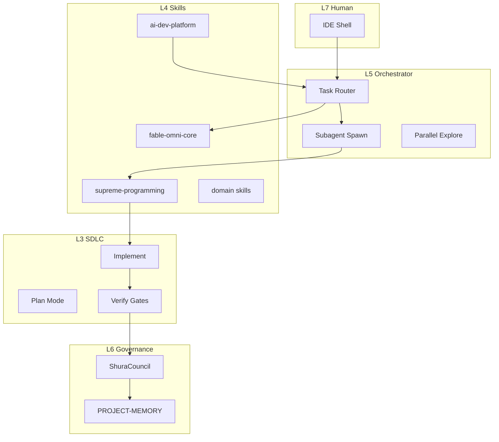

# Platform Architecture — Program Developer

> **Vision:** [platform-vision.md](platform-vision.md) · **Orchestration:** [agent-orchestration.md](agent-orchestration.md)

---

## Layer model

```
L7 Human        — intent · approval · launch authority
L6 Shura        — evidence consensus · P0→P3 · dissent preserved
L5 Orchestrator — spawn · route · parallel · persist
L4 Skills       — Fable · supreme-programming · domain · platform
L3 SDLC         — plan · implement · verify · MEM
L2 Repo         — source · tests · dist/evidence
L1 Runtime      — Cursor · shell · MCP · models
```

---

## Component diagram



---

## Integration contracts

| Boundary | Contract |
|----------|----------|
| Human → Agent | Directive or Inquiry (Gemini split) |
| Agent → Subagent | Goal · absolute paths · constraints · success criteria |
| Agent → Shura | SAVE CEEF/report → `run-shura-council.ps1` |
| Shura → Memory | `type: decision` + council JSON path |
| Leak Lab → Skills | ≤5 line principle · one primary home |
| Skills → Code | Read before edit · smallest diff |

---

## Data stores

| Store | Content | MUST NOT |
|-------|---------|----------|
| `dist/evidence/` | verify logs · council output · audits | secrets |
| `docs/PROJECT-MEMORY.yaml` | MEM rows | chat dumps |
| `.cursor/skills/` | agent law | leak paste |
| `reports/CEEF-*.md` | wave closure | false live claims |
| `system_prompts_leaks-main/` | grep source only | session bulk load |
| `merged_claude_files.md` | Claude Code CLI grep source | session bulk load |

---

## CognitiveQa component detail (primary product)

| Layer | Projects | Agent focus |
|-------|----------|-------------|
| Shell | `CognitiveQa.Desktop` | MainWindow · CloudCodeTheme · LocaleService |
| Entry | `CognitiveQa.Cli` | All CLI flags · exit codes 0–3 |
| Pipeline | `CognitiveQa.Orchestrator` | LAUNCH → EXPLORE → REPORT |
| Auditors | `CognitiveQa.Auditors` | 18 role implementations |
| Automation | `CognitiveQa.Automation` | FlaUI · HumanNavigator · Vision |
| Intel | `CognitiveQa.SourceIntel` | XAML/Roslyn constitution |
| Output | `CognitiveQa.Reports` · `Meta` · `Repair` | AUDIT_REPORT · synthesis · perfection |
| Tests | `CognitiveQa.Tests` | Shell gates · FlaUI smoke |

**Deep module:** [cognitiveqa-module.md](../ai-dev-platform/cognitiveqa-module.md)  
**Desktop bridge:** [cloud-code-desktop.md](../omni-qa-army/cloud-code-desktop.md)

---

## Conflict resolution (cross-layer)

```
Security > Verify > Architecture > Product > UX > Aesthetics
```

When Orchestrator and Shura disagree: **Shura wins on launch**; **Orchestrator wins on implementation** until Shura SAVE.

---

## MUST (architecture edits)

| ID | Rule |
|----|------|
| A01 | New module MUST declare layer L3–L6 |
| A02 | New agent role MUST map to leak pattern in leak-platform-synthesis |
| A03 | Shared state MUST grep callers before schema/API change |
| A04 | Evidence paths MUST be repo-relative in reports |

---

## MUST NOT

| ID | Forbidden |
|----|-----------|
| AF01 | Circular skill imports without hub router |
| AF02 | Agent law in application source (use skills/rules) |
| AF03 | Shura logic duplicated in chat — use `ShuraCouncil/` |

**Related:** [shura-governance.md](shura-governance.md) · [verify-gates.md](verify-gates.md)
