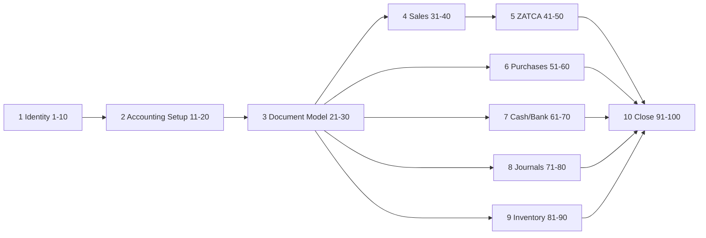

# BRQOSH — دورة الحياة الكاملة (100 خطوة)

> **النطاق:** من تسجيل الدخول → الإقفال النهائي  
> **النواة:** ERP محاسبي احترافي · متوافق ZATCA (السعودية)  
> **الاستراتيجية:** [`docs/مهم`](../docs/مهم) v4.0 · [`PLATFORM-ROADMAP.md`](PLATFORM-ROADMAP.md)  
> **التصميم:** [`pages/`](pages/) · `.cursor/skills/brqosh-ui-design-system/`

---

## مبدأ التصميم

هذه الخارطة هي **النواة التشغيلية** التي يُبنى عليها نظام التصميم الفاخر. كل خطوة لها:

| عمود | المعنى |
|------|--------|
| **UI** | شاشة/حوار WPF أو تدفق |
| **Domain** | كيان/خدمة في الكود |
| **حالة** | ✅ مغلق في المستودع · 🔶 جزئي · 🔜 مخطّط · ⏭ خارجي (OTP/SOCPA/…) |

**ZATCA:** الفاتورة الإلكترونية السعودية تتطلب XML (UBL) · QR (TLV للمبسطة) · UUID · Hash/ICV · CSID/التوقيع · حقول بيانات محددة. هيئة الزكاة تنشر المواصفات وتحديثاتها رسمياً على [fatoora.zatca.gov.sa](https://fatoora.zatca.gov.sa). مراجع المستودع: `docs/ZATCA_LIVE_CSID.md` · `src/Brqosh.Infrastructure/Zatca/`.

---

## تدفق macro (من الدخول إلى الإقفال)

---

## 1) البنية الأساسية (1–10)

| # | الخطوة | UI | Domain / Code | حالة |
|---|--------|-----|---------------|------|
| 1 | قاعدة الهوية: مستخدم · دور · صلاحيات · شركة · فرع | `LoginWindow` · `UsersPage` · `CompanySettingsPage` · `BranchesPage` · `OrganizationsPage` · `OrganizationProvisionerWindow` | `User` · `Role` · `PermissionService` · `Company` · `Branch` · Company Switcher | ✅ RBAC · G-69-C switcher (CEEF-118) |
| 2 | تسجيل دخول + MFA · قفل · سجل محاولات | `LoginWindow` | `TotpMfaService` · `LoginAuditService` · `LoginLockoutTracker` | 🔶 MFA ✅ · lockout ✅ · login audit ✅ |
| 3 | جلسات · رموز · خروج إجباري | `MainWindow` · `SessionIdleTracker` | `AppUser.SessionVersion` · `AppServices.IsSessionRevokedAsync` | 🔶 forced logout ✅ · idle ✅ |
| 4 | سجل تدقيق دخول/خروج | `AuditLogPage` | `LoginAuditEntry` | 🔶 login events ✅ |
| 5 | Tenants متعددة الكيانات | `CompanyGroupsPage` | Company group mapping | 🔶 |
| 6 | فروع · مخازن · خزائن · بنوك | `BranchesPage` · `WarehousesPage` · `BankAccountsPage` | Branch · Warehouse · BankAccount | ✅ |
| 7 | لغات · عملة · تقويم | `MainWindow` EN/ع · `CompanySettingsPage` | `LocaleManager` · company currency | 🔶 Hijri calendar helper ✅ |
| 8 | سنة مالية · فترات | `FiscalPeriodsPage` | `FiscalPeriod` | ✅ |
| 9 | سياسات أمان · retention | `CompanySettingsPage` | settings store | 🔜 |
| 10 | قوالب قطاعية للشركات الجديدة | `SetupWizardWindow` · `OrganizationProvisionerWindow` · settings | `BusinessProfile` (8 قطاعات) · `NavigationCatalog` | ✅ 8 قطاعات · معالج منشأة (CEEF-117) |

**UI spec:** `pages/login.md` · `pages/organization-provisioning.md` · `pages/settings-multi-company.md` · `pages/shell.md`

---

## 2) إعداد المحاسبة (11–20)

| # | الخطوة | UI | Domain / Code | حالة |
|---|--------|-----|---------------|------|
| 11 | دليل حسابات أساسي | `ChartOfAccountsPage` | `Account` · COA seed | ✅ |
| 12 | نوع الحساب (أصل/خصم/…) | `AccountDialog` | `AccountType` | ✅ |
| 13 | حسابات تفصيلية/رقابية | `ChartOfAccountsPage` | posting flags | ✅ |
| 14 | ربط مراكز تكلفة/مشاريع | `CostCentersPage` · journal lines | `CostCenter` · `ProjectId` | 🔶 |
| 15 | قواعد ترحيل تلقائي | posting services | `*PostingService` | ✅ |
| 16 | حسابات ضريبية | COA + invoice lines | VAT accounts | ✅ |
| 17 | حسابات تسويات بنكية | `BankReconciliationPage` | recon accounts | 🔶 |
| 18 | صندوق وعملات | vouchers · `ExchangeRatesPage` | `ReceiptMethod` · FX | 🔶 |
| 19 | أصول ثابتة وإهلاك | `FixedAssetsPage` | `FixedAsset` · depreciation JE | ✅ |
| 20 | قواعد إقفال شهري/سنوي | `FiscalPeriodsPage` | period close rules | 🔶 |

**UI spec:** `pages/general-ledger.md`

---

## 3) دورة المستند (21–30)

| # | الخطوة | UI | Domain / Code | حالة |
|---|--------|-----|---------------|------|
| 21 | نموذج مستند موحد | all `*Dialog` patterns | document base patterns | 🔶 |
| 22 | حالات: Draft → Approved → Posted → Paid → Closed | status columns · badges | `WorkflowEngine` · PO/Payment/ManualJE | 🔶 PO+Payment+JE ✅ · full pipeline 🔜 |
| 23 | منع التعديل بعد الترحيل · عكس رسمي | post dialogs · reverse actions | `PostingOrchestrator` · `Company.EnsureCanPost()` | ✅ |
| 24 | ترقيم تسلسلي لكل نوع | document number fields | number sequences | ✅ |
| 25 | من أنشأ/عدّل/اعتمد | audit columns | `CreatedBy` · audit | 🔶 |
| 26 | مرفقات · PDF/XML | invoice/ZATCA views | attachments 🔜 · ZATCA XML ✅ | 🔶 |
| 27 | Version History | document detail drawer | `DocumentVersionHistory` · `DocumentVersionService` | 🔶 على الترحيل ✅ |
| 28 | تنبيهات نقص بيانات | validation · `AlertStrip` | validators | 🔶 |
| 29 | تحقق حقول إلزامية | dialog save guards | domain validation | ✅ |
| 30 | ربط بالفترة المالية | period picker · blocks | `FiscalPeriodId` | ✅ |

---

## 4) المبيعات (31–40)

| # | الخطوة | UI | Domain / Code | حالة |
|---|--------|-----|---------------|------|
| 31 | عروض أسعار | `SalesQuotationsPage` | `SalesQuotation` · `SalesQuotationService` | ✅ UI+خدمة (CEEF-117) |
| 32 | تحويل عرض → أمر بيع | `SalesOrdersPage` · `SalesOrderDialog` | `SalesOrder` · `SalesOrderService` | ✅ MVP (CEEF-118) · حجز مخزون 🔜 |
| 33 | حجز مخزون | `StockMovementsPage` | reservation 🔜 | 🔜 |
| 34 | أوامر تسليم | — | delivery 🔜 | 🔜 |
| 35 | فاتورة ضريبية | `SalesInvoicesPage` · `SalesInvoiceDialog` | `SalesInvoice` | ✅ |
| 36 | فاتورة مبسطة | POS · simplified flag | simplified invoice | 🔶 |
| 37 | إشعارات دائن/مدين | `CreditNotesPage` · `DebitNotesPage` | credit/debit notes | ✅ |
| 38 | مرتجعات وخصومات | credit notes · line discounts | returns | 🔶 |
| 39 | عمولات | — | commissions 🔜 | 🔜 |
| 40 | ترحيل إيراد · ذمم · ضريبة | post action · JE link | `SalesInvoicePostingService` | ✅ |

**UI spec:** `pages/invoicing-sales.md`

---

## 5) ZATCA — الفاتورة الإلكترونية (41–50)

> **مرجع رسمي:** مواصفات هيئة الزكاة والضريبة والجمارك — [fatoora.zatca.gov.sa](https://fatoora.zatca.gov.sa)  
> **مستودع:** `ZatcaEInvoiceGenerator` · `ZatcaUblInvoiceBuilder` · `ZatcaQrGenerator` · `ZatcaXmlSigner` · `ZatcaSubmissionService`

| # | الخطوة | متطلب فني | UI | Code | حالة |
|---|--------|-----------|-----|------|------|
| 41 | تفعيل نمط e-invoice | إعدادات منشأة · VAT · mode | `ZatcaSettingsPage` | `ZatcaSettings` | ✅ |
| 42 | XML UBL حسب المواصفات | UBL 2.1 · حقول إلزامية | `ZatcaInvoicesPage` | `ZatcaUblInvoiceBuilder` | ✅ |
| 43 | QR للفاتورة المبسطة | TLV Base64 · Tag 1–5 | POS receipt · invoice | `ZatcaQrGenerator` | ✅ |
| 44 | UUID لكل فاتورة | UUID v4 | grid column | `InvoiceUuid` | ✅ |
| 45 | Hash · ICV · تسلسل | PIH · counter | document fields | ICV in domain | ✅ |
| 46 | CSID · ختم أمني | CSR · OTP · cert · P-256 sign | `ZatcaCsidWizardWindow` | `ZatcaXmlSigner` · CSID onboarding | 🔶 ⏭ OTP حي |
| 47 | إرسال حسب المرحلة | Reporting vs Clearance | submission status | `ZatcaSubmissionService` · `ZatcaPostingOrchestrator` | 🔶 محاكاة داخل TX ✅ · ⏭ production gate |
| 48 | حفظ أصل + نسخة موقعة | XML archive | `ZatcaInvoicesPage` | stored XML/signature | ✅ |
| 49 | حالات رفض/قبول | compliance status | status badges | `ComplianceStatus` | 🔶 |
| 50 | سجلات قابلة للتدقيق | immutable log | audit + ZATCA grid | audit + documents | 🔶 |

**UI spec:** `pages/compliance-tax.md`  
**Runbook:** `docs/ops/O-01_ZATCA_PRODUCTION_RUNBOOK.md` · `docs/ZATCA_LIVE_CSID.md`  
**⏭ خارجي:** OTP production · اعتماد هيئة — ليس «نقص كود» وحده

### حقول ZATCA الأساسية (UI يجب أن تعرض/يتحقق منها)

| حقل | سياق |
|-----|------|
| VAT registration (15 digit) | Company settings |
| Seller name · address | Company + branch |
| Invoice number · UUID · issue date/time | Invoice header |
| Line items · qty · unit price · VAT rate | Line grid |
| Total excl VAT · VAT amount · total incl VAT | Totals panel |
| QR (simplified) | Preview + print |
| Cryptographic stamp (standard) | Post-sign indicator |

---

## 6) المشتريات (51–60)

| # | الخطوة | UI | Domain / Code | حالة |
|---|--------|-----|---------------|------|
| 51 | طلب شراء | — | `PurchaseRequest` | 🔶 Domain+خدمة ✅ · UI 🔜 |
| 52 | اعتماد طلب | workflow | `WorkflowEngine` · `PurchaseRequestWorkflowService` | 🔶 سلسلة Manager→Finance ✅ |
| 53 | أمر شراء | `PurchaseOrdersPage` | `PurchaseOrder` | ✅ |
| 54 | استلام بضائع/خدمات | `GoodsReceiptsPage` | `GoodsReceipt` | ✅ |
| 55 | مطابقة PO ↔ GRN ↔ Bill | `GoodsReceiptsPage` · PI | `ThreeWayMatchService` | 🔶 خدمة+اختبار ✅ · UI 🔜 |
| 56 | فاتورة مورد | `PurchaseInvoicesPage` | `PurchaseInvoice` | ✅ |
| 57 | مرتجعات مورد | debit notes | supplier returns | 🔶 |
| 58 | خصومات مكتسبة | line discounts | discounts | 🔶 |
| 59 | ترحيل ذمم مورد | post → JE | AP posting | ✅ |
| 60 | دفع مورد | `PaymentVouchersPage` | payment · settlement | ✅ |

**UI spec:** `pages/purchases-suppliers.md`

---

## 7) النقد والبنوك (61–70)

| # | الخطوة | UI | Domain / Code | حالة |
|---|--------|-----|---------------|------|
| 61 | فتح صندوق يومي | `PosShiftsPage` · POS | shift open | 🔶 |
| 62 | إغلاق صندوق | POS shift close | shift | 🔶 |
| 63 | مقبوضات نقدية | `ReceiptVouchersPage` | receipt voucher | ✅ |
| 64 | مدفوعات نقدية | `PaymentVouchersPage` | payment voucher | ✅ |
| 65 | إيداعات بنكية | bank transactions | deposits · `BankTransferService` | 🔶 تحويل ✅ · إيداع 🔜 |
| 66 | تحويلات بنكية | transfers | `BankTransferService` | 🔶 Domain+خدمة ✅ · UI 🔜 |
| 67 | استيراد كشف بنكي | `BankReconciliationPage` · CSV | `BankStatementImportService` | ✅ |
| 68 | مطابقة تلقائية | recon matcher | `BankStatementMatcherService` | ✅ |
| 69 | فروقات بنكية | recon diff panel | adjustment JE | 🔶 |
| 70 | تقارير حركة نقد | dashboard · reports | `CashMovementReportService` | 🔶 |

**UI spec:** `pages/bank-cash.md`

---

## 8) القيود اليومية (71–80)

| # | الخطوة | UI | Domain / Code | حالة |
|---|--------|-----|---------------|------|
| 71 | قيد يدوي | `JournalEntryDialog` | manual JE | ✅ |
| 72 | قيد تلقائي من مستند | post links | `*PostingService` | ✅ |
| 73 | قيود استحقاق | accrual 🔜 | accrual | 🔜 |
| 74 | قيود إهلاك | `FixedAssetsPage` run | depreciation JE | ✅ |
| 75 | قيود تسويات | recon · adjustments | adjustment JE | 🔶 |
| 76 | قيود عكسية | reverse post | reversal | ✅ |
| 77 | إعادة تصنيف | reclass 🔜 | reclassification | 🔜 |
| 78 | قفل في فترات مغلقة | period guard | closed period block | ✅ |
| 79 | ترحيل دفعي | batch post 🔜 | batch | 🔜 |
| 80 | مراجعة قبل الترحيل | review dialog | pre-post validation | 🔶 |

**UI spec:** `pages/general-ledger.md`

---

## 9) المخزون والمستودعات (81–90)

| # | الخطوة | UI | Domain / Code | حالة |
|---|--------|-----|---------------|------|
| 81 | بطاقة صنف | `ProductsPage` · `ProductDialog` | `Product` | ✅ |
| 82 | وحدات وتحويل | UOM fields | units | 🔶 |
| 83 | سيريال/لوط | serial/lot 🔜 | tracking | 🔜 |
| 84 | مستودعات ومواقع | `WarehousesPage` | `Warehouse` | ✅ |
| 85 | حركات دخول/خروج | `StockMovementsPage` | movements | ✅ |
| 86 | تحويل بين مستودعات | transfer movement | inter-warehouse | 🔶 |
| 87 | جرد فعلي | `StockCountPage` | stock count | ✅ |
| 88 | فروقات جرد | count variance post | variance JE | 🔶 |
| 89 | تلف وهالك | write-off | scrap | 🔜 |
| 90 | تكلفة حسب السياسة | valuation · `LandedCostPage` | FIFO/avg policy | 🔶 |

**UI spec:** `pages/inventory.md`

---

## 10) الإقفال والنهاية (91–100)

| # | الخطوة | UI | Domain / Code | حالة |
|---|--------|-----|---------------|------|
| 91 | إغلاق فترة بعد مراجعة | `FiscalPeriodsPage` close | `MonthEndCloseOrchestrator` | ✅ |
| 92 | مطابقة ضرائب | `ZatcaInvoicesPage` · VAT reports | tax reconciliation | 🔶 |
| 93 | إهلاك شهري | fixed assets run | depreciation batch | ✅ |
| 94 | مراجعة أعمار ذمم | AR aging report | customer statement | 🔶 |
| 95 | مراجعة تسويات بنكية | `BankReconciliationPage` | import + auto-match | 🔶 |
| 96 | مطابقة مخزون نهائي | stock count · valuation | inventory tie-out | 🔶 |
| 97 | قوائم مالية | `BalanceSheetPage` · `IncomeStatementPage` · `CashFlowStatementPage` | financial statements + `CashFlowStatementService` | ✅ (CEEF-118 CFS) |
| 98 | إقفال سنة مالية | year-end close | `YearEndCloseService` | ✅ |
| 99 | أرشفة مستندات وقيود | archive 🔜 | `CompanyOperationalMode.Archived` | 🔶 وضع تشغيل ✅ |
| 100 | تجميد/تصفية + سجل تاريخي | read-only mode | `Company.EnsureCanPost()` · `OperationalMode` | 🔶 ReadOnly/Archived ✅ · فترة مقفلة ✅ |

**UI spec:** `pages/reports-analytics.md` · `pages/compliance-tax.md`

---

## ربط الخطوات بالتصميم الفاخر

| مرحلة دورة | شاشات تطبّق Luxury Design System |
|------------|----------------------------------|
| 1–10 | Login hero · Shell · Settings matrix |
| 11–20 | COA tree · GL professional tables |
| 21–30 | Status badges · audit chips على كل مستند |
| 31–40 | Split invoice editor/preview |
| 41–50 | Compliance panel · ZATCA wizard · XML/QR preview |
| 51–60 | 3-way match pipeline |
| 61–70 | Bank reconciliation matcher |
| 71–80 | Double-entry workspace |
| 81–90 | SKU cards · reorder alerts |
| 91–100 | Document-style reports · close checklist wizard |

---

## Quality Gates (Golden Paths)

Each path must be **runnable** in Desktop + covered by tests where marked ✅:

| Path | Steps |
|------|-------|
| **Sell → ZATCA → Collect** | 35 → 41–48 → 63 → 40 |
| **Procure → Receive → Pay** | 53 → 54 → 56 → 59 → 60 |
| **Month close** | 91 → 92–96 → 97 |
| **Year close** | 98 → 99 → 100 |

---

## Document Links

| Doc | Role |
|-----|------|
| This file | 100-step lifecycle canonical |
| `docs/EXECUTION_ROADMAP.md` | **مسار التنفيذ الرسمي** (M1–M12) |
| `PLATFORM-ROADMAP.md` | Strategic phases |
| `docs/مهم` | Council roadmap v4.0 |
| `docs/ZATCA_LIVE_CSID.md` | CSID/OTP runbook |
| `pages/compliance-tax.md` | ZATCA UI spec |

**Legend:** ✅ in repo · 🔶 partial · 🔜 planned · ⏭ external gate
