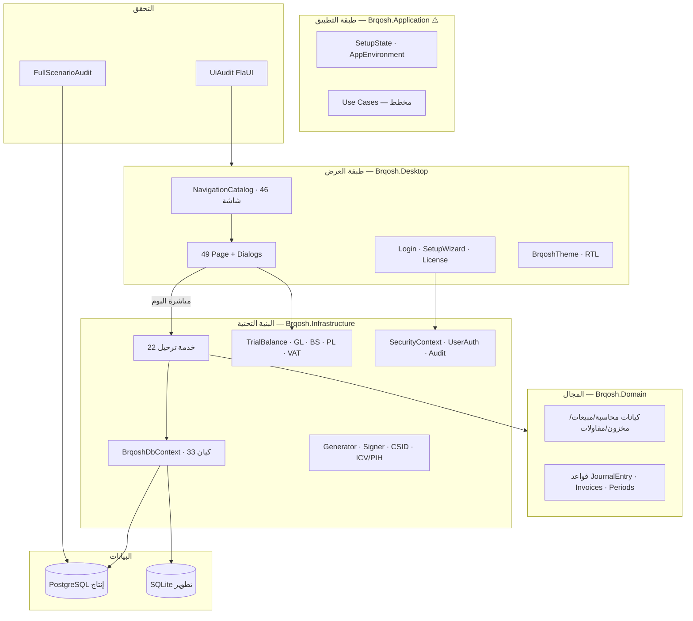
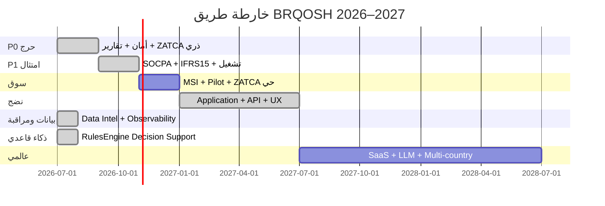

# خارطة طريق BRQOSH — نظام التشغيل المالي والتجاري والإداري

**الإصدار:** 3.0 — مجلس الخبراء العالمي المستقل  
**التاريخ:** 8 يوليو 2026  
**الحالة:** معتمدة للتنفيذ — **لا إطلاق إنتاج واسع قبل بوابة P0**  
**المراجع:** `docs/AUDIT_REPORT_DEEP_AR.md` · CEEF-001→012 · `تقارير/CEEF-010`

---

## 0. الرؤية والهدف الشمالي

BRQOSH ليس «برنامج محاسبة». الهدف النهائي:

> **نظام تشغيل مالي وتجاري وإداري للحياة الاقتصادية للمؤسسات** — يخدم الأفراد، SMB، المؤسسات الكبرى، الحكومات، والمجموعات متعددة الجنسيات، مع امتثال محلي قابل للتخصيص.

**الواقع اليوم (مُثبت 8/7/2026):** نموذج أولي ERP سعودي متقدم (WPF/.NET 9) بجاهزية إنتاج مؤسسي **~32–40%**.  
**الهدف بعد 12 شهراً:** ERP سعودي إنتاجي للـ SMB والمؤسسات المتوسطة (**~75–80%**).  
**الهدف بعد 24 شهراً:** منصة مؤسسية قابلة للتوسع عالمياً (**~90%** للسوق المستهدف).

---

## 1. تقرير الفهم الكامل للنظام

### 1.1 البنية الفعلية

```
Brqosh.sln
├── Brqosh.Domain          (47 .cs)   — كيانات + قواعد أعمال نقية
├── Brqosh.Application     (2 .cs)    — Setup فقط ⚠️
├── Brqosh.Infrastructure  (93 .cs)  — EF + ترحيل + ZATCA + تقارير
├── Brqosh.Desktop         (94 .cs)   — WPF monolith UI
├── Brqosh.Modules.*       (0 .cs)    — مشاريع فارغة
└── tests/                 — 133 اختبار (38 Domain + 95 Application) — 0 فشل
```

| المقياس | القيمة | المصدر |
|---------|--------|--------|
| شاشات التنقل | 46 مفتاح | `NavigationCatalog.cs` |
| صفحات WPF | 49 `*Page.xaml` | `Brqosh.Desktop` |
| كيانات DB | 33 DbSet | `BrqoshDbContext.cs` |
| خدمات ترحيل محمية بـ `EnsureCan*` | 14/22 (~64%) | grep Infrastructure |
| API HTTP | **0** | لا Controllers |
| FullScenarioAudit | 13/13 PASS | `tools/FullScenarioAudit` |
| UiAudit | 48 PASS | `tools/UiAudit` |

### 1.2 نقاط القوة (لا تُهدم أثناء الإصلاح)

- قيد مزدوج محمي في Domain (`JournalEntry.Post`)
- `UnitOfWork.ExecuteInTransactionAsync` على معظم orchestrators
- ربط المستندات بالقيود (فواتير، سندات، شيكات، رواتب، مستخلصات)
- ZATCA: UBL + XAdES + ICV/PIH + QR Phase 2 (بعد CEEF-012)
- دليل حسابات سعودي + VAT 15% + مقاولات (BOQ، مستخلصات، محتجزات)
- PBKDF2 + معالج إعداد (لا حساب افتراضي)
- تدقيق آلي: `FullScenarioAudit` + `UiAudit`

### 1.3 الفجوات الحرجة المؤكدة (P0)

| المعرف | الخلل | الملف | الأثر |
|--------|-------|-------|-------|
| SEC-001 | fail-open عند `CurrentRole == null` | `SecurityContext.cs:37` | ترحيل بلا صلاحية |
| ACC-001 | تقارير تستبعد `Reversed` | `TrialBalanceQuery.cs:32` | ميزان/قوائم تاريخياً خاطئة |
| ZATCA-001 | secp256k1 في CSID vs P-256 في التوقيع | `ZatcaCsidOnboardingService.cs:36` | رفض شهادات حية |
| ACC-002 | ZATCA خارج معاملة الترحيل | `SalesInvoicePostingService.cs:57-66` | GL مرحّل، ZATCA فاشل |
| SEC-002 | `PostCoreAsync` بلا RBAC | `SalesInvoicePostingService` + `PosSaleService:58` | تجاوز POS |
| SEC-8S | 8 خدمات ترحيل بلا `EnsureCanPost*` | انظر الملحق أ | Viewer/null يرحّل |
| ACC-006 | race في ترقيم JV/INV | `JournalEntryNumberGenerator` | أرقام مكررة |
| ACC-004 | إغلاق فترات بلا صلاحية مدير | `FiscalPeriodService.cs:11` | أي محاسب يغلق السنة |

### 1.4 ما أُنجز سابقاً (مرجع — لا يُعاد)

<details>
<summary>المراحل أ–د + QA يوليو 2026 (CEEF-003→012)</summary>

- وحدات: مقاولات، تصنيع، POS، أصول، رواتب، ZATCA، أمان، ترخيص
- معاملات: عرض/إلغاء/عكس فواتير، سندات، قيود، مستخلصات، إشعارات دائن
- مراجعة محاسبية: POS نقدي، محتجزات، أرصدة، استبعاد أصول، تسوية بنكية
- QA: 133 اختبار، UiAudit، FullScenarioAudit، `UiFeedback`، تواريخ محاسبية، RBAC إلغاء
- تفاصيل: `تقارير/CEEF-011_*` · `تقارير/CEEF-012_*`

</details>

---

## 2. خريطة المكونات



### 2.1 وحدات الأعمال ونضجها

| الوحدة | الشاشات | منطق الأعمال | تقارير | أمان | الامتثال |
|--------|---------|--------------|--------|------|----------|
| GL | دليل، قيود، فترات، مراكز | جيد | **معطوب تاريخياً** | جزئي | جزئي |
| AR/AP | عملاء، موردون، فواتير، سندات | جيد | جيد | جزئي | جيد |
| Inventory | أصناف، حركات، جرد، WAC | جيد | متوسط | جزئي | IAS 2 جزئي |
| Construction | مشاريع، BOQ، مستخلصات | متوسط | متوسط | جزئي | لا IFRS 15 |
| Manufacturing | BOM، أوامر، WIP | ضعيف | ضعيف | جزئي | — |
| POS | ورديات، بيع | متوسط | متوسط | **ثغرة PostCore** | ZATCA جزئي |
| ZATCA | إعدادات، سجل | جيد محاكاة | — | جزئي | **غير مثبت حياً** |
| Reports | ميزان، قوائم، VAT | **خلل ACC-001** | — | قراءة فقط | جزئي |
| Admin | مستخدمون، تدقيق، ترخيص | متوسط | — | **fail-open** | — |

---

## 3. المتطلبات المستخرجة (13 مجال خبرة)

### 3.1 معمارية مؤسسية (EA/DDD)

| # | المتطلب | الأولوية | الحالة |
|---|---------|----------|--------|
| M-01 | فصل Presentation → Application → Infrastructure | P1 | ❌ Desktop يتجاوز Application |
| M-02 | DI بدل Service Locator (`AppServices`) | P1 | ❌ |
| M-03 | وحدات `Brqosh.Modules.*` فعلية أو حذفها | P2 | ❌ فارغة |
| M-04 | Event-driven للترحيل/الإلغاء (اختياري) | P3 | ❌ |
| M-05 | API REST للتكامل | P1 | ❌ |
| M-06 | Multi-tenant / multi-company | P3 | ❌ |
| M-07 | HA / fault tolerance (cloud) | P4 | ❌ |

### 3.2 محاسبة ومالية (IFRS/SOCPA)

| # | المتطلب | الأولوية | الحالة |
|---|---------|----------|--------|
| A-01 | قيد مزدوج كامل لكل مستند | P0 | ✅ |
| A-02 | تقارير point-in-time صحيحة | P0 | ❌ ACC-001 |
| A-03 | إقفال سنوي SOCPA | P0 | ❌ |
| A-04 | IFRS 15 للمقاولات (WIP + نسبة إنجاز) | P1 | ❌ |
| A-05 | IAS 2 — فائض جرد ليس إيراداً | P0 | ❌ ACC-008 |
| A-06 | FIFO/LIFO بجانب WAC | P1 | ❌ WAC فقط |
| A-07 | تخصيص دفعات AR/AP | P1 | ❌ |
| A-08 | تعدد عملات + فروقات صرف | P2 | ❌ |
| A-09 | ميزانيات + انحراف | P2 | ❌ |
| A-10 | قيود متكررة / افتتاحية آلية | P2 | ❌ |
| A-11 | تدفقات نقدية (قائمة) | P2 | ❌ |
| A-12 | منع إهلاك مكرر | P0 | ❌ ACC-003 |

### 3.3 ERP عالمي

| # | المتطلب | الأولوية | الحالة |
|---|---------|----------|--------|
| E-01 | تكامل مبيعات↔مخزون↔GL | P0 | ✅ |
| E-02 | مشتريات + PO + 3-way match | P2 | جزئي |
| E-03 | مقاولات + محتجزات | P1 | ✅ جزئي |
| E-04 | تصنيع BOM + WO | P2 | ضعيف |
| E-05 | POS + ZATCA | P0 | جزئي |
| E-06 | رواتب + GOSI | P1 | أساسي |
| E-07 | أصول + إهلاك | P1 | جيد |
| E-08 | CRM / HR كامل | P4 | ❌ |
| E-09 | Workflow موافقات | P2 | ❌ |
| E-10 | إدارة وثائق | P3 | ❌ |

### 3.4 اقتصاد وBI

| # | المتطلب | الأولوية | الحالة |
|---|---------|----------|--------|
| B-01 | Dashboard KPIs | P2 | ✅ أساسي |
| B-02 | تقارير تفاعلية / drill-down | P2 | جزئي |
| B-03 | تحليل ربحية مشروع/مركز تكلفة | P2 | جزئي |
| B-04 | Data warehouse | P4 | ❌ |

### 3.5 ذكاء اصطناعي

| # | المتطلب | الأولوية | الحالة |
|---|---------|----------|--------|
| AI-01 | مساعد مالي (تصنيف قيود، أسئلة) | P3 | ❌ |
| AI-02 | كشف احتيال / أنماط غير طبيعية | P3 | ❌ |
| AI-03 | تنبؤ تدفقات نقدية | P4 | ❌ |
| AI-04 | اقتراح قرارات (ما يُرحّل، ما يُؤجل) | P4 | ❌ |

### 3.6 هندسة برمجيات

| # | المتطلب | الأولوية | الحالة |
|---|---------|----------|--------|
| S-01 | Clean Architecture صارم | P1 | جزئي |
| S-02 | SOLID + interfaces للخدمات | P2 | جزئي |
| S-03 | تغطية اختبارات 75%+ | P1 | ~40% تقديري |
| S-04 | CI: build + test + SAST | P2 | build+test فقط |
| S-05 | ترقيم آمن concurrent | P0 | ❌ |

### 3.7 أمن سيبراني

| # | المتطلب | الأولوية | الحالة |
|---|---------|----------|--------|
| SEC-01 | fail-closed RBAC | P0 | ❌ |
| SEC-02 | RBAC على كل خدمة ترحيل | P0 | 64% |
| SEC-03 | تشفير أسرار ZATCA/DB (DPAPI) | P0 | ❌ |
| SEC-04 | session timeout + lockout | P1 | ❌ |
| SEC-05 | سياسة كلمة مرور | P1 | ❌ |
| SEC-06 | EnsureAdministrator لإدارة مستخدمين/فترات | P0/P1 | جزئي |
| SEC-07 | Zero Trust / pen test | P3 | ❌ |

### 3.8 بيانات وقواعد بيانات

| # | المتطلب | الأولوية | الحالة |
|---|---------|----------|--------|
| D-01 | EF Migrations موحّد (لا hybrid schema) | P1 | جزئي |
| D-02 | فهارس تقارير + pagination DB | P1 | جزئي |
| D-03 | partitioning PostgreSQL (>1M قيد) | P2 | دليل فقط |
| D-04 | backup/restore مُختبر | P1 | 🟡 |
| D-05 | historical tracking / audit immutable | P2 | جزئي |

### 3.9 UX/UI

| # | المتطلب | الأولوية | الحالة |
|---|---------|----------|--------|
| U-01 | Design System موحد | P2 | 70% |
| U-02 | Toast بدل MessageBox | P2 | ❌ |
| U-03 | إخفاء أزرار حسب الدور | P1 | جزئي |
| U-04 | Pagination UI | P2 | ❌ |
| U-05 | Hijri DatePicker | P2 | ❌ |
| U-06 | Skeleton loading | P2 | dashboard فقط |
| U-07 | Keyboard shortcuts | P3 | ❌ |
| U-08 | Accessibility (UIA) | P2 | جزئي |

### 3.10 سلوك المستخدم

| # | المتطلب | الأولوية | الحالة |
|---|---------|----------|--------|
| UX-01 | تأكيدات للعمليات المالية الحرجة | P1 | ✅ جزئي |
| UX-02 | تواريخ محاسبية قابلة للاختيار | P1 | ✅ CEEF-011 |
| UX-03 | تقليل أخطاء إدخال (تحذير سعر، validation) | P2 | جزئي |
| UX-04 | أداة إعادة تعيين كلمة مرور | P1 | ❌ |

### 3.11 قانون وامتثال

| # | المتطلب | الأولوية | الحالة |
|---|---------|----------|--------|
| C-01 | ZATCA Phase 2 إنتاج | P0 | 🟡 محاكاة |
| C-02 | VAT 15% + إقرار | P1 | 85% |
| C-03 | SOCPA إقفال | P0 | ❌ |
| C-04 | GOSI رواتب | P1 | 60% |
| C-05 | PDPL / حماية بيانات | P2 | جزئي |
| C-06 | مراجعة محاسب قانوني خارجية | P1 | ❌ |

### 3.12 جودة وتحقق

| # | المتطلب | الأولوية | الحالة |
|---|---------|----------|--------|
| Q-01 | 133+ unit tests — 0 فشل | P0 | ✅ |
| Q-02 | FullScenarioAudit في CI | P1 | 🟡 يدوي |
| Q-03 | UiAudit في CI Windows | P1 | 🟡 يدوي |
| Q-04 | Load test 100k+ حركة | P2 | ❌ (أُوقف) |
| Q-05 | Regression 10 مسارات | P1 | جزئي |

### 3.13 بنية تحتية وتشغيل

| # | المتطلب | الأولوية | الحالة |
|---|---------|----------|--------|
| I-01 | MSI + VM نظيفة | P1 | 🟡 |
| I-02 | PostgreSQL hardening doc | P1 | 🟡 |
| I-03 | pg_dump مجدول + restore test | P1 | ❌ |
| I-04 | Code signing MSI | P2 | ❌ |
| I-05 | Observability (Serilog/AppInsights) | P2 | ❌ |
| I-06 | DR / 24-7 cloud | P4 | ❌ |

---

## 4. سجل المخاطر

### 4.1 P0 — يمنع الإنتاج

| المعرف | الاحتمال | الأثر | التخفيف | المالك |
|--------|----------|-------|---------|--------|
| ACC-001 | مؤكد | مالي/قانوني | point-in-time reporting | Backend |
| SEC-001 | مؤكد | أمني/مالي | fail-closed + `IsTest` | Security |
| SEC-8S | مؤكد | أمني | `EnsureCanPost*` على 8 خدمات | Backend |
| ACC-002 | مؤكد | امتثال ZATCA | ZATCA داخل TX أو saga | ZATCA |
| ZATCA-001 | مؤكد | امتثال | توحيد P-256 | ZATCA |
| ACC-006 | متوسط | تشغيلي | DB sequence/lock | Backend |

### 4.2 P1 — عالي

إهلاك مكرر · إغلاق فترات · CN POS على 1104 · WO إلغاء ناقص · فائض جرد · IFRS 15 · أسرار CSID · session/lockout · VAT تسوية · `username ?? "admin"`

### 4.3 P2–P4 — متوسط إلى طموح

Pagination · Hijri · API · FIFO · multi-branch · BI · AI · cloud HA · multi-tenant

---

## 5. خطة التنفيذ — المراحل والبوابات

### منهج القبول (كل مخرج)

1. مراجعة هندسية  
2. مراجعة أمنية  
3. مراجعة مالية/محاسبية  
4. مراجعة جودة (اختبارات + تدقيق)  
5. توافق متطلبات  

---

### المرحلة 0 — خط الأساس (أسبوع 1) ✅ جزئي

| المهمة | الحالة | معيار القبول |
|--------|--------|--------------|
| `dotnet test` 133/133 | ✅ | CI أخضر |
| FullScenarioAudit | ✅ | 13/13 |
| UiAudit | ✅ | 48/48 |
| توثيق بيانات الدخول (SetupWizard) | 🟡 | لا admin افتراضي |
| PostgreSQL perf benchmark | ❌ | أُوقف — إعادة بـ 10k |

---

### المرحلة 1 — P0 حرج (أسابيع 2–8) ✅ مُنفَّذ 2026-07-08

**الهدف:** صحة الأرقام + أمان fail-closed + ZATCA ذري  
**الجاهزية المستهدفة:** 32% → **~55%** (تقرير `تقارير/CEEF-013`)

| الأسبوع | المهمة | الحالة |
|---------|--------|--------|
| 2 | SEC-001 fail-closed | ✅ |
| 2 | SEC-8S — 8+ خدمات | ✅ |
| 2 | SEC-002 PostCoreAsync | ✅ |
| 3 | ACC-001 تقارير تاريخية | ✅ + `TrialBalanceHistoricalTests` |
| 3–4 | ACC-002 ZATCA في TX | ✅ |
| 4 | ZATCA-001 منحنى P-256 | ✅ |
| 4 | ACC-006 ترقيم آمن (PG lock) | ✅ |
| 5 | ACC-004 فترات | ✅ |
| 5 | ACC-003 إهلاك | ✅ |
| 6 | ACC-008 فائض جرد | ✅ |
| 6 | ACC-005 CN POS | ✅ |
| 7 | ACC-007 إلغاء WO | ✅ مكتمل في المرحلة 2 (`WorkOrderCancellation`) |
| 7–8 | ZATCA-002 DPAPI | ✅ Windows |
| 8 | بوابة P0 | ✅ 135 test + FullScenarioAudit |

**الخدمات الثمانية (SEC-8S):**

1. `CreditNotePostingService`  
2. `ReceiptVoucherPostingService`  
3. `PaymentVoucherPostingService`  
4. `ProgressBillingPostingService`  
5. `FixedAssetPostingService`  
6. `RetentionReleaseService`  
7. `DepreciationService` (ترحيل إهلاك)  
8. `WorkOrderCompletionService` / `WorkOrderService` (حسب المسار الفعلي)

---

### المرحلة 2 — P1 امتثال ومحاسبة سعودية (أسابيع 9–16) ✅ مغلق بالكامل 2026-07-08

**الهدف:** SOCPA أساسي + IFRS 15 (billing + cost-to-cost) + FIFO + تخصيص دفعات + أمان تشغيلي  
**الجاهزية:** 55% → **~68–70%** (تقرير `تقارير/CEEF-014` — إغلاق كامل)  
**التحقق:** `147/147` اختبار · FullScenarioAudit 13/13

| # | المهمة | الحالة |
|---|--------|--------|
| 1 | إقفال سنوي SOCPA | ✅ `YearEndCloseService` + شاشة |
| 2 | IFRS 15 مستخلصات | ✅ billing-based + **cost-to-cost** + 2105 + تكاليف مشروع |
| 3 | FIFO طبقة تكلفة | ✅ `InventoryCostingService` + إعداد شركة + اختبارات |
| 4 | تخصيص دفعات | ✅ AR/AP + UI سندات + عكس تخصيص |
| 5 | session timeout + lockout | ✅ 30د · 5 محاولات · **إعادة Login بدل إغلاق** |
| 6 | سياسة كلمة مرور | ✅ 12+ تعقيد |
| 7 | `EnsureAdministrator` مستخدمين | ✅ |
| 8 | إصلاح `username ?? "admin"` | ✅ |
| 9 | VAT تسوية 2107 | ✅ قراءة رصيد + فرق |
| 10 | ZATCA sandbox حي | ⏭ يعتمد OTP خارجي → بوابة المرحلة 3 |
| 11 | أداة PasswordReset | ✅ `tools/PasswordReset` |
| — | ACC-007 عكس WO مكتمل | ✅ |

---

### المرحلة 3 — جاهزية السوق السعودي (أسابيع 17–24) ✅ مغلق داخل المستودع 2026-07-08

**الهدف:** Pilot محدود → إطلاق SMB  
**الجاهزية:** 65% → **~75%** (تقرير `تقارير/CEEF-015`)  
**التحقق:** اختبارات PASS · FullScenarioAudit 13/13 · حراسة إنتاج

| # | المهمة | المخرج | الحالة |
|---|--------|--------|--------|
| 1 | MSI على VM نظيفة | `installer/` + قائمة تحقق | ✅ سكربتات؛ إثبات VM ميداني عند التشغيل |
| 2 | دليل تركيب كامل | `installer/README.md` | ✅ 6 أقسام |
| 3 | PostgreSQL hardening | `docs/postgres-production.md` | ✅ + منع EnsureCreated في الإنتاج |
| 4 | backup/restore | `scripts/backup-postgres.ps1` · `restore-postgres.ps1` | ⚠️ **صُحّح 2026-09-04 (م-٣٦):** كان ✅ على سكربتين **لا يُحلَّلان أصلاً** (`"$hostName:$port"` يُقرأ مرجعَ متغيّرٍ ذا نطاق، وبلا BOM تحت 5.1). أُصلحا وشُغّلا؛ **وRTO &lt; 4h يبقى هدفاً موثّقاً لا رقماً مقيساً** — لا تمرينَ استعادةٍ مُسجّل |
| 5 | UX: إخفاء أزرار RBAC | تنقل + أزرار ترحيل/إلغاء | ✅ |
| 6 | Toast notifications | `UiFeedback` v2 | ✅ |
| 7 | Pagination تقارير | Audit · فواتير · JE · GL | ✅ |
| 8 | مراجعة SOCPA خارجية | طرف ثالث | ⏭ خارجي |
| 9 | ZATCA Production OTP | بيئة حية | ⏭ خارجي (سكللت موجود) |
| 10 | بوابة إطلاق Pilot | `CEEF-015` | ✅ |

**بوابة الإطلاق التجاري (Pilot):**

| الشرط | مطلوب |
|-------|-------|
| P0 مغلق بالكامل | ✅ |
| P1 مغلق بالكامل | ✅ |
| 150+ اختبار | ✅ |
| FullScenarioAudit SUCCESS | ✅ |
| MSI + دليل + backup | ✅ |
| RBAC كامل (شاشات+أزرار) | ✅ |
| ZATCA sandbox معتمد (OTP) | ⏭ |
| مراجعة SOCPA | 🟡 موصى |

---

### المرحلة 4 — نضج ERP (أشهر 7–12) ✅ مغلق داخل المستودع 2026-07-08

**الهدف:** ERP سعودي كامل للمؤسسات المتوسطة  
**الجاهزية:** 75% → **~80%** (تقرير `تقارير/CEEF-016`)  
**التحقق:** 157 اختبار PASS · FullScenarioAudit 13/13 · API integration

| الربع | المحور | مخرجات | الحالة |
|-------|--------|--------|--------|
| M7–M8 | معمارية | `Brqosh.Application` use-cases · DI · `ReportingContracts` | ✅ |
| M8–M9 | API | ASP.NET Core Minimal API v1 | ✅ `Brqosh.Api` + `Brqosh.Api.Tests` |
| M9–M10 | مخزون متقدم | Landed cost · debit notes · 3-way match · GRN | ✅ |
| M10–M11 | مقاولات | تقارير ربحية مشروع · IFRS 15 (من المرحلة 2) | ✅ |
| M11–M12 | UX مؤسسي | Hijri · Excel export · dark mode اختياري | ✅ `ThemeManager` |
| M12 | جودة | Coverlet بوابة 75% · security scan · حمل 5k · API key | ✅ `CEEF-020`؛ 1M/ZAP ⏭ |

---

### المرحلة 5 — منصة عالمية (أشهر 13–24)

**الجزء أ — تكامل تشغيلي داخل المستودع ✅ مُغلق 2026-07-08 (`CEEF-020`)**  
أحداث 19/19 · Branch UI · FX UI · تخزين `domain_events` · API فروع/أحداث · تغطية بوابة **75%** (قياس **82.24%**) · أمن ثابت في CI · حمل **5 000** قيد · **182** اختبار · FullScenario 13/13

| المحور | الحالة داخل المستودع |
|--------|----------------------|
| Domain Map · Branch · BranchId · HQ | ✅ |
| عملات + FX revaluation + UI | ✅ |
| Event bus + تخزين أحداث | ✅ |
| Coverage gate ≥75% (assemblies المجمّعة) | ✅ |
| Security static scan في CI | ✅ |

**الجزء ب — منصة عالمية كاملة ⏭ مشروع استراتيجي منفصل** (انظر `docs/OPEN_ITEMS.md`)

| المحور | الحالة |
|--------|--------|
| Multi-tenant SaaS · billing · onboarding | ⏭ O-09 |
| Cloud HA / DR | ⏭ O-10 |
| BI كامل / Power BI | ⏭ O-11 |
| LLM حي / Mobile | ⏭ O-12 / O-13 |
| Load 1M · ZAP حي · OTP · SOCPA | ⏭ O-01…O-05 |

---

### مرحلة Data Intelligence + Observability ✅ داخل المستودع 2026-07-08 (`CEEF-021`)

**الهدف وفق `docs/مهم`:** أساس بيانات + مراقبة **قبل** AI/SaaS  
**التحقق (وقت الإغلاق):** 190 اختبار PASS · FullScenario 13/13 · بوابة تغطية 75%

| المحور | المخرج | الحالة |
|--------|--------|--------|
| Observability | Serilog · `/health` · `/health/ready` · `AppMetrics` · `/ops/metrics` | ✅ |
| Historical snapshots | `ReportSnapshot` + SHA256 · TB capture API | ✅ |
| Data Quality | `DataQualityService` (5 فحوصات قراءة) | ✅ |
| Event Tracking | تجميع `domain_events` عبر API | ✅ |
| BI warehouse / SaaS | — | ⏭ O-11 / O-09 |

---

### مرحلة 6 — AI Financial Intelligence ✅ داخل المستودع (قواعد) 2026-07-08 (`CEEF-022`)

**الهدف وفق `docs/مهم`:** Decision Support — **ليس** chatbot / **ليس** ادعاء LLM.  
**التحقق:** **194** اختبار PASS (43 Domain · 138 Application · 13 API؛ `BRQOSH_SKIP_STRESS=1`) · FullScenario **13/13** · coverlet **82.25%** · security static **PASS**

| المحور | المخرج | الحالة |
|--------|--------|--------|
| محرك قواعد `RulesEngine-v1` | أداء · سيولة · شذوذ قيود · نسبة إلغاء · جسر DQ · اقتراح تصنيف | ✅ |
| عقود + DI | `IFinancialIntelligenceService` | ✅ |
| API | `GET /api/v1/intelligence/financial` | ✅ |
| اختبارات | `FinancialIntelligenceTests` (3) + BadRequest API | ✅ |
| LLM / AI CFO حي / Fraud ML | — | ⏭ **O-12** |
| UI Desktop ذكاء كاملة | — | ⏭ اختياري (غير مطلوب للإغلاق بالكود) |

---

### تدقيق تشغيل كامل + جلسة محاسبية ✅ داخل المستودع 2026-07-08 (`CEEF-023`)

**النطاق:** من التشغيل → ترحيل عبر كل الأفرع → تقارير/إقفال  
**التحقق:** **197** اختبار PASS (43+141+13) · FullScenario **13/13** · Desktop 0 أخطاء · أمن ثابت PASS · تغطية **82.25%**

| الضعف المكتشف | الحالة بعد الإصلاح |
|---------------|---------------------|
| أحداث الإنتاج غير مُخزّنة | ✅ |
| إلغاء GRN / DebitNote | ✅ خدمة + UI + اختبارات |
| RBAC تسوية بنكية / PO / مشاريع / ZATCA Submit / عقود / POS | ✅ |
| BranchId على StockMovement | ✅ |
| منتقي فرع UI · خمول جلسة عالمي · Visibility على كل CRUD | ✅ `CEEF-024` |
| BranchId على كل الكيانات التشغيلية (28) | ✅ `CEEF-025` |
| أساس Global Platform (مجموعة · TB موحّد · TenantId · API stubs) | ✅ `CEEF-026` |
| FX آلي + tenant middleware | ✅ `CEEF-027` |
| ترجمة إقفال CTA + P&L/BS موحّد | ✅ `CEEF-028` |

---

### جلسة فرع · خمول · RBAC أزرار ✅ داخل المستودع 2026-07-08 (`CEEF-024`)

**التحقق:** **199** اختبار PASS (43+143+13) · FullScenario **13/13** · Desktop 0 أخطاء · أمن ثابت PASS · تغطية **82.25%**

| البند | الحالة |
|-------|--------|
| منتقي فرع جلسة + PreferredBranchId عند الترحيل الحرج | ✅ |
| مؤقت خمول عالمي + MustChangePassword عند إعادة الدخول | ✅ |
| ApplyActionVisibility على صفحات CRUD mutating | ✅ |
| خارجي/استراتيجي | ⏭ O-01…O-06 · O-08…O-13 |

---

### BranchId شامل على الكيانات التشغيلية ✅ 2026-07-08 (`CEEF-025`)

**التحقق:** **200** اختبار PASS (43+144+13) · Solution build 0 أخطاء · BranchAssignment **6/6**

---

### أساس Global Platform (مرحلة 7 — داخل المستودع) ✅ 2026-07-08 (`CEEF-026`)

**النطاق:** `CompanyGroup` · ميزان مراجعة موحّد + FX يدوي · `TenantId`/`TenantContext` · `/health/live` · `GET /api/v1/companies` · `GET /api/v1/company-groups`

**التحقق:** **206** اختبار PASS (45+145+16) · FullScenario **13/13** · Desktop Release **0** أخطاء · coverlet **80.64%** · أمن ثابت **PASS**

**ما يبقى ⏭:** O-08…O-13 كاملة · O-01…O-06 خارجي — انظر `تقارير/CEEF-026_Global_Platform_Foundation.md`

---

### FX آلي + Tenant Middleware ✅ 2026-07-08 (`CEEF-027`)

**النطاق:** `ExchangeRate` · حل تلقائي في TB موحّد · `FxRevaluationBatchService` · `X-Tenant-Id` middleware · `TenantGuard`

**التحقق:** **219** اختبار PASS (47+153+19) · FullScenario **13/13** · أمن ثابت **PASS**

**ما يبقى ⏭:** ترجمة إقفال · SaaS billing · O-01…O-05 — `تقارير/CEEF-027_FX_Auto_Tenant_Middleware.md`

---

### ترجمة إقفال + تقارير موحّدة موسّعة ✅ 2026-07-08 (`CEEF-028`)

**النطاق:** `GetAverageRateAsync` · `FxClosingTranslationService` · `ConsolidatedIncomeStatementQuery` · `ConsolidatedBalanceSheetQuery` · CTA `3106`

**التحقق:** **225** اختبار PASS (49+157+19) · FullScenario **13/13** · أمن ثابت **PASS**

**ما يبقى ⏭:** إزالة معاملات بين الشركات · Desktop موحّد · O-01…O-05 — `تقارير/CEEF-028_Consolidated_FX_Closing.md`

**⚠ نُقض جزءان منه (2026-09-23):** ترحيلُ فرق الترجمة قيداً في دفاتر التابعة يخالف IAS 21 —
**صار حساباً يُعاد لا قيداً** (ح-٤٦)؛ **وموازنُ المركز الموحَّد كان يسمّي أرباحَ السنوات غير
المقفلة «احتياطيَ ترجمة»** (ح-٤٥). — `docs/OPEN_ITEMS.md`

---

### إزالة معاملات بين الشركات + Desktop موحّد ✅ 2026-07-08 (`CEEF-029`)

**النطاق:** `IntercompanyEliminationHelper` · `MarkIntercompany()` · صفحات Desktop موحّدة · `CompanyGroupsPage`

**التحقق:** **228** اختبار PASS (51+158+19) · FullScenario **13/13** · Desktop Release **0** أخطاء · أمن ثابت **PASS** · coverlet **80.64%**

**ما يبقى ⏭:** واجهة قيود IC · مصادر FX حية · O-01…O-05 — `تقارير/CEEF-029_Intercompany_Desktop_Consolidated.md`

---

### تحضير بوابات O-01…O-05 ✅ 2026-07-08 (`CEEF-030`)

**النطاق:** `scripts/ops/external-gates-checklist.ps1` · `scripts/ops/run-external-gates.ps1`

**التحقق:** تشغيل المشغّل الموحّد — أمن **PASS** · **228/228** اختبار · FullScenario **13/13**

**ما يبقى ⏭:** تنفيذ حي O-01…O-05 (OTP · SOCPA · MSI VM · 1M · ZAP) — `تقارير/CEEF-030_External_Gates_Prep.md`

---

### مصادر أسعار FX حية ✅ 2026-07-08 (`CEEF-032`)

**النطاق:** `IFxRateProvider` · `FrankfurterFxRateProvider` · `FxRateSyncService` · `ExchangeRatesPage` · API sync

**التحقق:** **230** اختبار PASS (51+160+19) · Desktop Release **0** أخطاء

**ما يبقى ⏭:** SAMA رسمي · خرائط حسابات IC — `تقارير/CEEF-032_Live_FX_Providers.md`

---

### خرائط حسابات IC ✅ 2026-07-08 (`CEEF-033`)

**النطاق:** `IntercompanyAccountMap` · فلترة `IntercompanyEliminationHelper` · `CompanyGroupsPage` · API

**التحقق:** **231** اختبار PASS · Desktop Release **0** أخطاء

**ما يبقى ⏭:** SAMA رسمي · O-01…O-05 — `تقارير/CEEF-033_IC_Account_Maps.md`

| البند | الحالة |
|-------|--------|
| `IBranchScoped` · 28 كياناً · مخطط 28 جدول | ✅ |
| ترحيل CN/DN/PB/Payroll/Cheque/أصول/تسوية/POS | ✅ |
| وراثة فرع من الفاتورة الأصل (CN/DN) | ✅ |

---

### UI/UX Design System — تغطية كاملة للسطح (2026-07-08)

**المرجع:** `docs/UI_UX_DESIGN_SYSTEM.md` · الثيم: `Themes/BrqoshTheme.xaml`  
**التحقق:** Desktop Release **0 Error / 0 Warning** · جرد صفحات/حوارات **NONE stale**

| السطح | الحالة |
|-------|--------|
| نظام تصميم موحّد (ألوان · خطوط · أزرار · جداول · شريط أدوات) | ✅ |
| تسجيل الدخول · ترخيص · تغيير كلمة المرور · إعداد أولي · CSID · إيصال POS | ✅ |
| الهيكل الرئيسي + شريط حالة (مزوّد DB · جلسة) | ✅ |
| **كل** صفحات التنقل (~65 Page) — هرمية أدوات RTL · Primary/Secondary/SoftDanger | ✅ |
| **كل** الحوارات (~35 Dialog) — FieldLabel · IsDefault/IsCancel · أنماط حقول | ✅ |
| تقارير/كشوف/ZATCA/WIP/تسوية بنكية/شيكات/POS | ✅ |
| Dark mode موسّع (Status/Muted/BorderLight) | ✅ |
| Visibility إجراءات RBAC على كل CRUD | ✅ CEEF-024 (منفصل عن الجلد البصري) |

---

### ملخص الحقائق — ما أُغلق / ما بقي / ما لم يُغلق (2026-07-08)

| البند | الحالة | الدليل |
|-------|--------|--------|
| P0 / P1 / Pilot كود / مرحلة 4 / M12+مرحلة 5أ كود | ✅ | CEEF-013→020 |
| Data Intelligence + Observability | ✅ | CEEF-021 |
| AI Decision Support قاعدي | ✅ | CEEF-022 · `RulesEngine-v1` |
| تدقيق تشغيل كامل + إصلاح P0/P1 جلسة محاسبية | ✅ | CEEF-023 |
| منتقي فرع جلسة · خمول عالمي · Visibility CRUD | ✅ | CEEF-024 |
| BranchId على كل الكيانات التشغيلية (28) | ✅ | CEEF-025 |
| أساس Global Platform (stubs داخل المستودع) | ✅ | CEEF-026 |
| FX آلي + tenant middleware | ✅ | CEEF-027 |
| ترجمة إقفال + P&L/BS موحّد | ✅ | CEEF-028 |
| إزالة معاملات بين الشركات + Desktop موحّد | ✅ | CEEF-029 |
| تحضير بوابات O-01…O-05 | ✅ | CEEF-030 |
| مصادر FX حية (Frankfurter) | ✅ | CEEF-032 |
| خرائط حسابات IC | ✅ | CEEF-033 |
| ZATCA OTP حي · SOCPA طرف ثالث · MSI VM نظيف | ⏭ | O-01…O-03 |
| Load 1M · ZAP حي · coverlet كل المشاريع | ⏭ | O-04…O-06 |
| FX/SaaS/Cloud/BI/LLM/Mobile **كاملة** | ⏭ | O-08 (SAMA) · O-09…O-13 |
| O-01…O-05 تنفيذ حي | ⏭ **التالي** | OPEN_ITEMS · `run-external-gates.ps1` |



---

## 6. استراتيجية الاختبار

### 6.1 الحالي

- **194** اختبار xUnit — 0 فشل (Domain 43 · Application 138 · API 13؛ قياس مع `BRQOSH_SKIP_STRESS=1`)  
- `FullScenarioAudit` — 13/13 PASS  
- `UiAudit` — 48 فحص FlaUI (مرجع سابق)  
- Coverlet + بوابة CI **75%** — قياس **82.25%** · أمن ثابت **PASS**  
- Data Intelligence: `CEEF-021` … FX حي: `CEEF-032` · خرائط IC: `CEEF-033` (**231** اختبار)  
- البنود الخارجية/المتعمدة: `docs/OPEN_ITEMS.md` (O-01…O-06 · O-08…O-13)  

### 6.2 المستهدف

| الطبقة | أداة | هدف التغطية |
|--------|------|-------------|
| Domain | xUnit | 90% |
| Application | xUnit + Moq | 85% |
| Infrastructure | Testcontainers PG | 75% |
| API | WebApplicationFactory | 80% |
| UI | FlaUI في CI Windows | مسارات حرجة |
| ZATCA | Golden XML + OTP حي | 100% مسارات |
| Security | OWASP ZAP | سنوي |
| Performance | NBomber / k6 | 1M قيد · 100k حركة |

### 6.3 مجموعات انحدار إلزامية (كل إصدار)

1. دورة مبيعات: عميل → فاتورة → ZATCA → إشعار دائن → إلغاء  
2. دورة مشتريات: مورد → PO → فاتورة → سند  
3. مخزون: استلام → بيع → WAC → جرد  
4. مقاولات: مشروع → مستخلص → محتجز → إفراج  
5. رواتب: دورة → ترحيل → عكس  
6. أصول: اقتناء → إهلاك → استبعاد  
7. تقارير: TB → P&L → BS (بعد إلغاء عبر فترات)  
8. أمان: 4 أدوار × عمليات كتابة  
9. ZATCA: توليد → توقيع → إرسال → إلغاء  
10. فترات: ترحيل → إغلاق → رفض  

---

## 7. النشر والتشغيل

### 7.1 الحالي

- `installer/publish.ps1` · `build-msi.ps1` (WiX)  
- SQLite dev / PostgreSQL prod عبر `database.json`  
- CI: build + test  

### 7.2 المستهدف

1. **CI/CD:** build → test → SAST → sign MSI → artifact  
2. **بيئات:** Dev (SQLite) → Staging (PG) → Prod (PG)  
3. **نسخ احتياطي:** `pg_dump` يومي + restore test شهري  
4. **ترقية:** EF Migrations فقط — إيقاف `EnsureCreated` في الإنتاج  
5. **مراقبة:** Serilog + (اختياري) Application Insights  
6. **توقيع:** Code signing certificate للـ MSI  

### 7.3 تشغيل التدقيق

```powershell
.\scripts\ops\run-external-gates.ps1   # يعزل جذرَ البيانات قبل FullScenarioAudit — لا تُشغّلها مباشرةً (ح-٧٦)
cd ..\UiAudit && .\run-audit.ps1
dotnet test Brqosh.sln -c Release
```

---

## 8. مؤشرات الجاهزية (KPI)

| المؤشر | الآن | بعد P0 | بعد P1 | Pilot | نضج 12ش |
|--------|------|--------|--------|-------|---------|
| جاهزية إنتاج مؤسسي | 32–40% | 55% | 65% | 75% | 80% |
| سلامة تقارير تاريخية | 35% | **90%** | 95% | 95% | 98% |
| RBAC fail-closed | 30% | **95%** | 98% | 99% | 99% |
| ZATCA Phase 2 | 55% | 70% | 80% | **85%** | 90% |
| UX مؤسسي | 55% | 55% | 60% | 70% | 80% |
| قابلية توسع | 25% | 25% | 30% | 35% | 50% |
| اختبارات | 133 | 150+ | 180+ | 200+ | 250+ |

---

## 9. Checklist تغطية مجلس الخبراء (100%)

| # | مجال | تحليل | خطة | تنفيذ |
|---|------|-------|-----|-------|
| 1 | معمارية مؤسسية | ✅ | ✅ M4 | 🟡 |
| 2 | محاسبة/مالية | ✅ | ✅ M1–M2 | 🔴 P0 |
| 3 | ERP عالمي | ✅ | ✅ M4–M5 | 🟡 |
| 4 | اقتصاد/BI | ✅ | ✅ M4 + CEEF-021 | 🟡 أساس؛ BI كامل ⏭ O-11 |
| 5 | AI | ✅ | ✅ CEEF-022 قواعد | 🟡 LLM ⏭ O-12 |
| 6 | هندسة برمجيات | ✅ | ✅ M1–M4 | 🟡 |
| 7 | أمن سيبراني | ✅ | ✅ M1 | 🔴 P0 |
| 8 | بيانات/DB | ✅ | ✅ M2–M4 | 🟡 |
| 9 | UX/UI | ✅ | ✅ M2–M3 | 🟡 |
| 10 | سلوك المستخدم | ✅ | ✅ M2 | 🟡 |
| 11 | قانون/امتثال | ✅ | ✅ M1–M3 | 🔴 |
| 12 | جودة/تحقق | ✅ | ✅ كل مرحلة | 🟡 |
| 13 | بنية تحتية | ✅ | ✅ M3 | 🟡 |

---

## 10. الملحق أ — الخدمات الثمانية بلا `EnsureCanPost*` (SEC-8S)

| # | الخدمة | نقطة الدخول | الفحص المطلوب |
|---|--------|-------------|---------------|
| 1 | `CreditNotePostingService` | `PostAsync` | `EnsureCanPost` |
| 2 | `ReceiptVoucherPostingService` | `PostAsync` | `EnsureCanPostAccounting` |
| 3 | `PaymentVoucherPostingService` | `PostAsync` | `EnsureCanPostAccounting` |
| 4 | `ProgressBillingPostingService` | `PostAsync` | `EnsureCanPost` |
| 5 | `FixedAssetPostingService` | `PostAsync` | `EnsureCanPostAccounting` |
| 6 | `RetentionReleaseService` | `ReleaseAsync` | `EnsureCanPostAccounting` |
| 7 | `DepreciationService` | `RunMonthlyAsync` | `EnsureCanPostAccounting` |
| 8 | `WorkOrderService` | `CompleteAsync` | `EnsureCanPost` |

> **تبعية:** إصلاح SEC-8S بلا SEC-001 = لا قيمة — يجب fail-closed أولاً.

---

## 11. الملحق ب — قرارات معمارية (ADR مختصر)

| القرار | البديل المرفوض | السبب |
|--------|----------------|-------|
| إبقاء WPF للـ SMB السعودي | إعادة كتابة Blazor فوراً | تكلفة · زمن · قيمة موجودة |
| Application layer قبل API | API مباشرة من Infrastructure | فصل اختبار · أمان |
| PostgreSQL للإنتاج | SQLite multi-user | تزامن · سلامة |
| DPAPI لأسرار ZATCA | plain text | امتثال · نسخ احتياطي |
| Point-in-time reporting | إعادة بناء event sourcing | تعقيد · وقت |
| Pilot قبل SaaS | إطلاق واسع فوري | مخاطر مالية/قانونية |

---

## 12. الحكم النهائي للمجلس

**BRQOSH قاعدة صلبة لـ ERP سعودي** — القيد المزدوج والوحدات الوظيفية قوية.  
**المراحل 1–4 + تكامل 5أ + Data Intelligence + Decision Support القاعدي مغلقة داخل المستودع** (`CEEF-013`→`CEEF-022`) مع تمييز صريح للاعتمادات الخارجية (OTP · SOCPA · VM · 1M · ZAP · SaaS · LLM).  
**Pilot تقني جاهز للمستودع**؛ الإطلاق التجاري يتبع اجتياز OTP/VM عند الحاجة.  

**الخطوة التالية الموصى بها:** **تنفيذ حي O-01…O-05** (اعتمادات سوقية). تحديث تشغيلي: `CEEF-033`.

---

*وثيقة حية — تُحدَّث عند إغلاق كل بوابة · المرجع التفصيلي: `docs/AUDIT_REPORT_DEEP_AR.md` · البنود المفتوحة: `docs/OPEN_ITEMS.md`*
