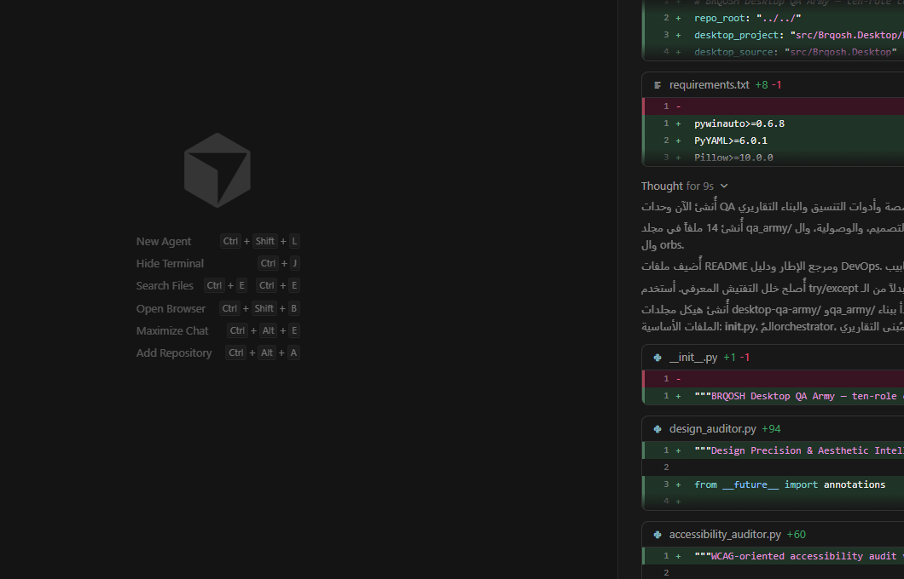
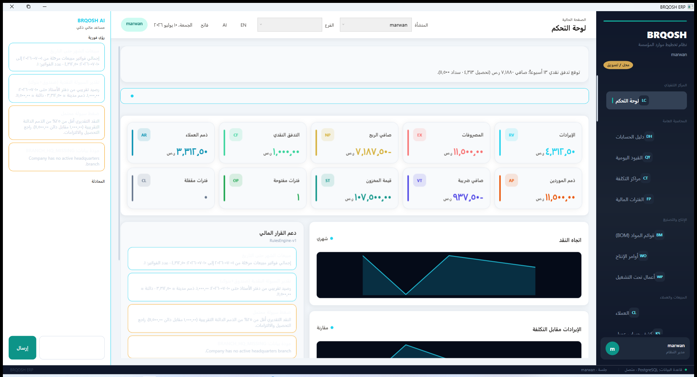
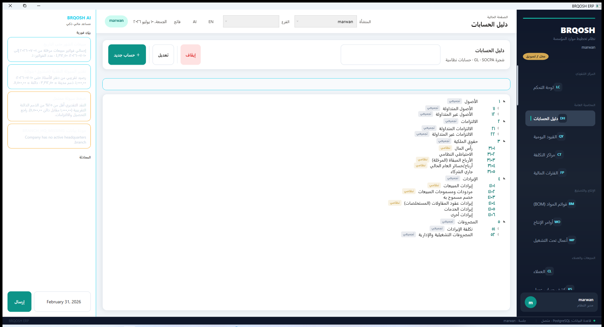
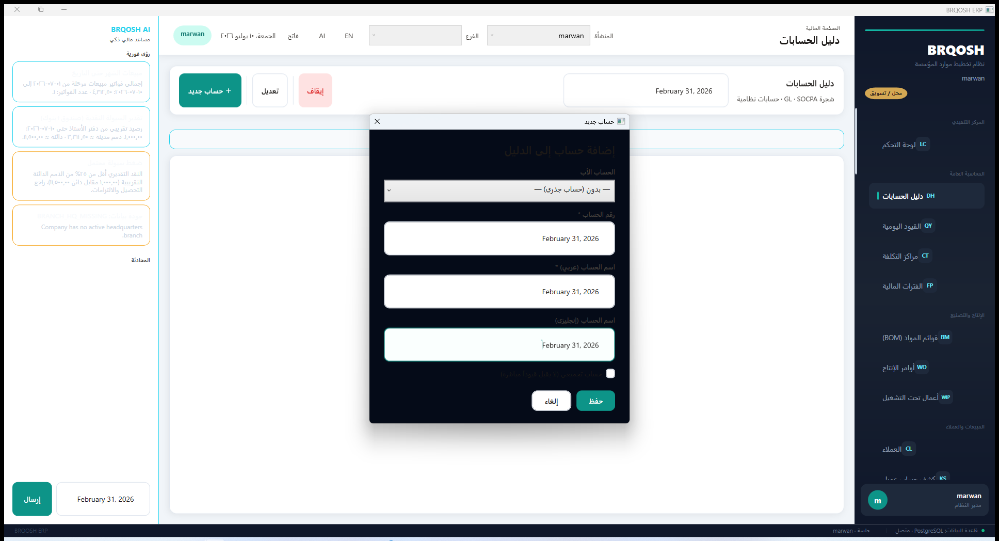
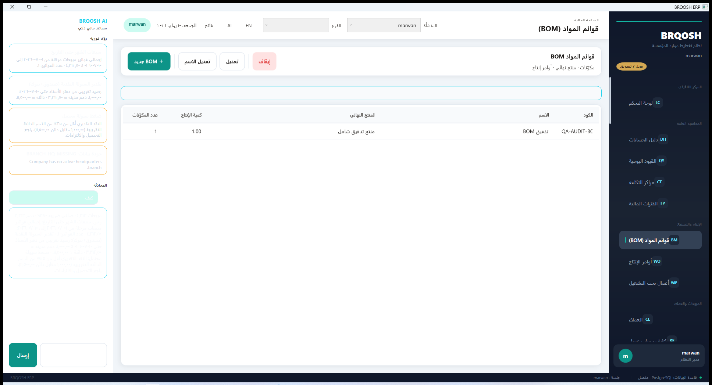
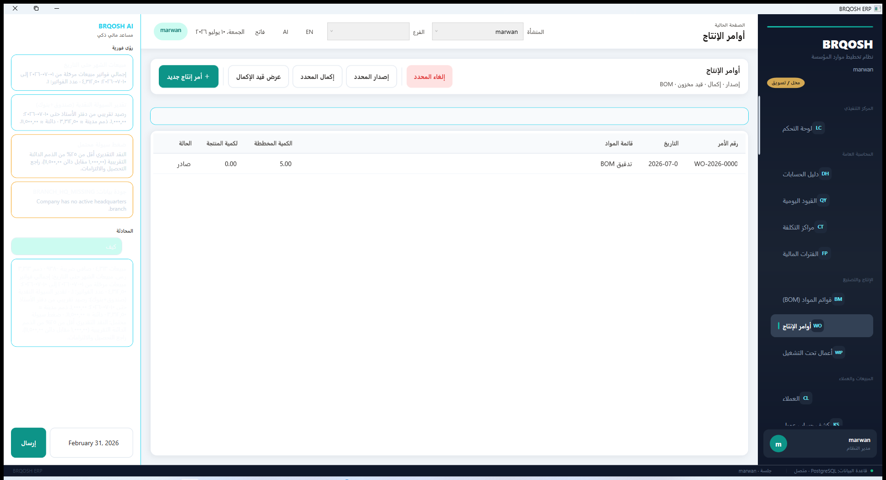
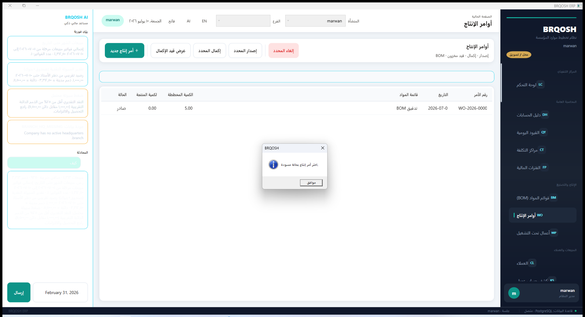
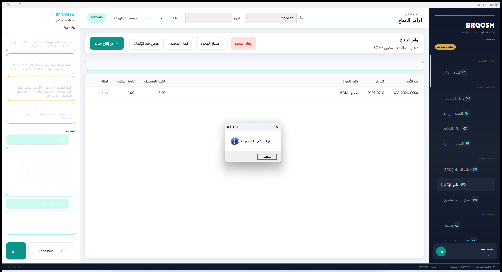
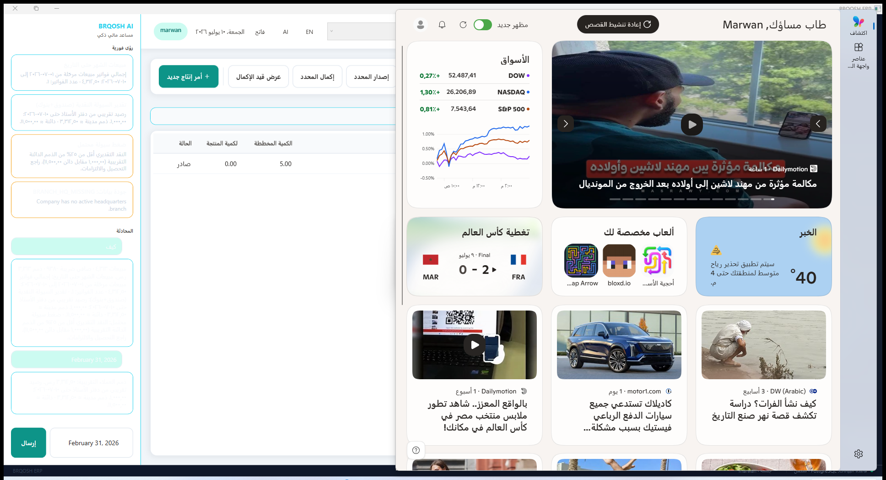

# BRQOSH Cognitive Audit Chronicle

_Observation · Reasoning · Action · Result · Affect_

---

## Entry 1 — `2026-07-10 12:42:36.377 UTC`
**Observation:** Login screen: BRQOSH — تسجيل الدخول; 26 UIA elements
**Reasoning:** Must authenticate before exploring ERP modules — marwan QA user.
**Action:** Focus login form
**Result:** Ready to type credentials
**Inner monologue:** _Another login screen… let's get this over with._
**Affective read:** Neutral impatience

**Source hint:** `src/Brqosh.Desktop/Views/LoginWindow.xaml`
---

## Entry 2 — `2026-07-10 12:43:26.776 UTC`
**Observation:** Main shell: BRQOSH ERP
**Reasoning:** Navigation sidebar should expose profile-specific modules.
**Action:** Login complete
**Result:** Nav ready — profile context 
**Inner monologue:** _We're in. Time to poke everything._
**Affective read:** Cautious optimism
---

## Entry 3 — `2026-07-10 12:43:29.153 UTC`
**Observation:** 60 Nav_* buttons
**Reasoning:** Profile Retail module matrix
**Action:** count_nav
**Result:** 60
**Inner monologue:** _Army deploying on Retail…_
**Affective read:** Battle-ready
---

## Entry 4 — `2026-07-10 12:43:53.704 UTC`
**Observation:** تصغير
استعادة
إغلاق
لوحة التحكم
دليل الحسابات
القيود اليومية
مراكز التكلفة
الفترات المالية
قوائم المواد (BOM)
أوامر الإنتاج
أعمال تحت التشغيل
العملاء
كشف حساب عميل
عروض الأسعار
أوامر البيع
فواتير المبيعات
مردودات المبيعات
العملاء المحتملون
فرص البيع
أنشطة CRM
الموردون
كشف حساب مورد
طلبات الشراء
أوامر الشراء
أذونات استلام البضاعة
فواتير المشتريات
إشعارات المدين (مشتريات)
الأصناف والمنتجات
المستودعا
**Reasoning:** Opened 'لوحة التحكم' — scanning all fields/buttons before chaos.
**Action:** Click nav → لوحة التحكم
**Result:** 155 interactive elements perceived
**Inner monologue:** _New room unlocked. What's breakable here?_
**Affective read:** Curious focus

---

## Entry 5 — `2026-07-10 12:44:01.996 UTC`
**Observation:** Field '' on لوحة التحكم
**Reasoning:** Inject compliant data first to advance state machine.
**Action:** type valid (text): QA-COG عميل 154401
**Result:** Accepted without crash
**Inner monologue:** _Let's be a good user first…_
**Affective read:** Dutiful
---

## Entry 6 — `2026-07-10 12:44:02.052 UTC`
**Observation:** Field '' on لوحة التحكم
**Reasoning:** Inject compliant data first to advance state machine.
**Action:** type valid (text): شركة الاختبار المحدودة
**Result:** Accepted without crash
**Inner monologue:** _Let's be a good user first…_
**Affective read:** Dutiful
---

## Entry 7 — `2026-07-10 12:44:02.207 UTC`
**Observation:** Field '' on لوحة التحكم
**Reasoning:** Inject compliant data first to advance state machine.
**Action:** type valid (text): Test Corp Ltd
**Result:** Accepted without crash
**Inner monologue:** _Let's be a good user first…_
**Affective read:** Dutiful
---

## Entry 8 — `2026-07-10 12:44:05.289 UTC`
**Observation:** Field ''
**Reasoning:** Post-exploration malicious resilience test.
**Action:** inject malicious: ' OR '1'='1
**Result:** No immediate crash
**Inner monologue:** _Hehe, what does THIS do?_
**Affective read:** Mischievous
---

## Entry 9 — `2026-07-10 12:44:05.376 UTC`
**Observation:** Field ''
**Reasoning:** Post-exploration malicious resilience test.
**Action:** inject malicious: 
**Result:** No immediate crash
**Inner monologue:** _Hehe, what does THIS do?_
**Affective read:** Mischievous
---

## Entry 10 — `2026-07-10 12:44:05.455 UTC`
**Observation:** Field ''
**Reasoning:** Post-exploration malicious resilience test.
**Action:** inject malicious: '; DROP TABLE Users;--
**Result:** No immediate crash
**Inner monologue:** _Hehe, what does THIS do?_
**Affective read:** Mischievous
---

## Entry 11 — `2026-07-10 12:44:05.529 UTC`
**Observation:** Field ''
**Reasoning:** Post-exploration chaos resilience test.
**Action:** inject chaos: 🙂🙂🙂🙂🙂🙂🙂🙂🙂🙂🙂🙂🙂🙂🙂🙂🙂🙂🙂🙂🙂🙂🙂🙂🙂🙂🙂🙂🙂🙂🙂🙂🙂🙂🙂🙂🙂🙂🙂🙂🙂🙂🙂🙂🙂🙂🙂🙂🙂🙂🙂🙂🙂🙂🙂🙂🙂🙂🙂🙂
**Result:** No immediate crash
**Inner monologue:** _Hehe, what does THIS do?_
**Affective read:** Mischievous
---

## Entry 12 — `2026-07-10 12:44:05.608 UTC`
**Observation:** Field ''
**Reasoning:** Post-exploration chaos resilience test.
**Action:** inject chaos: مرحبا‮‭HACK
**Result:** No immediate crash
**Inner monologue:** _Hehe, what does THIS do?_
**Affective read:** Mischievous
---

## Entry 13 — `2026-07-10 12:44:05.685 UTC`
**Observation:** Field ''
**Reasoning:** Post-exploration chaos resilience test.
**Action:** inject chaos: February 31, 2026
**Result:** No immediate crash
**Inner monologue:** _Hehe, what does THIS do?_
**Affective read:** Mischievous
---

## Entry 14 — `2026-07-10 12:44:35.842 UTC`
**Observation:** تصغير
استعادة
إغلاق
لوحة التحكم
دليل الحسابات
القيود اليومية
مراكز التكلفة
الفترات المالية
قوائم المواد (BOM)
أوامر الإنتاج
أعمال تحت التشغيل
العملاء
كشف حساب عميل
عروض الأسعار
أوامر البيع
فواتير المبيعات
مردودات المبيعات
العملاء المحتملون
فرص البيع
أنشطة CRM
الموردون
كشف حساب مورد
طلبات الشراء
أوامر الشراء
أذونات استلام البضاعة
فواتير المشتريات
إشعارات المدين (مشتريات)
الأصناف والمنتجات
المستودعا
**Reasoning:** Opened 'دليل الحسابات' — scanning all fields/buttons before chaos.
**Action:** Click nav → دليل الحسابات
**Result:** 165 interactive elements perceived
**Inner monologue:** _New room unlocked. What's breakable here?_
**Affective read:** Curious focus

---

## Entry 15 — `2026-07-10 12:44:43.389 UTC`
**Observation:** Field '' on دليل الحسابات
**Reasoning:** Inject compliant data first to advance state machine.
**Action:** type valid (text): QA-COG عميل 154443
**Result:** Accepted without crash
**Inner monologue:** _Let's be a good user first…_
**Affective read:** Dutiful
---

## Entry 16 — `2026-07-10 12:44:43.552 UTC`
**Observation:** Field '' on دليل الحسابات
**Reasoning:** Inject compliant data first to advance state machine.
**Action:** type valid (text): شركة الاختبار المحدودة
**Result:** Accepted without crash
**Inner monologue:** _Let's be a good user first…_
**Affective read:** Dutiful
---

## Entry 17 — `2026-07-10 12:44:43.727 UTC`
**Observation:** Field '' on دليل الحسابات
**Reasoning:** Inject compliant data first to advance state machine.
**Action:** type valid (text): Test Corp Ltd
**Result:** Accepted without crash
**Inner monologue:** _Let's be a good user first…_
**Affective read:** Dutiful
---

## Entry 18 — `2026-07-10 12:44:43.898 UTC`
**Observation:** Field '' on دليل الحسابات
**Reasoning:** Inject compliant data first to advance state machine.
**Action:** type valid (text): QA-COG عميل 154443
**Result:** Accepted without crash
**Inner monologue:** _Let's be a good user first…_
**Affective read:** Dutiful
---

## Entry 19 — `2026-07-10 12:44:43.948 UTC`
**Observation:** Field '' on دليل الحسابات
**Reasoning:** Inject compliant data first to advance state machine.
**Action:** type valid (text): شركة الاختبار المحدودة
**Result:** Accepted without crash
**Inner monologue:** _Let's be a good user first…_
**Affective read:** Dutiful
---

## Entry 20 — `2026-07-10 12:44:44.062 UTC`
**Observation:** Field '' on دليل الحسابات
**Reasoning:** Inject compliant data first to advance state machine.
**Action:** type valid (text): Test Corp Ltd
**Result:** Accepted without crash
**Inner monologue:** _Let's be a good user first…_
**Affective read:** Dutiful
---

## Entry 21 — `2026-07-10 12:46:26.968 UTC`
**Observation:** Button 'حساب جديد' on دليل الحسابات
**Reasoning:** Catalog action: open_dialog_cancel
**Action:** click → حساب جديد
**Result:** Executed
**Inner monologue:** _Clickety-click… what's behind door number two?_
**Affective read:** Anticipation
---

## Entry 22 — `2026-07-10 12:46:36.937 UTC`
**Observation:** Button 'تعديل' on دليل الحسابات
**Reasoning:** Catalog action: require_selection_warning
**Action:** click → تعديل
**Result:** Executed
**Inner monologue:** _Clickety-click… what's behind door number two?_
**Affective read:** Anticipation
---

## Entry 23 — `2026-07-10 12:46:46.007 UTC`
**Observation:** Button 'إيقاف' on دليل الحسابات
**Reasoning:** Catalog action: require_selection_warning
**Action:** click → إيقاف
**Result:** Executed
**Inner monologue:** _Clickety-click… what's behind door number two?_
**Affective read:** Anticipation
---

## Entry 24 — `2026-07-10 12:46:48.816 UTC`
**Observation:** Field ''
**Reasoning:** Post-exploration malicious resilience test.
**Action:** inject malicious: ' OR '1'='1
**Result:** No immediate crash
**Inner monologue:** _Hehe, what does THIS do?_
**Affective read:** Mischievous
---

## Entry 25 — `2026-07-10 12:46:48.887 UTC`
**Observation:** Field ''
**Reasoning:** Post-exploration malicious resilience test.
**Action:** inject malicious: 
**Result:** No immediate crash
**Inner monologue:** _Hehe, what does THIS do?_
**Affective read:** Mischievous
---

## Entry 26 — `2026-07-10 12:46:48.964 UTC`
**Observation:** Field ''
**Reasoning:** Post-exploration malicious resilience test.
**Action:** inject malicious: '; DROP TABLE Users;--
**Result:** No immediate crash
**Inner monologue:** _Hehe, what does THIS do?_
**Affective read:** Mischievous
---

## Entry 27 — `2026-07-10 12:46:49.034 UTC`
**Observation:** Field ''
**Reasoning:** Post-exploration chaos resilience test.
**Action:** inject chaos: 🙂🙂🙂🙂🙂🙂🙂🙂🙂🙂🙂🙂🙂🙂🙂🙂🙂🙂🙂🙂🙂🙂🙂🙂🙂🙂🙂🙂🙂🙂🙂🙂🙂🙂🙂🙂🙂🙂🙂🙂🙂🙂🙂🙂🙂🙂🙂🙂🙂🙂🙂🙂🙂🙂🙂🙂🙂🙂🙂🙂
**Result:** No immediate crash
**Inner monologue:** _Hehe, what does THIS do?_
**Affective read:** Mischievous
---

## Entry 28 — `2026-07-10 12:46:49.105 UTC`
**Observation:** Field ''
**Reasoning:** Post-exploration chaos resilience test.
**Action:** inject chaos: مرحبا‮‭HACK
**Result:** No immediate crash
**Inner monologue:** _Hehe, what does THIS do?_
**Affective read:** Mischievous
---

## Entry 29 — `2026-07-10 12:46:49.178 UTC`
**Observation:** Field ''
**Reasoning:** Post-exploration chaos resilience test.
**Action:** inject chaos: February 31, 2026
**Result:** No immediate crash
**Inner monologue:** _Hehe, what does THIS do?_
**Affective read:** Mischievous
---

## Entry 30 — `2026-07-10 12:46:49.394 UTC`
**Observation:** Field ''
**Reasoning:** Post-exploration malicious resilience test.
**Action:** inject malicious: ' OR '1'='1
**Result:** No immediate crash
**Inner monologue:** _Hehe, what does THIS do?_
**Affective read:** Mischievous
---

## Entry 31 — `2026-07-10 12:46:49.470 UTC`
**Observation:** Field ''
**Reasoning:** Post-exploration malicious resilience test.
**Action:** inject malicious: 
**Result:** No immediate crash
**Inner monologue:** _Hehe, what does THIS do?_
**Affective read:** Mischievous
---

## Entry 32 — `2026-07-10 12:46:49.552 UTC`
**Observation:** Field ''
**Reasoning:** Post-exploration malicious resilience test.
**Action:** inject malicious: '; DROP TABLE Users;--
**Result:** No immediate crash
**Inner monologue:** _Hehe, what does THIS do?_
**Affective read:** Mischievous
---

## Entry 33 — `2026-07-10 12:46:49.628 UTC`
**Observation:** Field ''
**Reasoning:** Post-exploration chaos resilience test.
**Action:** inject chaos: 🙂🙂🙂🙂🙂🙂🙂🙂🙂🙂🙂🙂🙂🙂🙂🙂🙂🙂🙂🙂🙂🙂🙂🙂🙂🙂🙂🙂🙂🙂🙂🙂🙂🙂🙂🙂🙂🙂🙂🙂🙂🙂🙂🙂🙂🙂🙂🙂🙂🙂🙂🙂🙂🙂🙂🙂🙂🙂🙂🙂
**Result:** No immediate crash
**Inner monologue:** _Hehe, what does THIS do?_
**Affective read:** Mischievous
---

## Entry 34 — `2026-07-10 12:46:49.702 UTC`
**Observation:** Field ''
**Reasoning:** Post-exploration chaos resilience test.
**Action:** inject chaos: مرحبا‮‭HACK
**Result:** No immediate crash
**Inner monologue:** _Hehe, what does THIS do?_
**Affective read:** Mischievous
---

## Entry 35 — `2026-07-10 12:46:49.781 UTC`
**Observation:** Field ''
**Reasoning:** Post-exploration chaos resilience test.
**Action:** inject chaos: February 31, 2026
**Result:** No immediate crash
**Inner monologue:** _Hehe, what does THIS do?_
**Affective read:** Mischievous
---

## Entry 36 — `2026-07-10 12:46:49.898 UTC`
**Observation:** Field ''
**Reasoning:** Post-exploration malicious resilience test.
**Action:** inject malicious: ' OR '1'='1
**Result:** No immediate crash
**Inner monologue:** _Hehe, what does THIS do?_
**Affective read:** Mischievous
---

## Entry 37 — `2026-07-10 12:46:50.027 UTC`
**Observation:** Field ''
**Reasoning:** Post-exploration malicious resilience test.
**Action:** inject malicious: 
**Result:** No immediate crash
**Inner monologue:** _Hehe, what does THIS do?_
**Affective read:** Mischievous
---

## Entry 38 — `2026-07-10 12:46:50.102 UTC`
**Observation:** Field ''
**Reasoning:** Post-exploration malicious resilience test.
**Action:** inject malicious: '; DROP TABLE Users;--
**Result:** No immediate crash
**Inner monologue:** _Hehe, what does THIS do?_
**Affective read:** Mischievous
---

## Entry 39 — `2026-07-10 12:46:50.180 UTC`
**Observation:** Field ''
**Reasoning:** Post-exploration chaos resilience test.
**Action:** inject chaos: 🙂🙂🙂🙂🙂🙂🙂🙂🙂🙂🙂🙂🙂🙂🙂🙂🙂🙂🙂🙂🙂🙂🙂🙂🙂🙂🙂🙂🙂🙂🙂🙂🙂🙂🙂🙂🙂🙂🙂🙂🙂🙂🙂🙂🙂🙂🙂🙂🙂🙂🙂🙂🙂🙂🙂🙂🙂🙂🙂🙂
**Result:** No immediate crash
**Inner monologue:** _Hehe, what does THIS do?_
**Affective read:** Mischievous
---

## Entry 40 — `2026-07-10 12:46:50.258 UTC`
**Observation:** Field ''
**Reasoning:** Post-exploration chaos resilience test.
**Action:** inject chaos: مرحبا‮‭HACK
**Result:** No immediate crash
**Inner monologue:** _Hehe, what does THIS do?_
**Affective read:** Mischievous
---

## Entry 41 — `2026-07-10 12:46:50.332 UTC`
**Observation:** Field ''
**Reasoning:** Post-exploration chaos resilience test.
**Action:** inject chaos: February 31, 2026
**Result:** No immediate crash
**Inner monologue:** _Hehe, what does THIS do?_
**Affective read:** Mischievous
---

## Entry 42 — `2026-07-10 12:46:50.599 UTC`
**Observation:** Field ''
**Reasoning:** Post-exploration malicious resilience test.
**Action:** inject malicious: ' OR '1'='1
**Result:** No immediate crash
**Inner monologue:** _Hehe, what does THIS do?_
**Affective read:** Mischievous
---

## Entry 43 — `2026-07-10 12:46:50.731 UTC`
**Observation:** Field ''
**Reasoning:** Post-exploration malicious resilience test.
**Action:** inject malicious: 
**Result:** No immediate crash
**Inner monologue:** _Hehe, what does THIS do?_
**Affective read:** Mischievous
---

## Entry 44 — `2026-07-10 12:46:50.810 UTC`
**Observation:** Field ''
**Reasoning:** Post-exploration malicious resilience test.
**Action:** inject malicious: '; DROP TABLE Users;--
**Result:** No immediate crash
**Inner monologue:** _Hehe, what does THIS do?_
**Affective read:** Mischievous
---

## Entry 45 — `2026-07-10 12:46:50.889 UTC`
**Observation:** Field ''
**Reasoning:** Post-exploration chaos resilience test.
**Action:** inject chaos: 🙂🙂🙂🙂🙂🙂🙂🙂🙂🙂🙂🙂🙂🙂🙂🙂🙂🙂🙂🙂🙂🙂🙂🙂🙂🙂🙂🙂🙂🙂🙂🙂🙂🙂🙂🙂🙂🙂🙂🙂🙂🙂🙂🙂🙂🙂🙂🙂🙂🙂🙂🙂🙂🙂🙂🙂🙂🙂🙂🙂
**Result:** No immediate crash
**Inner monologue:** _Hehe, what does THIS do?_
**Affective read:** Mischievous
---

## Entry 46 — `2026-07-10 12:46:50.967 UTC`
**Observation:** Field ''
**Reasoning:** Post-exploration chaos resilience test.
**Action:** inject chaos: مرحبا‮‭HACK
**Result:** No immediate crash
**Inner monologue:** _Hehe, what does THIS do?_
**Affective read:** Mischievous
---

## Entry 47 — `2026-07-10 12:46:51.039 UTC`
**Observation:** Field ''
**Reasoning:** Post-exploration chaos resilience test.
**Action:** inject chaos: February 31, 2026
**Result:** No immediate crash
**Inner monologue:** _Hehe, what does THIS do?_
**Affective read:** Mischievous
---

## Entry 48 — `2026-07-10 12:46:51.164 UTC`
**Observation:** Field ''
**Reasoning:** Post-exploration malicious resilience test.
**Action:** inject malicious: ' OR '1'='1
**Result:** No immediate crash
**Inner monologue:** _Hehe, what does THIS do?_
**Affective read:** Mischievous
---

## Entry 49 — `2026-07-10 12:46:51.293 UTC`
**Observation:** Field ''
**Reasoning:** Post-exploration malicious resilience test.
**Action:** inject malicious: 
**Result:** No immediate crash
**Inner monologue:** _Hehe, what does THIS do?_
**Affective read:** Mischievous
---

## Entry 50 — `2026-07-10 12:46:51.377 UTC`
**Observation:** Field ''
**Reasoning:** Post-exploration malicious resilience test.
**Action:** inject malicious: '; DROP TABLE Users;--
**Result:** No immediate crash
**Inner monologue:** _Hehe, what does THIS do?_
**Affective read:** Mischievous
---

## Entry 51 — `2026-07-10 12:46:51.450 UTC`
**Observation:** Field ''
**Reasoning:** Post-exploration chaos resilience test.
**Action:** inject chaos: 🙂🙂🙂🙂🙂🙂🙂🙂🙂🙂🙂🙂🙂🙂🙂🙂🙂🙂🙂🙂🙂🙂🙂🙂🙂🙂🙂🙂🙂🙂🙂🙂🙂🙂🙂🙂🙂🙂🙂🙂🙂🙂🙂🙂🙂🙂🙂🙂🙂🙂🙂🙂🙂🙂🙂🙂🙂🙂🙂🙂
**Result:** No immediate crash
**Inner monologue:** _Hehe, what does THIS do?_
**Affective read:** Mischievous
---

## Entry 52 — `2026-07-10 12:46:51.528 UTC`
**Observation:** Field ''
**Reasoning:** Post-exploration chaos resilience test.
**Action:** inject chaos: مرحبا‮‭HACK
**Result:** No immediate crash
**Inner monologue:** _Hehe, what does THIS do?_
**Affective read:** Mischievous
---

## Entry 53 — `2026-07-10 12:46:51.606 UTC`
**Observation:** Field ''
**Reasoning:** Post-exploration chaos resilience test.
**Action:** inject chaos: February 31, 2026
**Result:** No immediate crash
**Inner monologue:** _Hehe, what does THIS do?_
**Affective read:** Mischievous
---

## Entry 54 — `2026-07-10 12:47:15.530 UTC`
**Observation:** إغلاق
حفظ
إلغاء
تصغير
استعادة
إغلاق
لوحة التحكم
دليل الحسابات
القيود اليومية
مراكز التكلفة
الفترات المالية
قوائم المواد (BOM)
أوامر الإنتاج
أعمال تحت التشغيل
العملاء
كشف حساب عميل
عروض الأسعار
أوامر البيع
فواتير المبيعات
مردودات المبيعات
العملاء المحتملون
فرص البيع
أنشطة CRM
الموردون
كشف حساب مورد
طلبات الشراء
أوامر الشراء
أذونات استلام البضاعة
فواتير المشتريات
إشعارات المدين (مشتريات)
الأصناف وال
**Reasoning:** Opened 'القيود اليومية' — scanning all fields/buttons before chaos.
**Action:** Click nav → القيود اليومية
**Result:** 166 interactive elements perceived
**Inner monologue:** _New room unlocked. What's breakable here?_
**Affective read:** Curious focus

---

## Entry 55 — `2026-07-10 12:47:23.296 UTC`
**Observation:** Field '' on القيود اليومية
**Reasoning:** Inject compliant data first to advance state machine.
**Action:** type valid (text): QA-COG عميل 154723
**Result:** Accepted without crash
**Inner monologue:** _Let's be a good user first…_
**Affective read:** Dutiful
---

## Entry 56 — `2026-07-10 12:47:23.342 UTC`
**Observation:** Field '' on القيود اليومية
**Reasoning:** Inject compliant data first to advance state machine.
**Action:** type valid (text): شركة الاختبار المحدودة
**Result:** Accepted without crash
**Inner monologue:** _Let's be a good user first…_
**Affective read:** Dutiful
---

## Entry 57 — `2026-07-10 12:47:23.387 UTC`
**Observation:** Field '' on القيود اليومية
**Reasoning:** Inject compliant data first to advance state machine.
**Action:** type valid (text): Test Corp Ltd
**Result:** Accepted without crash
**Inner monologue:** _Let's be a good user first…_
**Affective read:** Dutiful
---

## Entry 58 — `2026-07-10 12:47:23.557 UTC`
**Observation:** Field '' on القيود اليومية
**Reasoning:** Inject compliant data first to advance state machine.
**Action:** type valid (text): QA-COG عميل 154723
**Result:** Accepted without crash
**Inner monologue:** _Let's be a good user first…_
**Affective read:** Dutiful
---

## Entry 59 — `2026-07-10 12:47:23.600 UTC`
**Observation:** Field '' on القيود اليومية
**Reasoning:** Inject compliant data first to advance state machine.
**Action:** type valid (text): شركة الاختبار المحدودة
**Result:** Accepted without crash
**Inner monologue:** _Let's be a good user first…_
**Affective read:** Dutiful
---

## Entry 60 — `2026-07-10 12:47:23.655 UTC`
**Observation:** Field '' on القيود اليومية
**Reasoning:** Inject compliant data first to advance state machine.
**Action:** type valid (text): Test Corp Ltd
**Result:** Accepted without crash
**Inner monologue:** _Let's be a good user first…_
**Affective read:** Dutiful
---

## Entry 61 — `2026-07-10 12:47:23.789 UTC`
**Observation:** Field '' on القيود اليومية
**Reasoning:** Inject compliant data first to advance state machine.
**Action:** type valid (text): QA-COG عميل 154723
**Result:** Accepted without crash
**Inner monologue:** _Let's be a good user first…_
**Affective read:** Dutiful
---

## Entry 62 — `2026-07-10 12:47:23.839 UTC`
**Observation:** Field '' on القيود اليومية
**Reasoning:** Inject compliant data first to advance state machine.
**Action:** type valid (text): شركة الاختبار المحدودة
**Result:** Accepted without crash
**Inner monologue:** _Let's be a good user first…_
**Affective read:** Dutiful
---

## Entry 63 — `2026-07-10 12:47:23.877 UTC`
**Observation:** Field '' on القيود اليومية
**Reasoning:** Inject compliant data first to advance state machine.
**Action:** type valid (text): Test Corp Ltd
**Result:** Accepted without crash
**Inner monologue:** _Let's be a good user first…_
**Affective read:** Dutiful
---

## Entry 64 — `2026-07-10 12:47:24.150 UTC`
**Observation:** Field '' on القيود اليومية
**Reasoning:** Inject compliant data first to advance state machine.
**Action:** type valid (text): QA-COG عميل 154723
**Result:** Accepted without crash
**Inner monologue:** _Let's be a good user first…_
**Affective read:** Dutiful
---

## Entry 65 — `2026-07-10 12:47:24.298 UTC`
**Observation:** Field '' on القيود اليومية
**Reasoning:** Inject compliant data first to advance state machine.
**Action:** type valid (text): شركة الاختبار المحدودة
**Result:** Accepted without crash
**Inner monologue:** _Let's be a good user first…_
**Affective read:** Dutiful
---

## Entry 66 — `2026-07-10 12:47:24.421 UTC`
**Observation:** Field '' on القيود اليومية
**Reasoning:** Inject compliant data first to advance state machine.
**Action:** type valid (text): Test Corp Ltd
**Result:** Accepted without crash
**Inner monologue:** _Let's be a good user first…_
**Affective read:** Dutiful
---

## Entry 67 — `2026-07-10 12:47:24.588 UTC`
**Observation:** Field '' on القيود اليومية
**Reasoning:** Inject compliant data first to advance state machine.
**Action:** type valid (text): QA-COG عميل 154724
**Result:** Accepted without crash
**Inner monologue:** _Let's be a good user first…_
**Affective read:** Dutiful
---

## Entry 68 — `2026-07-10 12:47:24.634 UTC`
**Observation:** Field '' on القيود اليومية
**Reasoning:** Inject compliant data first to advance state machine.
**Action:** type valid (text): شركة الاختبار المحدودة
**Result:** Accepted without crash
**Inner monologue:** _Let's be a good user first…_
**Affective read:** Dutiful
---

## Entry 69 — `2026-07-10 12:47:24.748 UTC`
**Observation:** Field '' on القيود اليومية
**Reasoning:** Inject compliant data first to advance state machine.
**Action:** type valid (text): Test Corp Ltd
**Result:** Accepted without crash
**Inner monologue:** _Let's be a good user first…_
**Affective read:** Dutiful
---

## Entry 70 — `2026-07-10 12:47:27.909 UTC`
**Observation:** Button 'قيد جديد' missing on القيود اليومية
**Reasoning:** PageAuditCatalog expects this action — dead binding?
**Action:** find_page_button
**Result:** FAIL
**Inner monologue:** _Promised button isn't there. Did dev forget RTL label?_
**Affective read:** Betrayed
**Source hint:** `src/Brqosh.Desktop/Views/Pages/*القيود اليومية*`
---

## Entry 71 — `2026-07-10 12:47:31.532 UTC`
**Observation:** Button 'عرض' missing on القيود اليومية
**Reasoning:** PageAuditCatalog expects this action — dead binding?
**Action:** find_page_button
**Result:** FAIL
**Inner monologue:** _Promised button isn't there. Did dev forget RTL label?_
**Affective read:** Betrayed
**Source hint:** `src/Brqosh.Desktop/Views/Pages/*القيود اليومية*`
---

## Entry 72 — `2026-07-10 12:47:37.328 UTC`
**Observation:** Button 'عكس' missing on القيود اليومية
**Reasoning:** PageAuditCatalog expects this action — dead binding?
**Action:** find_page_button
**Result:** FAIL
**Inner monologue:** _Promised button isn't there. Did dev forget RTL label?_
**Affective read:** Betrayed
**Source hint:** `src/Brqosh.Desktop/Views/Pages/*القيود اليومية*`
---

## Entry 73 — `2026-07-10 12:47:40.730 UTC`
**Observation:** Field ''
**Reasoning:** Post-exploration malicious resilience test.
**Action:** inject malicious: ' OR '1'='1
**Result:** No immediate crash
**Inner monologue:** _Hehe, what does THIS do?_
**Affective read:** Mischievous
---

## Entry 74 — `2026-07-10 12:47:40.893 UTC`
**Observation:** Field ''
**Reasoning:** Post-exploration malicious resilience test.
**Action:** inject malicious: 
**Result:** No immediate crash
**Inner monologue:** _Hehe, what does THIS do?_
**Affective read:** Mischievous
---

## Entry 75 — `2026-07-10 12:47:41.178 UTC`
**Observation:** Field ''
**Reasoning:** Post-exploration malicious resilience test.
**Action:** inject malicious: '; DROP TABLE Users;--
**Result:** No immediate crash
**Inner monologue:** _Hehe, what does THIS do?_
**Affective read:** Mischievous
---

## Entry 76 — `2026-07-10 12:47:41.319 UTC`
**Observation:** Field ''
**Reasoning:** Post-exploration chaos resilience test.
**Action:** inject chaos: 🙂🙂🙂🙂🙂🙂🙂🙂🙂🙂🙂🙂🙂🙂🙂🙂🙂🙂🙂🙂🙂🙂🙂🙂🙂🙂🙂🙂🙂🙂🙂🙂🙂🙂🙂🙂🙂🙂🙂🙂🙂🙂🙂🙂🙂🙂🙂🙂🙂🙂🙂🙂🙂🙂🙂🙂🙂🙂🙂🙂
**Result:** No immediate crash
**Inner monologue:** _Hehe, what does THIS do?_
**Affective read:** Mischievous
---

## Entry 77 — `2026-07-10 12:47:41.506 UTC`
**Observation:** Field ''
**Reasoning:** Post-exploration chaos resilience test.
**Action:** inject chaos: مرحبا‮‭HACK
**Result:** No immediate crash
**Inner monologue:** _Hehe, what does THIS do?_
**Affective read:** Mischievous
---

## Entry 78 — `2026-07-10 12:47:41.708 UTC`
**Observation:** Field ''
**Reasoning:** Post-exploration chaos resilience test.
**Action:** inject chaos: February 31, 2026
**Result:** No immediate crash
**Inner monologue:** _Hehe, what does THIS do?_
**Affective read:** Mischievous
---

## Entry 79 — `2026-07-10 12:47:42.073 UTC`
**Observation:** Field ''
**Reasoning:** Post-exploration malicious resilience test.
**Action:** inject malicious: ' OR '1'='1
**Result:** No immediate crash
**Inner monologue:** _Hehe, what does THIS do?_
**Affective read:** Mischievous
---

## Entry 80 — `2026-07-10 12:47:42.161 UTC`
**Observation:** Field ''
**Reasoning:** Post-exploration malicious resilience test.
**Action:** inject malicious: 
**Result:** No immediate crash
**Inner monologue:** _Hehe, what does THIS do?_
**Affective read:** Mischievous
---

## Entry 81 — `2026-07-10 12:47:42.440 UTC`
**Observation:** Field ''
**Reasoning:** Post-exploration malicious resilience test.
**Action:** inject malicious: '; DROP TABLE Users;--
**Result:** No immediate crash
**Inner monologue:** _Hehe, what does THIS do?_
**Affective read:** Mischievous
---

## Entry 82 — `2026-07-10 12:47:42.586 UTC`
**Observation:** Field ''
**Reasoning:** Post-exploration chaos resilience test.
**Action:** inject chaos: 🙂🙂🙂🙂🙂🙂🙂🙂🙂🙂🙂🙂🙂🙂🙂🙂🙂🙂🙂🙂🙂🙂🙂🙂🙂🙂🙂🙂🙂🙂🙂🙂🙂🙂🙂🙂🙂🙂🙂🙂🙂🙂🙂🙂🙂🙂🙂🙂🙂🙂🙂🙂🙂🙂🙂🙂🙂🙂🙂🙂
**Result:** No immediate crash
**Inner monologue:** _Hehe, what does THIS do?_
**Affective read:** Mischievous
---

## Entry 83 — `2026-07-10 12:47:42.765 UTC`
**Observation:** Field ''
**Reasoning:** Post-exploration chaos resilience test.
**Action:** inject chaos: مرحبا‮‭HACK
**Result:** No immediate crash
**Inner monologue:** _Hehe, what does THIS do?_
**Affective read:** Mischievous
---

## Entry 84 — `2026-07-10 12:47:42.946 UTC`
**Observation:** Field ''
**Reasoning:** Post-exploration chaos resilience test.
**Action:** inject chaos: February 31, 2026
**Result:** No immediate crash
**Inner monologue:** _Hehe, what does THIS do?_
**Affective read:** Mischievous
---

## Entry 85 — `2026-07-10 12:47:43.187 UTC`
**Observation:** Field ''
**Reasoning:** Post-exploration malicious resilience test.
**Action:** inject malicious: ' OR '1'='1
**Result:** No immediate crash
**Inner monologue:** _Hehe, what does THIS do?_
**Affective read:** Mischievous
---

## Entry 86 — `2026-07-10 12:47:43.310 UTC`
**Observation:** Field ''
**Reasoning:** Post-exploration malicious resilience test.
**Action:** inject malicious: 
**Result:** No immediate crash
**Inner monologue:** _Hehe, what does THIS do?_
**Affective read:** Mischievous
---

## Entry 87 — `2026-07-10 12:47:43.434 UTC`
**Observation:** Field ''
**Reasoning:** Post-exploration malicious resilience test.
**Action:** inject malicious: '; DROP TABLE Users;--
**Result:** No immediate crash
**Inner monologue:** _Hehe, what does THIS do?_
**Affective read:** Mischievous
---

## Entry 88 — `2026-07-10 12:47:43.819 UTC`
**Observation:** Field ''
**Reasoning:** Post-exploration chaos resilience test.
**Action:** inject chaos: 🙂🙂🙂🙂🙂🙂🙂🙂🙂🙂🙂🙂🙂🙂🙂🙂🙂🙂🙂🙂🙂🙂🙂🙂🙂🙂🙂🙂🙂🙂🙂🙂🙂🙂🙂🙂🙂🙂🙂🙂🙂🙂🙂🙂🙂🙂🙂🙂🙂🙂🙂🙂🙂🙂🙂🙂🙂🙂🙂🙂
**Result:** No immediate crash
**Inner monologue:** _Hehe, what does THIS do?_
**Affective read:** Mischievous
---

## Entry 89 — `2026-07-10 12:47:44.043 UTC`
**Observation:** Field ''
**Reasoning:** Post-exploration chaos resilience test.
**Action:** inject chaos: مرحبا‮‭HACK
**Result:** No immediate crash
**Inner monologue:** _Hehe, what does THIS do?_
**Affective read:** Mischievous
---

## Entry 90 — `2026-07-10 12:47:44.273 UTC`
**Observation:** Field ''
**Reasoning:** Post-exploration chaos resilience test.
**Action:** inject chaos: February 31, 2026
**Result:** No immediate crash
**Inner monologue:** _Hehe, what does THIS do?_
**Affective read:** Mischievous
---

## Entry 91 — `2026-07-10 12:47:44.746 UTC`
**Observation:** Field ''
**Reasoning:** Post-exploration malicious resilience test.
**Action:** inject malicious: ' OR '1'='1
**Result:** No immediate crash
**Inner monologue:** _Hehe, what does THIS do?_
**Affective read:** Mischievous
---

## Entry 92 — `2026-07-10 12:47:44.964 UTC`
**Observation:** Field ''
**Reasoning:** Post-exploration malicious resilience test.
**Action:** inject malicious: 
**Result:** No immediate crash
**Inner monologue:** _Hehe, what does THIS do?_
**Affective read:** Mischievous
---

## Entry 93 — `2026-07-10 12:47:45.080 UTC`
**Observation:** Field ''
**Reasoning:** Post-exploration malicious resilience test.
**Action:** inject malicious: '; DROP TABLE Users;--
**Result:** No immediate crash
**Inner monologue:** _Hehe, what does THIS do?_
**Affective read:** Mischievous
---

## Entry 94 — `2026-07-10 12:47:45.256 UTC`
**Observation:** Field ''
**Reasoning:** Post-exploration chaos resilience test.
**Action:** inject chaos: 🙂🙂🙂🙂🙂🙂🙂🙂🙂🙂🙂🙂🙂🙂🙂🙂🙂🙂🙂🙂🙂🙂🙂🙂🙂🙂🙂🙂🙂🙂🙂🙂🙂🙂🙂🙂🙂🙂🙂🙂🙂🙂🙂🙂🙂🙂🙂🙂🙂🙂🙂🙂🙂🙂🙂🙂🙂🙂🙂🙂
**Result:** No immediate crash
**Inner monologue:** _Hehe, what does THIS do?_
**Affective read:** Mischievous
---

## Entry 95 — `2026-07-10 12:47:45.368 UTC`
**Observation:** Field ''
**Reasoning:** Post-exploration chaos resilience test.
**Action:** inject chaos: مرحبا‮‭HACK
**Result:** No immediate crash
**Inner monologue:** _Hehe, what does THIS do?_
**Affective read:** Mischievous
---

## Entry 96 — `2026-07-10 12:47:45.561 UTC`
**Observation:** Field ''
**Reasoning:** Post-exploration chaos resilience test.
**Action:** inject chaos: February 31, 2026
**Result:** No immediate crash
**Inner monologue:** _Hehe, what does THIS do?_
**Affective read:** Mischievous
---

## Entry 97 — `2026-07-10 12:47:45.850 UTC`
**Observation:** Field ''
**Reasoning:** Post-exploration malicious resilience test.
**Action:** inject malicious: ' OR '1'='1
**Result:** No immediate crash
**Inner monologue:** _Hehe, what does THIS do?_
**Affective read:** Mischievous
---

## Entry 98 — `2026-07-10 12:47:46.123 UTC`
**Observation:** Field ''
**Reasoning:** Post-exploration malicious resilience test.
**Action:** inject malicious: 
**Result:** No immediate crash
**Inner monologue:** _Hehe, what does THIS do?_
**Affective read:** Mischievous
---

## Entry 99 — `2026-07-10 12:47:46.279 UTC`
**Observation:** Field ''
**Reasoning:** Post-exploration malicious resilience test.
**Action:** inject malicious: '; DROP TABLE Users;--
**Result:** No immediate crash
**Inner monologue:** _Hehe, what does THIS do?_
**Affective read:** Mischievous
---

## Entry 100 — `2026-07-10 12:47:46.461 UTC`
**Observation:** Field ''
**Reasoning:** Post-exploration chaos resilience test.
**Action:** inject chaos: 🙂🙂🙂🙂🙂🙂🙂🙂🙂🙂🙂🙂🙂🙂🙂🙂🙂🙂🙂🙂🙂🙂🙂🙂🙂🙂🙂🙂🙂🙂🙂🙂🙂🙂🙂🙂🙂🙂🙂🙂🙂🙂🙂🙂🙂🙂🙂🙂🙂🙂🙂🙂🙂🙂🙂🙂🙂🙂🙂🙂
**Result:** No immediate crash
**Inner monologue:** _Hehe, what does THIS do?_
**Affective read:** Mischievous
---

## Entry 101 — `2026-07-10 12:47:46.637 UTC`
**Observation:** Field ''
**Reasoning:** Post-exploration chaos resilience test.
**Action:** inject chaos: مرحبا‮‭HACK
**Result:** No immediate crash
**Inner monologue:** _Hehe, what does THIS do?_
**Affective read:** Mischievous
---

## Entry 102 — `2026-07-10 12:47:46.816 UTC`
**Observation:** Field ''
**Reasoning:** Post-exploration chaos resilience test.
**Action:** inject chaos: February 31, 2026
**Result:** No immediate crash
**Inner monologue:** _Hehe, what does THIS do?_
**Affective read:** Mischievous
---

## Entry 103 — `2026-07-10 12:48:17.363 UTC`
**Observation:** إغلاق
حفظ
إلغاء
تصغير
استعادة
إغلاق
لوحة التحكم
دليل الحسابات
القيود اليومية
مراكز التكلفة
الفترات المالية
قوائم المواد (BOM)
أوامر الإنتاج
أعمال تحت التشغيل
العملاء
كشف حساب عميل
عروض الأسعار
أوامر البيع
فواتير المبيعات
مردودات المبيعات
العملاء المحتملون
فرص البيع
أنشطة CRM
الموردون
كشف حساب مورد
طلبات الشراء
أوامر الشراء
أذونات استلام البضاعة
فواتير المشتريات
إشعارات المدين (مشتريات)
الأصناف وال
**Reasoning:** Opened 'مراكز التكلفة' — scanning all fields/buttons before chaos.
**Action:** Click nav → مراكز التكلفة
**Result:** 166 interactive elements perceived
**Inner monologue:** _New room unlocked. What's breakable here?_
**Affective read:** Curious focus

---

## Entry 104 — `2026-07-10 12:48:25.005 UTC`
**Observation:** Field '' on مراكز التكلفة
**Reasoning:** Inject compliant data first to advance state machine.
**Action:** type valid (text): QA-COG عميل 154824
**Result:** Accepted without crash
**Inner monologue:** _Let's be a good user first…_
**Affective read:** Dutiful
---

## Entry 105 — `2026-07-10 12:48:25.043 UTC`
**Observation:** Field '' on مراكز التكلفة
**Reasoning:** Inject compliant data first to advance state machine.
**Action:** type valid (text): شركة الاختبار المحدودة
**Result:** Accepted without crash
**Inner monologue:** _Let's be a good user first…_
**Affective read:** Dutiful
---

## Entry 106 — `2026-07-10 12:48:25.083 UTC`
**Observation:** Field '' on مراكز التكلفة
**Reasoning:** Inject compliant data first to advance state machine.
**Action:** type valid (text): Test Corp Ltd
**Result:** Accepted without crash
**Inner monologue:** _Let's be a good user first…_
**Affective read:** Dutiful
---

## Entry 107 — `2026-07-10 12:48:25.242 UTC`
**Observation:** Field '' on مراكز التكلفة
**Reasoning:** Inject compliant data first to advance state machine.
**Action:** type valid (text): QA-COG عميل 154825
**Result:** Accepted without crash
**Inner monologue:** _Let's be a good user first…_
**Affective read:** Dutiful
---

## Entry 108 — `2026-07-10 12:48:25.299 UTC`
**Observation:** Field '' on مراكز التكلفة
**Reasoning:** Inject compliant data first to advance state machine.
**Action:** type valid (text): شركة الاختبار المحدودة
**Result:** Accepted without crash
**Inner monologue:** _Let's be a good user first…_
**Affective read:** Dutiful
---

## Entry 109 — `2026-07-10 12:48:25.416 UTC`
**Observation:** Field '' on مراكز التكلفة
**Reasoning:** Inject compliant data first to advance state machine.
**Action:** type valid (text): Test Corp Ltd
**Result:** Accepted without crash
**Inner monologue:** _Let's be a good user first…_
**Affective read:** Dutiful
---

## Entry 110 — `2026-07-10 12:48:25.574 UTC`
**Observation:** Field '' on مراكز التكلفة
**Reasoning:** Inject compliant data first to advance state machine.
**Action:** type valid (text): QA-COG عميل 154825
**Result:** Accepted without crash
**Inner monologue:** _Let's be a good user first…_
**Affective read:** Dutiful
---

## Entry 111 — `2026-07-10 12:48:25.609 UTC`
**Observation:** Field '' on مراكز التكلفة
**Reasoning:** Inject compliant data first to advance state machine.
**Action:** type valid (text): شركة الاختبار المحدودة
**Result:** Accepted without crash
**Inner monologue:** _Let's be a good user first…_
**Affective read:** Dutiful
---

## Entry 112 — `2026-07-10 12:48:25.651 UTC`
**Observation:** Field '' on مراكز التكلفة
**Reasoning:** Inject compliant data first to advance state machine.
**Action:** type valid (text): Test Corp Ltd
**Result:** Accepted without crash
**Inner monologue:** _Let's be a good user first…_
**Affective read:** Dutiful
---

## Entry 113 — `2026-07-10 12:48:25.770 UTC`
**Observation:** Field '' on مراكز التكلفة
**Reasoning:** Inject compliant data first to advance state machine.
**Action:** type valid (text): QA-COG عميل 154825
**Result:** Accepted without crash
**Inner monologue:** _Let's be a good user first…_
**Affective read:** Dutiful
---

## Entry 114 — `2026-07-10 12:48:25.839 UTC`
**Observation:** Field '' on مراكز التكلفة
**Reasoning:** Inject compliant data first to advance state machine.
**Action:** type valid (text): شركة الاختبار المحدودة
**Result:** Accepted without crash
**Inner monologue:** _Let's be a good user first…_
**Affective read:** Dutiful
---

## Entry 115 — `2026-07-10 12:48:25.903 UTC`
**Observation:** Field '' on مراكز التكلفة
**Reasoning:** Inject compliant data first to advance state machine.
**Action:** type valid (text): Test Corp Ltd
**Result:** Accepted without crash
**Inner monologue:** _Let's be a good user first…_
**Affective read:** Dutiful
---

## Entry 116 — `2026-07-10 12:48:26.000 UTC`
**Observation:** Field '' on مراكز التكلفة
**Reasoning:** Inject compliant data first to advance state machine.
**Action:** type valid (text): QA-COG عميل 154825
**Result:** Accepted without crash
**Inner monologue:** _Let's be a good user first…_
**Affective read:** Dutiful
---

## Entry 117 — `2026-07-10 12:48:26.034 UTC`
**Observation:** Field '' on مراكز التكلفة
**Reasoning:** Inject compliant data first to advance state machine.
**Action:** type valid (text): شركة الاختبار المحدودة
**Result:** Accepted without crash
**Inner monologue:** _Let's be a good user first…_
**Affective read:** Dutiful
---

## Entry 118 — `2026-07-10 12:48:26.097 UTC`
**Observation:** Field '' on مراكز التكلفة
**Reasoning:** Inject compliant data first to advance state machine.
**Action:** type valid (text): Test Corp Ltd
**Result:** Accepted without crash
**Inner monologue:** _Let's be a good user first…_
**Affective read:** Dutiful
---

## Entry 119 — `2026-07-10 12:48:30.943 UTC`
**Observation:** Button 'مركز تكلفة' missing on مراكز التكلفة
**Reasoning:** PageAuditCatalog expects this action — dead binding?
**Action:** find_page_button
**Result:** FAIL
**Inner monologue:** _Promised button isn't there. Did dev forget RTL label?_
**Affective read:** Betrayed
**Source hint:** `src/Brqosh.Desktop/Views/Pages/*مراكز التكلفة*`
---

## Entry 120 — `2026-07-10 12:48:46.749 UTC`
**Observation:** Button 'إيقاف' on مراكز التكلفة
**Reasoning:** Catalog action: require_selection_warning
**Action:** click → إيقاف
**Result:** Executed
**Inner monologue:** _Clickety-click… what's behind door number two?_
**Affective read:** Anticipation
---

## Entry 121 — `2026-07-10 12:48:50.834 UTC`
**Observation:** Field ''
**Reasoning:** Post-exploration malicious resilience test.
**Action:** inject malicious: ' OR '1'='1
**Result:** No immediate crash
**Inner monologue:** _Hehe, what does THIS do?_
**Affective read:** Mischievous
---

## Entry 122 — `2026-07-10 12:48:50.913 UTC`
**Observation:** Field ''
**Reasoning:** Post-exploration malicious resilience test.
**Action:** inject malicious: 
**Result:** No immediate crash
**Inner monologue:** _Hehe, what does THIS do?_
**Affective read:** Mischievous
---

## Entry 123 — `2026-07-10 12:48:50.984 UTC`
**Observation:** Field ''
**Reasoning:** Post-exploration malicious resilience test.
**Action:** inject malicious: '; DROP TABLE Users;--
**Result:** No immediate crash
**Inner monologue:** _Hehe, what does THIS do?_
**Affective read:** Mischievous
---

## Entry 124 — `2026-07-10 12:48:51.060 UTC`
**Observation:** Field ''
**Reasoning:** Post-exploration chaos resilience test.
**Action:** inject chaos: 🙂🙂🙂🙂🙂🙂🙂🙂🙂🙂🙂🙂🙂🙂🙂🙂🙂🙂🙂🙂🙂🙂🙂🙂🙂🙂🙂🙂🙂🙂🙂🙂🙂🙂🙂🙂🙂🙂🙂🙂🙂🙂🙂🙂🙂🙂🙂🙂🙂🙂🙂🙂🙂🙂🙂🙂🙂🙂🙂🙂
**Result:** No immediate crash
**Inner monologue:** _Hehe, what does THIS do?_
**Affective read:** Mischievous
---

## Entry 125 — `2026-07-10 12:48:51.133 UTC`
**Observation:** Field ''
**Reasoning:** Post-exploration chaos resilience test.
**Action:** inject chaos: مرحبا‮‭HACK
**Result:** No immediate crash
**Inner monologue:** _Hehe, what does THIS do?_
**Affective read:** Mischievous
---

## Entry 126 — `2026-07-10 12:48:51.203 UTC`
**Observation:** Field ''
**Reasoning:** Post-exploration chaos resilience test.
**Action:** inject chaos: February 31, 2026
**Result:** No immediate crash
**Inner monologue:** _Hehe, what does THIS do?_
**Affective read:** Mischievous
---

## Entry 127 — `2026-07-10 12:48:51.316 UTC`
**Observation:** Field ''
**Reasoning:** Post-exploration malicious resilience test.
**Action:** inject malicious: ' OR '1'='1
**Result:** No immediate crash
**Inner monologue:** _Hehe, what does THIS do?_
**Affective read:** Mischievous
---

## Entry 128 — `2026-07-10 12:48:51.389 UTC`
**Observation:** Field ''
**Reasoning:** Post-exploration malicious resilience test.
**Action:** inject malicious: 
**Result:** No immediate crash
**Inner monologue:** _Hehe, what does THIS do?_
**Affective read:** Mischievous
---

## Entry 129 — `2026-07-10 12:48:51.462 UTC`
**Observation:** Field ''
**Reasoning:** Post-exploration malicious resilience test.
**Action:** inject malicious: '; DROP TABLE Users;--
**Result:** No immediate crash
**Inner monologue:** _Hehe, what does THIS do?_
**Affective read:** Mischievous
---

## Entry 130 — `2026-07-10 12:48:51.534 UTC`
**Observation:** Field ''
**Reasoning:** Post-exploration chaos resilience test.
**Action:** inject chaos: 🙂🙂🙂🙂🙂🙂🙂🙂🙂🙂🙂🙂🙂🙂🙂🙂🙂🙂🙂🙂🙂🙂🙂🙂🙂🙂🙂🙂🙂🙂🙂🙂🙂🙂🙂🙂🙂🙂🙂🙂🙂🙂🙂🙂🙂🙂🙂🙂🙂🙂🙂🙂🙂🙂🙂🙂🙂🙂🙂🙂
**Result:** No immediate crash
**Inner monologue:** _Hehe, what does THIS do?_
**Affective read:** Mischievous
---

## Entry 131 — `2026-07-10 12:48:51.603 UTC`
**Observation:** Field ''
**Reasoning:** Post-exploration chaos resilience test.
**Action:** inject chaos: مرحبا‮‭HACK
**Result:** No immediate crash
**Inner monologue:** _Hehe, what does THIS do?_
**Affective read:** Mischievous
---

## Entry 132 — `2026-07-10 12:48:51.675 UTC`
**Observation:** Field ''
**Reasoning:** Post-exploration chaos resilience test.
**Action:** inject chaos: February 31, 2026
**Result:** No immediate crash
**Inner monologue:** _Hehe, what does THIS do?_
**Affective read:** Mischievous
---

## Entry 133 — `2026-07-10 12:48:51.826 UTC`
**Observation:** Field ''
**Reasoning:** Post-exploration malicious resilience test.
**Action:** inject malicious: ' OR '1'='1
**Result:** No immediate crash
**Inner monologue:** _Hehe, what does THIS do?_
**Affective read:** Mischievous
---

## Entry 134 — `2026-07-10 12:48:51.914 UTC`
**Observation:** Field ''
**Reasoning:** Post-exploration malicious resilience test.
**Action:** inject malicious: 
**Result:** No immediate crash
**Inner monologue:** _Hehe, what does THIS do?_
**Affective read:** Mischievous
---

## Entry 135 — `2026-07-10 12:48:51.986 UTC`
**Observation:** Field ''
**Reasoning:** Post-exploration malicious resilience test.
**Action:** inject malicious: '; DROP TABLE Users;--
**Result:** No immediate crash
**Inner monologue:** _Hehe, what does THIS do?_
**Affective read:** Mischievous
---

## Entry 136 — `2026-07-10 12:48:52.059 UTC`
**Observation:** Field ''
**Reasoning:** Post-exploration chaos resilience test.
**Action:** inject chaos: 🙂🙂🙂🙂🙂🙂🙂🙂🙂🙂🙂🙂🙂🙂🙂🙂🙂🙂🙂🙂🙂🙂🙂🙂🙂🙂🙂🙂🙂🙂🙂🙂🙂🙂🙂🙂🙂🙂🙂🙂🙂🙂🙂🙂🙂🙂🙂🙂🙂🙂🙂🙂🙂🙂🙂🙂🙂🙂🙂🙂
**Result:** No immediate crash
**Inner monologue:** _Hehe, what does THIS do?_
**Affective read:** Mischievous
---

## Entry 137 — `2026-07-10 12:48:52.135 UTC`
**Observation:** Field ''
**Reasoning:** Post-exploration chaos resilience test.
**Action:** inject chaos: مرحبا‮‭HACK
**Result:** No immediate crash
**Inner monologue:** _Hehe, what does THIS do?_
**Affective read:** Mischievous
---

## Entry 138 — `2026-07-10 12:48:52.208 UTC`
**Observation:** Field ''
**Reasoning:** Post-exploration chaos resilience test.
**Action:** inject chaos: February 31, 2026
**Result:** No immediate crash
**Inner monologue:** _Hehe, what does THIS do?_
**Affective read:** Mischievous
---

## Entry 139 — `2026-07-10 12:48:52.546 UTC`
**Observation:** Field ''
**Reasoning:** Post-exploration malicious resilience test.
**Action:** inject malicious: ' OR '1'='1
**Result:** No immediate crash
**Inner monologue:** _Hehe, what does THIS do?_
**Affective read:** Mischievous
---

## Entry 140 — `2026-07-10 12:48:52.698 UTC`
**Observation:** Field ''
**Reasoning:** Post-exploration malicious resilience test.
**Action:** inject malicious: 
**Result:** No immediate crash
**Inner monologue:** _Hehe, what does THIS do?_
**Affective read:** Mischievous
---

## Entry 141 — `2026-07-10 12:48:52.791 UTC`
**Observation:** Field ''
**Reasoning:** Post-exploration malicious resilience test.
**Action:** inject malicious: '; DROP TABLE Users;--
**Result:** No immediate crash
**Inner monologue:** _Hehe, what does THIS do?_
**Affective read:** Mischievous
---

## Entry 142 — `2026-07-10 12:48:52.869 UTC`
**Observation:** Field ''
**Reasoning:** Post-exploration chaos resilience test.
**Action:** inject chaos: 🙂🙂🙂🙂🙂🙂🙂🙂🙂🙂🙂🙂🙂🙂🙂🙂🙂🙂🙂🙂🙂🙂🙂🙂🙂🙂🙂🙂🙂🙂🙂🙂🙂🙂🙂🙂🙂🙂🙂🙂🙂🙂🙂🙂🙂🙂🙂🙂🙂🙂🙂🙂🙂🙂🙂🙂🙂🙂🙂🙂
**Result:** No immediate crash
**Inner monologue:** _Hehe, what does THIS do?_
**Affective read:** Mischievous
---

## Entry 143 — `2026-07-10 12:48:53.038 UTC`
**Observation:** Field ''
**Reasoning:** Post-exploration chaos resilience test.
**Action:** inject chaos: مرحبا‮‭HACK
**Result:** No immediate crash
**Inner monologue:** _Hehe, what does THIS do?_
**Affective read:** Mischievous
---

## Entry 144 — `2026-07-10 12:48:53.109 UTC`
**Observation:** Field ''
**Reasoning:** Post-exploration chaos resilience test.
**Action:** inject chaos: February 31, 2026
**Result:** No immediate crash
**Inner monologue:** _Hehe, what does THIS do?_
**Affective read:** Mischievous
---

## Entry 145 — `2026-07-10 12:48:53.235 UTC`
**Observation:** Field ''
**Reasoning:** Post-exploration malicious resilience test.
**Action:** inject malicious: ' OR '1'='1
**Result:** No immediate crash
**Inner monologue:** _Hehe, what does THIS do?_
**Affective read:** Mischievous
---

## Entry 146 — `2026-07-10 12:48:53.319 UTC`
**Observation:** Field ''
**Reasoning:** Post-exploration malicious resilience test.
**Action:** inject malicious: 
**Result:** No immediate crash
**Inner monologue:** _Hehe, what does THIS do?_
**Affective read:** Mischievous
---

## Entry 147 — `2026-07-10 12:48:53.397 UTC`
**Observation:** Field ''
**Reasoning:** Post-exploration malicious resilience test.
**Action:** inject malicious: '; DROP TABLE Users;--
**Result:** No immediate crash
**Inner monologue:** _Hehe, what does THIS do?_
**Affective read:** Mischievous
---

## Entry 148 — `2026-07-10 12:48:53.606 UTC`
**Observation:** Field ''
**Reasoning:** Post-exploration chaos resilience test.
**Action:** inject chaos: 🙂🙂🙂🙂🙂🙂🙂🙂🙂🙂🙂🙂🙂🙂🙂🙂🙂🙂🙂🙂🙂🙂🙂🙂🙂🙂🙂🙂🙂🙂🙂🙂🙂🙂🙂🙂🙂🙂🙂🙂🙂🙂🙂🙂🙂🙂🙂🙂🙂🙂🙂🙂🙂🙂🙂🙂🙂🙂🙂🙂
**Result:** No immediate crash
**Inner monologue:** _Hehe, what does THIS do?_
**Affective read:** Mischievous
---

## Entry 149 — `2026-07-10 12:48:53.697 UTC`
**Observation:** Field ''
**Reasoning:** Post-exploration chaos resilience test.
**Action:** inject chaos: مرحبا‮‭HACK
**Result:** No immediate crash
**Inner monologue:** _Hehe, what does THIS do?_
**Affective read:** Mischievous
---

## Entry 150 — `2026-07-10 12:48:53.778 UTC`
**Observation:** Field ''
**Reasoning:** Post-exploration chaos resilience test.
**Action:** inject chaos: February 31, 2026
**Result:** No immediate crash
**Inner monologue:** _Hehe, what does THIS do?_
**Affective read:** Mischievous
---

## Entry 151 — `2026-07-10 12:49:23.920 UTC`
**Observation:** إغلاق
حفظ
إلغاء
تصغير
استعادة
إغلاق
لوحة التحكم
دليل الحسابات
القيود اليومية
مراكز التكلفة
الفترات المالية
قوائم المواد (BOM)
أوامر الإنتاج
أعمال تحت التشغيل
العملاء
كشف حساب عميل
عروض الأسعار
أوامر البيع
فواتير المبيعات
مردودات المبيعات
العملاء المحتملون
فرص البيع
أنشطة CRM
الموردون
كشف حساب مورد
طلبات الشراء
أوامر الشراء
أذونات استلام البضاعة
فواتير المشتريات
إشعارات المدين (مشتريات)
الأصناف وال
**Reasoning:** Opened 'الفترات المالية' — scanning all fields/buttons before chaos.
**Action:** Click nav → الفترات المالية
**Result:** 166 interactive elements perceived
**Inner monologue:** _New room unlocked. What's breakable here?_
**Affective read:** Curious focus

---

## Entry 152 — `2026-07-10 12:49:33.059 UTC`
**Observation:** Field '' on الفترات المالية
**Reasoning:** Inject compliant data first to advance state machine.
**Action:** type valid (text): QA-COG عميل 154932
**Result:** Accepted without crash
**Inner monologue:** _Let's be a good user first…_
**Affective read:** Dutiful
---

## Entry 153 — `2026-07-10 12:49:33.111 UTC`
**Observation:** Field '' on الفترات المالية
**Reasoning:** Inject compliant data first to advance state machine.
**Action:** type valid (text): شركة الاختبار المحدودة
**Result:** Accepted without crash
**Inner monologue:** _Let's be a good user first…_
**Affective read:** Dutiful
---

## Entry 154 — `2026-07-10 12:49:33.140 UTC`
**Observation:** Field '' on الفترات المالية
**Reasoning:** Inject compliant data first to advance state machine.
**Action:** type valid (text): Test Corp Ltd
**Result:** Accepted without crash
**Inner monologue:** _Let's be a good user first…_
**Affective read:** Dutiful
---

## Entry 155 — `2026-07-10 12:49:33.326 UTC`
**Observation:** Field '' on الفترات المالية
**Reasoning:** Inject compliant data first to advance state machine.
**Action:** type valid (text): QA-COG عميل 154933
**Result:** Accepted without crash
**Inner monologue:** _Let's be a good user first…_
**Affective read:** Dutiful
---

## Entry 156 — `2026-07-10 12:49:33.361 UTC`
**Observation:** Field '' on الفترات المالية
**Reasoning:** Inject compliant data first to advance state machine.
**Action:** type valid (text): شركة الاختبار المحدودة
**Result:** Accepted without crash
**Inner monologue:** _Let's be a good user first…_
**Affective read:** Dutiful
---

## Entry 157 — `2026-07-10 12:49:33.504 UTC`
**Observation:** Field '' on الفترات المالية
**Reasoning:** Inject compliant data first to advance state machine.
**Action:** type valid (text): Test Corp Ltd
**Result:** Accepted without crash
**Inner monologue:** _Let's be a good user first…_
**Affective read:** Dutiful
---

## Entry 158 — `2026-07-10 12:49:33.663 UTC`
**Observation:** Field '' on الفترات المالية
**Reasoning:** Inject compliant data first to advance state machine.
**Action:** type valid (text): QA-COG عميل 154933
**Result:** Accepted without crash
**Inner monologue:** _Let's be a good user first…_
**Affective read:** Dutiful
---

## Entry 159 — `2026-07-10 12:49:33.710 UTC`
**Observation:** Field '' on الفترات المالية
**Reasoning:** Inject compliant data first to advance state machine.
**Action:** type valid (text): شركة الاختبار المحدودة
**Result:** Accepted without crash
**Inner monologue:** _Let's be a good user first…_
**Affective read:** Dutiful
---

## Entry 160 — `2026-07-10 12:49:33.763 UTC`
**Observation:** Field '' on الفترات المالية
**Reasoning:** Inject compliant data first to advance state machine.
**Action:** type valid (text): Test Corp Ltd
**Result:** Accepted without crash
**Inner monologue:** _Let's be a good user first…_
**Affective read:** Dutiful
---

## Entry 161 — `2026-07-10 12:49:34.036 UTC`
**Observation:** Field '' on الفترات المالية
**Reasoning:** Inject compliant data first to advance state machine.
**Action:** type valid (text): QA-COG عميل 154933
**Result:** Accepted without crash
**Inner monologue:** _Let's be a good user first…_
**Affective read:** Dutiful
---

## Entry 162 — `2026-07-10 12:49:34.119 UTC`
**Observation:** Field '' on الفترات المالية
**Reasoning:** Inject compliant data first to advance state machine.
**Action:** type valid (text): شركة الاختبار المحدودة
**Result:** Accepted without crash
**Inner monologue:** _Let's be a good user first…_
**Affective read:** Dutiful
---

## Entry 163 — `2026-07-10 12:49:34.258 UTC`
**Observation:** Field '' on الفترات المالية
**Reasoning:** Inject compliant data first to advance state machine.
**Action:** type valid (text): Test Corp Ltd
**Result:** Accepted without crash
**Inner monologue:** _Let's be a good user first…_
**Affective read:** Dutiful
---

## Entry 164 — `2026-07-10 12:49:34.458 UTC`
**Observation:** Field '' on الفترات المالية
**Reasoning:** Inject compliant data first to advance state machine.
**Action:** type valid (text): QA-COG عميل 154934
**Result:** Accepted without crash
**Inner monologue:** _Let's be a good user first…_
**Affective read:** Dutiful
---

## Entry 165 — `2026-07-10 12:49:34.501 UTC`
**Observation:** Field '' on الفترات المالية
**Reasoning:** Inject compliant data first to advance state machine.
**Action:** type valid (text): شركة الاختبار المحدودة
**Result:** Accepted without crash
**Inner monologue:** _Let's be a good user first…_
**Affective read:** Dutiful
---

## Entry 166 — `2026-07-10 12:49:34.647 UTC`
**Observation:** Field '' on الفترات المالية
**Reasoning:** Inject compliant data first to advance state machine.
**Action:** type valid (text): Test Corp Ltd
**Result:** Accepted without crash
**Inner monologue:** _Let's be a good user first…_
**Affective read:** Dutiful
---

## Entry 167 — `2026-07-10 12:49:39.059 UTC`
**Observation:** Button 'إقفال' missing on الفترات المالية
**Reasoning:** PageAuditCatalog expects this action — dead binding?
**Action:** find_page_button
**Result:** FAIL
**Inner monologue:** _Promised button isn't there. Did dev forget RTL label?_
**Affective read:** Betrayed
**Source hint:** `src/Brqosh.Desktop/Views/Pages/*الفترات المالية*`
---

## Entry 168 — `2026-07-10 12:49:42.413 UTC`
**Observation:** Button 'إعادة فتح' missing on الفترات المالية
**Reasoning:** PageAuditCatalog expects this action — dead binding?
**Action:** find_page_button
**Result:** FAIL
**Inner monologue:** _Promised button isn't there. Did dev forget RTL label?_
**Affective read:** Betrayed
**Source hint:** `src/Brqosh.Desktop/Views/Pages/*الفترات المالية*`
---

## Entry 169 — `2026-07-10 12:49:45.421 UTC`
**Observation:** Field ''
**Reasoning:** Post-exploration malicious resilience test.
**Action:** inject malicious: ' OR '1'='1
**Result:** No immediate crash
**Inner monologue:** _Hehe, what does THIS do?_
**Affective read:** Mischievous
---

## Entry 170 — `2026-07-10 12:49:45.613 UTC`
**Observation:** Field ''
**Reasoning:** Post-exploration malicious resilience test.
**Action:** inject malicious: 
**Result:** No immediate crash
**Inner monologue:** _Hehe, what does THIS do?_
**Affective read:** Mischievous
---

## Entry 171 — `2026-07-10 12:49:45.719 UTC`
**Observation:** Field ''
**Reasoning:** Post-exploration malicious resilience test.
**Action:** inject malicious: '; DROP TABLE Users;--
**Result:** No immediate crash
**Inner monologue:** _Hehe, what does THIS do?_
**Affective read:** Mischievous
---

## Entry 172 — `2026-07-10 12:49:45.860 UTC`
**Observation:** Field ''
**Reasoning:** Post-exploration chaos resilience test.
**Action:** inject chaos: 🙂🙂🙂🙂🙂🙂🙂🙂🙂🙂🙂🙂🙂🙂🙂🙂🙂🙂🙂🙂🙂🙂🙂🙂🙂🙂🙂🙂🙂🙂🙂🙂🙂🙂🙂🙂🙂🙂🙂🙂🙂🙂🙂🙂🙂🙂🙂🙂🙂🙂🙂🙂🙂🙂🙂🙂🙂🙂🙂🙂
**Result:** No immediate crash
**Inner monologue:** _Hehe, what does THIS do?_
**Affective read:** Mischievous
---

## Entry 173 — `2026-07-10 12:49:45.967 UTC`
**Observation:** Field ''
**Reasoning:** Post-exploration chaos resilience test.
**Action:** inject chaos: مرحبا‮‭HACK
**Result:** No immediate crash
**Inner monologue:** _Hehe, what does THIS do?_
**Affective read:** Mischievous
---

## Entry 174 — `2026-07-10 12:49:46.216 UTC`
**Observation:** Field ''
**Reasoning:** Post-exploration chaos resilience test.
**Action:** inject chaos: February 31, 2026
**Result:** No immediate crash
**Inner monologue:** _Hehe, what does THIS do?_
**Affective read:** Mischievous
---

## Entry 175 — `2026-07-10 12:49:46.454 UTC`
**Observation:** Field ''
**Reasoning:** Post-exploration malicious resilience test.
**Action:** inject malicious: ' OR '1'='1
**Result:** No immediate crash
**Inner monologue:** _Hehe, what does THIS do?_
**Affective read:** Mischievous
---

## Entry 176 — `2026-07-10 12:49:46.532 UTC`
**Observation:** Field ''
**Reasoning:** Post-exploration malicious resilience test.
**Action:** inject malicious: 
**Result:** No immediate crash
**Inner monologue:** _Hehe, what does THIS do?_
**Affective read:** Mischievous
---

## Entry 177 — `2026-07-10 12:49:46.610 UTC`
**Observation:** Field ''
**Reasoning:** Post-exploration malicious resilience test.
**Action:** inject malicious: '; DROP TABLE Users;--
**Result:** No immediate crash
**Inner monologue:** _Hehe, what does THIS do?_
**Affective read:** Mischievous
---

## Entry 178 — `2026-07-10 12:49:46.680 UTC`
**Observation:** Field ''
**Reasoning:** Post-exploration chaos resilience test.
**Action:** inject chaos: 🙂🙂🙂🙂🙂🙂🙂🙂🙂🙂🙂🙂🙂🙂🙂🙂🙂🙂🙂🙂🙂🙂🙂🙂🙂🙂🙂🙂🙂🙂🙂🙂🙂🙂🙂🙂🙂🙂🙂🙂🙂🙂🙂🙂🙂🙂🙂🙂🙂🙂🙂🙂🙂🙂🙂🙂🙂🙂🙂🙂
**Result:** No immediate crash
**Inner monologue:** _Hehe, what does THIS do?_
**Affective read:** Mischievous
---

## Entry 179 — `2026-07-10 12:49:46.748 UTC`
**Observation:** Field ''
**Reasoning:** Post-exploration chaos resilience test.
**Action:** inject chaos: مرحبا‮‭HACK
**Result:** No immediate crash
**Inner monologue:** _Hehe, what does THIS do?_
**Affective read:** Mischievous
---

## Entry 180 — `2026-07-10 12:49:46.819 UTC`
**Observation:** Field ''
**Reasoning:** Post-exploration chaos resilience test.
**Action:** inject chaos: February 31, 2026
**Result:** No immediate crash
**Inner monologue:** _Hehe, what does THIS do?_
**Affective read:** Mischievous
---

## Entry 181 — `2026-07-10 12:49:46.966 UTC`
**Observation:** Field ''
**Reasoning:** Post-exploration malicious resilience test.
**Action:** inject malicious: ' OR '1'='1
**Result:** No immediate crash
**Inner monologue:** _Hehe, what does THIS do?_
**Affective read:** Mischievous
---

## Entry 182 — `2026-07-10 12:49:47.151 UTC`
**Observation:** Field ''
**Reasoning:** Post-exploration malicious resilience test.
**Action:** inject malicious: 
**Result:** No immediate crash
**Inner monologue:** _Hehe, what does THIS do?_
**Affective read:** Mischievous
---

## Entry 183 — `2026-07-10 12:49:47.325 UTC`
**Observation:** Field ''
**Reasoning:** Post-exploration malicious resilience test.
**Action:** inject malicious: '; DROP TABLE Users;--
**Result:** No immediate crash
**Inner monologue:** _Hehe, what does THIS do?_
**Affective read:** Mischievous
---

## Entry 184 — `2026-07-10 12:49:47.444 UTC`
**Observation:** Field ''
**Reasoning:** Post-exploration chaos resilience test.
**Action:** inject chaos: 🙂🙂🙂🙂🙂🙂🙂🙂🙂🙂🙂🙂🙂🙂🙂🙂🙂🙂🙂🙂🙂🙂🙂🙂🙂🙂🙂🙂🙂🙂🙂🙂🙂🙂🙂🙂🙂🙂🙂🙂🙂🙂🙂🙂🙂🙂🙂🙂🙂🙂🙂🙂🙂🙂🙂🙂🙂🙂🙂🙂
**Result:** No immediate crash
**Inner monologue:** _Hehe, what does THIS do?_
**Affective read:** Mischievous
---

## Entry 185 — `2026-07-10 12:49:47.589 UTC`
**Observation:** Field ''
**Reasoning:** Post-exploration chaos resilience test.
**Action:** inject chaos: مرحبا‮‭HACK
**Result:** No immediate crash
**Inner monologue:** _Hehe, what does THIS do?_
**Affective read:** Mischievous
---

## Entry 186 — `2026-07-10 12:49:47.667 UTC`
**Observation:** Field ''
**Reasoning:** Post-exploration chaos resilience test.
**Action:** inject chaos: February 31, 2026
**Result:** No immediate crash
**Inner monologue:** _Hehe, what does THIS do?_
**Affective read:** Mischievous
---

## Entry 187 — `2026-07-10 12:49:47.917 UTC`
**Observation:** Field ''
**Reasoning:** Post-exploration malicious resilience test.
**Action:** inject malicious: ' OR '1'='1
**Result:** No immediate crash
**Inner monologue:** _Hehe, what does THIS do?_
**Affective read:** Mischievous
---

## Entry 188 — `2026-07-10 12:49:48.076 UTC`
**Observation:** Field ''
**Reasoning:** Post-exploration malicious resilience test.
**Action:** inject malicious: 
**Result:** No immediate crash
**Inner monologue:** _Hehe, what does THIS do?_
**Affective read:** Mischievous
---

## Entry 189 — `2026-07-10 12:49:48.207 UTC`
**Observation:** Field ''
**Reasoning:** Post-exploration malicious resilience test.
**Action:** inject malicious: '; DROP TABLE Users;--
**Result:** No immediate crash
**Inner monologue:** _Hehe, what does THIS do?_
**Affective read:** Mischievous
---

## Entry 190 — `2026-07-10 12:49:48.286 UTC`
**Observation:** Field ''
**Reasoning:** Post-exploration chaos resilience test.
**Action:** inject chaos: 🙂🙂🙂🙂🙂🙂🙂🙂🙂🙂🙂🙂🙂🙂🙂🙂🙂🙂🙂🙂🙂🙂🙂🙂🙂🙂🙂🙂🙂🙂🙂🙂🙂🙂🙂🙂🙂🙂🙂🙂🙂🙂🙂🙂🙂🙂🙂🙂🙂🙂🙂🙂🙂🙂🙂🙂🙂🙂🙂🙂
**Result:** No immediate crash
**Inner monologue:** _Hehe, what does THIS do?_
**Affective read:** Mischievous
---

## Entry 191 — `2026-07-10 12:49:48.360 UTC`
**Observation:** Field ''
**Reasoning:** Post-exploration chaos resilience test.
**Action:** inject chaos: مرحبا‮‭HACK
**Result:** No immediate crash
**Inner monologue:** _Hehe, what does THIS do?_
**Affective read:** Mischievous
---

## Entry 192 — `2026-07-10 12:49:48.437 UTC`
**Observation:** Field ''
**Reasoning:** Post-exploration chaos resilience test.
**Action:** inject chaos: February 31, 2026
**Result:** No immediate crash
**Inner monologue:** _Hehe, what does THIS do?_
**Affective read:** Mischievous
---

## Entry 193 — `2026-07-10 12:49:48.637 UTC`
**Observation:** Field ''
**Reasoning:** Post-exploration malicious resilience test.
**Action:** inject malicious: ' OR '1'='1
**Result:** No immediate crash
**Inner monologue:** _Hehe, what does THIS do?_
**Affective read:** Mischievous
---

## Entry 194 — `2026-07-10 12:49:48.712 UTC`
**Observation:** Field ''
**Reasoning:** Post-exploration malicious resilience test.
**Action:** inject malicious: 
**Result:** No immediate crash
**Inner monologue:** _Hehe, what does THIS do?_
**Affective read:** Mischievous
---

## Entry 195 — `2026-07-10 12:49:48.781 UTC`
**Observation:** Field ''
**Reasoning:** Post-exploration malicious resilience test.
**Action:** inject malicious: '; DROP TABLE Users;--
**Result:** No immediate crash
**Inner monologue:** _Hehe, what does THIS do?_
**Affective read:** Mischievous
---

## Entry 196 — `2026-07-10 12:49:48.859 UTC`
**Observation:** Field ''
**Reasoning:** Post-exploration chaos resilience test.
**Action:** inject chaos: 🙂🙂🙂🙂🙂🙂🙂🙂🙂🙂🙂🙂🙂🙂🙂🙂🙂🙂🙂🙂🙂🙂🙂🙂🙂🙂🙂🙂🙂🙂🙂🙂🙂🙂🙂🙂🙂🙂🙂🙂🙂🙂🙂🙂🙂🙂🙂🙂🙂🙂🙂🙂🙂🙂🙂🙂🙂🙂🙂🙂
**Result:** No immediate crash
**Inner monologue:** _Hehe, what does THIS do?_
**Affective read:** Mischievous
---

## Entry 197 — `2026-07-10 12:49:49.004 UTC`
**Observation:** Field ''
**Reasoning:** Post-exploration chaos resilience test.
**Action:** inject chaos: مرحبا‮‭HACK
**Result:** No immediate crash
**Inner monologue:** _Hehe, what does THIS do?_
**Affective read:** Mischievous
---

## Entry 198 — `2026-07-10 12:49:49.094 UTC`
**Observation:** Field ''
**Reasoning:** Post-exploration chaos resilience test.
**Action:** inject chaos: February 31, 2026
**Result:** No immediate crash
**Inner monologue:** _Hehe, what does THIS do?_
**Affective read:** Mischievous
---

## Entry 199 — `2026-07-10 12:51:29.582 UTC`
**Observation:** Nav item 'المشاريع' not visible
**Reasoning:** May be outside Retail module matrix or below scroll fold.
**Action:** Search Nav_projects
**Result:** NOT FOUND
**Inner monologue:** _Where did you hide, little menu item?_
**Affective read:** Confusion
**Source hint:** `src/Brqosh.Desktop/Navigation/NavigationCatalog.cs`
---

## Entry 200 — `2026-07-10 12:53:04.583 UTC`
**Observation:** Nav item 'العقود' not visible
**Reasoning:** May be outside Retail module matrix or below scroll fold.
**Action:** Search Nav_contracts
**Result:** NOT FOUND
**Inner monologue:** _Where did you hide, little menu item?_
**Affective read:** Confusion
**Source hint:** `src/Brqosh.Desktop/Navigation/NavigationCatalog.cs`
---

## Entry 201 — `2026-07-10 12:55:21.299 UTC`
**Observation:** Nav item 'جداول الكميات (BOQ)' not visible
**Reasoning:** May be outside Retail module matrix or below scroll fold.
**Action:** Search Nav_boq
**Result:** NOT FOUND
**Inner monologue:** _Where did you hide, little menu item?_
**Affective read:** Confusion
**Source hint:** `src/Brqosh.Desktop/Navigation/NavigationCatalog.cs`
---

## Entry 202 — `2026-07-10 12:57:48.820 UTC`
**Observation:** Nav item 'المستخلصات' not visible
**Reasoning:** May be outside Retail module matrix or below scroll fold.
**Action:** Search Nav_progress_billings
**Result:** NOT FOUND
**Inner monologue:** _Where did you hide, little menu item?_
**Affective read:** Confusion
**Source hint:** `src/Brqosh.Desktop/Navigation/NavigationCatalog.cs`
---

## Entry 203 — `2026-07-10 13:00:08.211 UTC`
**Observation:** Nav item 'مقاولو الباطن' not visible
**Reasoning:** May be outside Retail module matrix or below scroll fold.
**Action:** Search Nav_subcontractors
**Result:** NOT FOUND
**Inner monologue:** _Where did you hide, little menu item?_
**Affective read:** Confusion
**Source hint:** `src/Brqosh.Desktop/Navigation/NavigationCatalog.cs`
---

## Entry 204 — `2026-07-10 13:01:44.246 UTC`
**Observation:** Nav item 'المحتجزات' not visible
**Reasoning:** May be outside Retail module matrix or below scroll fold.
**Action:** Search Nav_retentions
**Result:** NOT FOUND
**Inner monologue:** _Where did you hide, little menu item?_
**Affective read:** Confusion
**Source hint:** `src/Brqosh.Desktop/Navigation/NavigationCatalog.cs`
---

## Entry 205 — `2026-07-10 13:03:16.491 UTC`
**Observation:** Nav item 'ربحية المشاريع' not visible
**Reasoning:** May be outside Retail module matrix or below scroll fold.
**Action:** Search Nav_project_profitability
**Result:** NOT FOUND
**Inner monologue:** _Where did you hide, little menu item?_
**Affective read:** Confusion
**Source hint:** `src/Brqosh.Desktop/Navigation/NavigationCatalog.cs`
---

## Entry 206 — `2026-07-10 13:03:37.065 UTC`
**Observation:** تصغير
استعادة
إغلاق
لوحة التحكم
دليل الحسابات
القيود اليومية
مراكز التكلفة
الفترات المالية
قوائم المواد (BOM)
أوامر الإنتاج
أعمال تحت التشغيل
العملاء
كشف حساب عميل
عروض الأسعار
أوامر البيع
فواتير المبيعات
مردودات المبيعات
العملاء المحتملون
فرص البيع
أنشطة CRM
الموردون
كشف حساب مورد
طلبات الشراء
أوامر الشراء
أذونات استلام البضاعة
فواتير المشتريات
إشعارات المدين (مشتريات)
الأصناف والمنتجات
المستودعا
**Reasoning:** Opened 'قوائم المواد (BOM)' — scanning all fields/buttons before chaos.
**Action:** Click nav → قوائم المواد (BOM)
**Result:** 158 interactive elements perceived
**Inner monologue:** _New room unlocked. What's breakable here?_
**Affective read:** Curious focus

---

## Entry 207 — `2026-07-10 13:03:45.128 UTC`
**Observation:** Field '' on قوائم المواد (BOM)
**Reasoning:** Inject compliant data first to advance state machine.
**Action:** type valid (text): QA-COG عميل 160345
**Result:** Accepted without crash
**Inner monologue:** _Let's be a good user first…_
**Affective read:** Dutiful
---

## Entry 208 — `2026-07-10 13:03:45.175 UTC`
**Observation:** Field '' on قوائم المواد (BOM)
**Reasoning:** Inject compliant data first to advance state machine.
**Action:** type valid (text): شركة الاختبار المحدودة
**Result:** Accepted without crash
**Inner monologue:** _Let's be a good user first…_
**Affective read:** Dutiful
---

## Entry 209 — `2026-07-10 13:03:45.209 UTC`
**Observation:** Field '' on قوائم المواد (BOM)
**Reasoning:** Inject compliant data first to advance state machine.
**Action:** type valid (text): Test Corp Ltd
**Result:** Accepted without crash
**Inner monologue:** _Let's be a good user first…_
**Affective read:** Dutiful
---

## Entry 210 — `2026-07-10 13:04:26.979 UTC`
**Observation:** Button 'BOM جديد' on قوائم المواد (BOM)
**Reasoning:** Catalog action: open_dialog_cancel
**Action:** click → BOM جديد
**Result:** Executed
**Inner monologue:** _Clickety-click… what's behind door number two?_
**Affective read:** Anticipation
---

## Entry 211 — `2026-07-10 13:04:36.071 UTC`
**Observation:** Button 'تعديل' on قوائم المواد (BOM)
**Reasoning:** Catalog action: require_selection_warning
**Action:** click → تعديل
**Result:** Executed
**Inner monologue:** _Clickety-click… what's behind door number two?_
**Affective read:** Anticipation
---

## Entry 212 — `2026-07-10 13:04:44.002 UTC`
**Observation:** Button 'تعديل الاسم' on قوائم المواد (BOM)
**Reasoning:** Catalog action: require_selection_warning
**Action:** click → تعديل الاسم
**Result:** Executed
**Inner monologue:** _Clickety-click… what's behind door number two?_
**Affective read:** Anticipation
---

## Entry 213 — `2026-07-10 13:04:53.118 UTC`
**Observation:** Button 'إيقاف' on قوائم المواد (BOM)
**Reasoning:** Catalog action: require_selection_warning
**Action:** click → إيقاف
**Result:** Executed
**Inner monologue:** _Clickety-click… what's behind door number two?_
**Affective read:** Anticipation
---

## Entry 214 — `2026-07-10 13:04:56.013 UTC`
**Observation:** Field ''
**Reasoning:** Post-exploration malicious resilience test.
**Action:** inject malicious: ' OR '1'='1
**Result:** No immediate crash
**Inner monologue:** _Hehe, what does THIS do?_
**Affective read:** Mischievous
---

## Entry 215 — `2026-07-10 13:04:56.094 UTC`
**Observation:** Field ''
**Reasoning:** Post-exploration malicious resilience test.
**Action:** inject malicious: 
**Result:** No immediate crash
**Inner monologue:** _Hehe, what does THIS do?_
**Affective read:** Mischievous
---

## Entry 216 — `2026-07-10 13:04:56.182 UTC`
**Observation:** Field ''
**Reasoning:** Post-exploration malicious resilience test.
**Action:** inject malicious: '; DROP TABLE Users;--
**Result:** No immediate crash
**Inner monologue:** _Hehe, what does THIS do?_
**Affective read:** Mischievous
---

## Entry 217 — `2026-07-10 13:04:56.260 UTC`
**Observation:** Field ''
**Reasoning:** Post-exploration chaos resilience test.
**Action:** inject chaos: 🙂🙂🙂🙂🙂🙂🙂🙂🙂🙂🙂🙂🙂🙂🙂🙂🙂🙂🙂🙂🙂🙂🙂🙂🙂🙂🙂🙂🙂🙂🙂🙂🙂🙂🙂🙂🙂🙂🙂🙂🙂🙂🙂🙂🙂🙂🙂🙂🙂🙂🙂🙂🙂🙂🙂🙂🙂🙂🙂🙂
**Result:** No immediate crash
**Inner monologue:** _Hehe, what does THIS do?_
**Affective read:** Mischievous
---

## Entry 218 — `2026-07-10 13:04:56.345 UTC`
**Observation:** Field ''
**Reasoning:** Post-exploration chaos resilience test.
**Action:** inject chaos: مرحبا‮‭HACK
**Result:** No immediate crash
**Inner monologue:** _Hehe, what does THIS do?_
**Affective read:** Mischievous
---

## Entry 219 — `2026-07-10 13:04:56.420 UTC`
**Observation:** Field ''
**Reasoning:** Post-exploration chaos resilience test.
**Action:** inject chaos: February 31, 2026
**Result:** No immediate crash
**Inner monologue:** _Hehe, what does THIS do?_
**Affective read:** Mischievous
---

## Entry 220 — `2026-07-10 13:05:21.266 UTC`
**Observation:** تصغير
استعادة
إغلاق
لوحة التحكم
دليل الحسابات
القيود اليومية
مراكز التكلفة
الفترات المالية
قوائم المواد (BOM)
أوامر الإنتاج
أعمال تحت التشغيل
العملاء
كشف حساب عميل
عروض الأسعار
أوامر البيع
فواتير المبيعات
مردودات المبيعات
العملاء المحتملون
فرص البيع
أنشطة CRM
الموردون
كشف حساب مورد
طلبات الشراء
أوامر الشراء
أذونات استلام البضاعة
فواتير المشتريات
إشعارات المدين (مشتريات)
الأصناف والمنتجات
المستودعا
**Reasoning:** Opened 'أوامر الإنتاج' — scanning all fields/buttons before chaos.
**Action:** Click nav → أوامر الإنتاج
**Result:** 159 interactive elements perceived
**Inner monologue:** _New room unlocked. What's breakable here?_
**Affective read:** Curious focus

---

## Entry 221 — `2026-07-10 13:05:29.139 UTC`
**Observation:** Field '' on أوامر الإنتاج
**Reasoning:** Inject compliant data first to advance state machine.
**Action:** type valid (text): QA-COG عميل 160529
**Result:** Accepted without crash
**Inner monologue:** _Let's be a good user first…_
**Affective read:** Dutiful
---

## Entry 222 — `2026-07-10 13:05:29.187 UTC`
**Observation:** Field '' on أوامر الإنتاج
**Reasoning:** Inject compliant data first to advance state machine.
**Action:** type valid (text): شركة الاختبار المحدودة
**Result:** Accepted without crash
**Inner monologue:** _Let's be a good user first…_
**Affective read:** Dutiful
---

## Entry 223 — `2026-07-10 13:05:29.225 UTC`
**Observation:** Field '' on أوامر الإنتاج
**Reasoning:** Inject compliant data first to advance state machine.
**Action:** type valid (text): Test Corp Ltd
**Result:** Accepted without crash
**Inner monologue:** _Let's be a good user first…_
**Affective read:** Dutiful
---

## Entry 224 — `2026-07-10 13:06:11.096 UTC`
**Observation:** Button 'أمر إنتاج' on أوامر الإنتاج
**Reasoning:** Catalog action: open_dialog_cancel
**Action:** click → أمر إنتاج
**Result:** Executed
**Inner monologue:** _Clickety-click… what's behind door number two?_
**Affective read:** Anticipation
---

## Entry 225 — `2026-07-10 13:06:19.492 UTC`
**Observation:** Button 'إصدار' on أوامر الإنتاج
**Reasoning:** Catalog action: require_selection_warning
**Action:** click → إصدار
**Result:** Executed
**Inner monologue:** _Clickety-click… what's behind door number two?_
**Affective read:** Anticipation
---

## Entry 226 — `2026-07-10 13:06:27.931 UTC`
**Observation:** Button 'إكمال' on أوامر الإنتاج
**Reasoning:** Catalog action: require_selection_warning
**Action:** click → إكمال
**Result:** Executed
**Inner monologue:** _Clickety-click… what's behind door number two?_
**Affective read:** Anticipation
---

## Entry 227 — `2026-07-10 13:06:36.838 UTC`
**Observation:** Button 'عرض قيد' on أوامر الإنتاج
**Reasoning:** Catalog action: select_first_then_act
**Action:** click → عرض قيد
**Result:** Executed
**Inner monologue:** _Clickety-click… what's behind door number two?_
**Affective read:** Anticipation
---

## Entry 228 — `2026-07-10 13:06:45.685 UTC`
**Observation:** Button 'إلغاء' on أوامر الإنتاج
**Reasoning:** Catalog action: require_selection_warning
**Action:** click → إلغاء
**Result:** Executed
**Inner monologue:** _Clickety-click… what's behind door number two?_
**Affective read:** Anticipation
---

## Entry 229 — `2026-07-10 13:06:49.102 UTC`
**Observation:** Field ''
**Reasoning:** Post-exploration malicious resilience test.
**Action:** inject malicious: ' OR '1'='1
**Result:** No immediate crash
**Inner monologue:** _Hehe, what does THIS do?_
**Affective read:** Mischievous
---

## Entry 230 — `2026-07-10 13:06:49.180 UTC`
**Observation:** Field ''
**Reasoning:** Post-exploration malicious resilience test.
**Action:** inject malicious: 
**Result:** No immediate crash
**Inner monologue:** _Hehe, what does THIS do?_
**Affective read:** Mischievous
---

## Entry 231 — `2026-07-10 13:06:49.253 UTC`
**Observation:** Field ''
**Reasoning:** Post-exploration malicious resilience test.
**Action:** inject malicious: '; DROP TABLE Users;--
**Result:** No immediate crash
**Inner monologue:** _Hehe, what does THIS do?_
**Affective read:** Mischievous
---

## Entry 232 — `2026-07-10 13:06:49.317 UTC`
**Observation:** Field ''
**Reasoning:** Post-exploration chaos resilience test.
**Action:** inject chaos: 🙂🙂🙂🙂🙂🙂🙂🙂🙂🙂🙂🙂🙂🙂🙂🙂🙂🙂🙂🙂🙂🙂🙂🙂🙂🙂🙂🙂🙂🙂🙂🙂🙂🙂🙂🙂🙂🙂🙂🙂🙂🙂🙂🙂🙂🙂🙂🙂🙂🙂🙂🙂🙂🙂🙂🙂🙂🙂🙂🙂
**Result:** No immediate crash
**Inner monologue:** _Hehe, what does THIS do?_
**Affective read:** Mischievous
---

## Entry 233 — `2026-07-10 13:06:49.396 UTC`
**Observation:** Field ''
**Reasoning:** Post-exploration chaos resilience test.
**Action:** inject chaos: مرحبا‮‭HACK
**Result:** No immediate crash
**Inner monologue:** _Hehe, what does THIS do?_
**Affective read:** Mischievous
---

## Entry 234 — `2026-07-10 13:06:49.469 UTC`
**Observation:** Field ''
**Reasoning:** Post-exploration chaos resilience test.
**Action:** inject chaos: February 31, 2026
**Result:** No immediate crash
**Inner monologue:** _Hehe, what does THIS do?_
**Affective read:** Mischievous
---

## Entry 235 — `2026-07-10 13:07:14.010 UTC`
**Observation:** موافق
إغلاق
تصغير
استعادة
إغلاق
لوحة التحكم
دليل الحسابات
القيود اليومية
مراكز التكلفة
الفترات المالية
قوائم المواد (BOM)
أوامر الإنتاج
أعمال تحت التشغيل
العملاء
كشف حساب عميل
عروض الأسعار
أوامر البيع
فواتير المبيعات
مردودات المبيعات
العملاء المحتملون
فرص البيع
أنشطة CRM
الموردون
كشف حساب مورد
طلبات الشراء
أوامر الشراء
أذونات استلام البضاعة
فواتير المشتريات
إشعارات المدين (مشتريات)
الأصناف والمنتج
**Reasoning:** Opened 'أعمال تحت التشغيل' — scanning all fields/buttons before chaos.
**Action:** Click nav → أعمال تحت التشغيل
**Result:** 161 interactive elements perceived
**Inner monologue:** _New room unlocked. What's breakable here?_
**Affective read:** Curious focus

---

## Entry 236 — `2026-07-10 13:07:22.013 UTC`
**Observation:** Field '' on أعمال تحت التشغيل
**Reasoning:** Inject compliant data first to advance state machine.
**Action:** type valid (text): QA-COG عميل 160721
**Result:** Accepted without crash
**Inner monologue:** _Let's be a good user first…_
**Affective read:** Dutiful
---

## Entry 237 — `2026-07-10 13:07:22.039 UTC`
**Observation:** Field '' on أعمال تحت التشغيل
**Reasoning:** Inject compliant data first to advance state machine.
**Action:** type valid (text): شركة الاختبار المحدودة
**Result:** Accepted without crash
**Inner monologue:** _Let's be a good user first…_
**Affective read:** Dutiful
---

## Entry 238 — `2026-07-10 13:07:22.056 UTC`
**Observation:** Field '' on أعمال تحت التشغيل
**Reasoning:** Inject compliant data first to advance state machine.
**Action:** type valid (text): Test Corp Ltd
**Result:** Accepted without crash
**Inner monologue:** _Let's be a good user first…_
**Affective read:** Dutiful
---

## Entry 239 — `2026-07-10 13:07:24.747 UTC`
**Observation:** Field ''
**Reasoning:** Post-exploration malicious resilience test.
**Action:** inject malicious: ' OR '1'='1
**Result:** No immediate crash
**Inner monologue:** _Hehe, what does THIS do?_
**Affective read:** Mischievous
---

## Entry 240 — `2026-07-10 13:07:24.835 UTC`
**Observation:** Field ''
**Reasoning:** Post-exploration malicious resilience test.
**Action:** inject malicious: 
**Result:** No immediate crash
**Inner monologue:** _Hehe, what does THIS do?_
**Affective read:** Mischievous
---

## Entry 241 — `2026-07-10 13:07:24.904 UTC`
**Observation:** Field ''
**Reasoning:** Post-exploration malicious resilience test.
**Action:** inject malicious: '; DROP TABLE Users;--
**Result:** No immediate crash
**Inner monologue:** _Hehe, what does THIS do?_
**Affective read:** Mischievous
---

## Entry 242 — `2026-07-10 13:07:24.980 UTC`
**Observation:** Field ''
**Reasoning:** Post-exploration chaos resilience test.
**Action:** inject chaos: 🙂🙂🙂🙂🙂🙂🙂🙂🙂🙂🙂🙂🙂🙂🙂🙂🙂🙂🙂🙂🙂🙂🙂🙂🙂🙂🙂🙂🙂🙂🙂🙂🙂🙂🙂🙂🙂🙂🙂🙂🙂🙂🙂🙂🙂🙂🙂🙂🙂🙂🙂🙂🙂🙂🙂🙂🙂🙂🙂🙂
**Result:** No immediate crash
**Inner monologue:** _Hehe, what does THIS do?_
**Affective read:** Mischievous
---

## Entry 243 — `2026-07-10 13:07:25.060 UTC`
**Observation:** Field ''
**Reasoning:** Post-exploration chaos resilience test.
**Action:** inject chaos: مرحبا‮‭HACK
**Result:** No immediate crash
**Inner monologue:** _Hehe, what does THIS do?_
**Affective read:** Mischievous
---

## Entry 244 — `2026-07-10 13:07:25.136 UTC`
**Observation:** Field ''
**Reasoning:** Post-exploration chaos resilience test.
**Action:** inject chaos: February 31, 2026
**Result:** No immediate crash
**Inner monologue:** _Hehe, what does THIS do?_
**Affective read:** Mischievous
---

## Entry 245 — `2026-07-10 13:09:02.124 UTC`
**Observation:** Nav item 'شاشة البيع' not visible
**Reasoning:** May be outside Retail module matrix or below scroll fold.
**Action:** Search Nav_pos_session
**Result:** NOT FOUND
**Inner monologue:** _Where did you hide, little menu item?_
**Affective read:** Confusion
**Source hint:** `src/Brqosh.Desktop/Navigation/NavigationCatalog.cs`
---

## Entry 246 — `2026-07-10 13:10:32.522 UTC`
**Observation:** Nav item 'الورديات' not visible
**Reasoning:** May be outside Retail module matrix or below scroll fold.
**Action:** Search Nav_pos_shifts
**Result:** NOT FOUND
**Inner monologue:** _Where did you hide, little menu item?_
**Affective read:** Confusion
**Source hint:** `src/Brqosh.Desktop/Navigation/NavigationCatalog.cs`
---

## Entry 247 — `2026-07-10 13:12:02.761 UTC`
**Observation:** Nav item 'تقارير نقاط البيع' not visible
**Reasoning:** May be outside Retail module matrix or below scroll fold.
**Action:** Search Nav_pos_reports
**Result:** NOT FOUND
**Inner monologue:** _Where did you hide, little menu item?_
**Affective read:** Confusion
**Source hint:** `src/Brqosh.Desktop/Navigation/NavigationCatalog.cs`
---

## Entry 248 — `2026-07-10 13:12:23.622 UTC`
**Observation:** موافق
إغلاق
تصغير
استعادة
إغلاق
لوحة التحكم
دليل الحسابات
القيود اليومية
مراكز التكلفة
الفترات المالية
قوائم المواد (BOM)
أوامر الإنتاج
أعمال تحت التشغيل
العملاء
كشف حساب عميل
عروض الأسعار
أوامر البيع
فواتير المبيعات
مردودات المبيعات
العملاء المحتملون
فرص البيع
أنشطة CRM
الموردون
كشف حساب مورد
طلبات الشراء
أوامر الشراء
أذونات استلام البضاعة
فواتير المشتريات
إشعارات المدين (مشتريات)
الأصناف والمنتج
**Reasoning:** Opened 'العملاء' — scanning all fields/buttons before chaos.
**Action:** Click nav → العملاء
**Result:** 161 interactive elements perceived
**Inner monologue:** _New room unlocked. What's breakable here?_
**Affective read:** Curious focus

---

## Entry 249 — `2026-07-10 13:12:31.044 UTC`
**Observation:** Field '' on العملاء
**Reasoning:** Inject compliant data first to advance state machine.
**Action:** type valid (text): QA-COG عميل 161230
**Result:** Accepted without crash
**Inner monologue:** _Let's be a good user first…_
**Affective read:** Dutiful
---

## Entry 250 — `2026-07-10 13:12:31.068 UTC`
**Observation:** Field '' on العملاء
**Reasoning:** Inject compliant data first to advance state machine.
**Action:** type valid (text): شركة الاختبار المحدودة
**Result:** Accepted without crash
**Inner monologue:** _Let's be a good user first…_
**Affective read:** Dutiful
---

## Entry 251 — `2026-07-10 13:12:31.083 UTC`
**Observation:** Field '' on العملاء
**Reasoning:** Inject compliant data first to advance state machine.
**Action:** type valid (text): Test Corp Ltd
**Result:** Accepted without crash
**Inner monologue:** _Let's be a good user first…_
**Affective read:** Dutiful
---

## Entry 252 — `2026-07-10 13:12:34.790 UTC`
**Observation:** Button 'عميل جديد' missing on العملاء
**Reasoning:** PageAuditCatalog expects this action — dead binding?
**Action:** find_page_button
**Result:** FAIL
**Inner monologue:** _Promised button isn't there. Did dev forget RTL label?_
**Affective read:** Betrayed
**Source hint:** `src/Brqosh.Desktop/Views/Pages/*العملاء*`
---

## Entry 253 — `2026-07-10 13:12:38.946 UTC`
**Observation:** Button 'إيقاف' missing on العملاء
**Reasoning:** PageAuditCatalog expects this action — dead binding?
**Action:** find_page_button
**Result:** FAIL
**Inner monologue:** _Promised button isn't there. Did dev forget RTL label?_
**Affective read:** Betrayed
**Source hint:** `src/Brqosh.Desktop/Views/Pages/*العملاء*`
---

## Entry 254 — `2026-07-10 13:12:41.706 UTC`
**Observation:** Field ''
**Reasoning:** Post-exploration malicious resilience test.
**Action:** inject malicious: ' OR '1'='1
**Result:** No immediate crash
**Inner monologue:** _Hehe, what does THIS do?_
**Affective read:** Mischievous
---

## Entry 255 — `2026-07-10 13:12:41.786 UTC`
**Observation:** Field ''
**Reasoning:** Post-exploration malicious resilience test.
**Action:** inject malicious: 
**Result:** No immediate crash
**Inner monologue:** _Hehe, what does THIS do?_
**Affective read:** Mischievous
---

## Entry 256 — `2026-07-10 13:12:41.863 UTC`
**Observation:** Field ''
**Reasoning:** Post-exploration malicious resilience test.
**Action:** inject malicious: '; DROP TABLE Users;--
**Result:** No immediate crash
**Inner monologue:** _Hehe, what does THIS do?_
**Affective read:** Mischievous
---

## Entry 257 — `2026-07-10 13:12:41.946 UTC`
**Observation:** Field ''
**Reasoning:** Post-exploration chaos resilience test.
**Action:** inject chaos: 🙂🙂🙂🙂🙂🙂🙂🙂🙂🙂🙂🙂🙂🙂🙂🙂🙂🙂🙂🙂🙂🙂🙂🙂🙂🙂🙂🙂🙂🙂🙂🙂🙂🙂🙂🙂🙂🙂🙂🙂🙂🙂🙂🙂🙂🙂🙂🙂🙂🙂🙂🙂🙂🙂🙂🙂🙂🙂🙂🙂
**Result:** No immediate crash
**Inner monologue:** _Hehe, what does THIS do?_
**Affective read:** Mischievous
---

## Entry 258 — `2026-07-10 13:12:42.034 UTC`
**Observation:** Field ''
**Reasoning:** Post-exploration chaos resilience test.
**Action:** inject chaos: مرحبا‮‭HACK
**Result:** No immediate crash
**Inner monologue:** _Hehe, what does THIS do?_
**Affective read:** Mischievous
---

## Entry 259 — `2026-07-10 13:12:42.112 UTC`
**Observation:** Field ''
**Reasoning:** Post-exploration chaos resilience test.
**Action:** inject chaos: February 31, 2026
**Result:** No immediate crash
**Inner monologue:** _Hehe, what does THIS do?_
**Affective read:** Mischievous
---

## Entry 260 — `2026-07-10 13:13:07.377 UTC`
**Observation:** موافق
إغلاق
تصغير
استعادة
إغلاق
لوحة التحكم
دليل الحسابات
القيود اليومية
مراكز التكلفة
الفترات المالية
قوائم المواد (BOM)
أوامر الإنتاج
أعمال تحت التشغيل
العملاء
كشف حساب عميل
عروض الأسعار
أوامر البيع
فواتير المبيعات
مردودات المبيعات
العملاء المحتملون
فرص البيع
أنشطة CRM
الموردون
كشف حساب مورد
طلبات الشراء
أوامر الشراء
أذونات استلام البضاعة
فواتير المشتريات
إشعارات المدين (مشتريات)
الأصناف والمنتج
**Reasoning:** Opened 'كشف حساب عميل' — scanning all fields/buttons before chaos.
**Action:** Click nav → كشف حساب عميل
**Result:** 161 interactive elements perceived
**Inner monologue:** _New room unlocked. What's breakable here?_
**Affective read:** Curious focus

---

## Entry 261 — `2026-07-10 13:13:15.651 UTC`
**Observation:** Field '' on كشف حساب عميل
**Reasoning:** Inject compliant data first to advance state machine.
**Action:** type valid (text): QA-COG عميل 161315
**Result:** Accepted without crash
**Inner monologue:** _Let's be a good user first…_
**Affective read:** Dutiful
---

## Entry 262 — `2026-07-10 13:13:15.681 UTC`
**Observation:** Field '' on كشف حساب عميل
**Reasoning:** Inject compliant data first to advance state machine.
**Action:** type valid (text): شركة الاختبار المحدودة
**Result:** Accepted without crash
**Inner monologue:** _Let's be a good user first…_
**Affective read:** Dutiful
---

## Entry 263 — `2026-07-10 13:13:15.704 UTC`
**Observation:** Field '' on كشف حساب عميل
**Reasoning:** Inject compliant data first to advance state machine.
**Action:** type valid (text): Test Corp Ltd
**Result:** Accepted without crash
**Inner monologue:** _Let's be a good user first…_
**Affective read:** Dutiful
---

## Entry 264 — `2026-07-10 13:13:19.094 UTC`
**Observation:** Button 'عرض الكشف' missing on كشف حساب عميل
**Reasoning:** PageAuditCatalog expects this action — dead binding?
**Action:** find_page_button
**Result:** FAIL
**Inner monologue:** _Promised button isn't there. Did dev forget RTL label?_
**Affective read:** Betrayed
**Source hint:** `src/Brqosh.Desktop/Views/Pages/*كشف حساب عميل*`
---

## Entry 265 — `2026-07-10 13:13:22.402 UTC`
**Observation:** Button 'تصدير PDF' missing on كشف حساب عميل
**Reasoning:** PageAuditCatalog expects this action — dead binding?
**Action:** find_page_button
**Result:** FAIL
**Inner monologue:** _Promised button isn't there. Did dev forget RTL label?_
**Affective read:** Betrayed
**Source hint:** `src/Brqosh.Desktop/Views/Pages/*كشف حساب عميل*`
---

## Entry 266 — `2026-07-10 13:13:24.777 UTC`
**Observation:** Field ''
**Reasoning:** Post-exploration malicious resilience test.
**Action:** inject malicious: ' OR '1'='1
**Result:** No immediate crash
**Inner monologue:** _Hehe, what does THIS do?_
**Affective read:** Mischievous
---

## Entry 267 — `2026-07-10 13:13:24.852 UTC`
**Observation:** Field ''
**Reasoning:** Post-exploration malicious resilience test.
**Action:** inject malicious: 
**Result:** No immediate crash
**Inner monologue:** _Hehe, what does THIS do?_
**Affective read:** Mischievous
---

## Entry 268 — `2026-07-10 13:13:24.931 UTC`
**Observation:** Field ''
**Reasoning:** Post-exploration malicious resilience test.
**Action:** inject malicious: '; DROP TABLE Users;--
**Result:** No immediate crash
**Inner monologue:** _Hehe, what does THIS do?_
**Affective read:** Mischievous
---

## Entry 269 — `2026-07-10 13:13:25.008 UTC`
**Observation:** Field ''
**Reasoning:** Post-exploration chaos resilience test.
**Action:** inject chaos: 🙂🙂🙂🙂🙂🙂🙂🙂🙂🙂🙂🙂🙂🙂🙂🙂🙂🙂🙂🙂🙂🙂🙂🙂🙂🙂🙂🙂🙂🙂🙂🙂🙂🙂🙂🙂🙂🙂🙂🙂🙂🙂🙂🙂🙂🙂🙂🙂🙂🙂🙂🙂🙂🙂🙂🙂🙂🙂🙂🙂
**Result:** No immediate crash
**Inner monologue:** _Hehe, what does THIS do?_
**Affective read:** Mischievous
---

## Entry 270 — `2026-07-10 13:13:25.087 UTC`
**Observation:** Field ''
**Reasoning:** Post-exploration chaos resilience test.
**Action:** inject chaos: مرحبا‮‭HACK
**Result:** No immediate crash
**Inner monologue:** _Hehe, what does THIS do?_
**Affective read:** Mischievous
---

## Entry 271 — `2026-07-10 13:13:25.168 UTC`
**Observation:** Field ''
**Reasoning:** Post-exploration chaos resilience test.
**Action:** inject chaos: February 31, 2026
**Result:** No immediate crash
**Inner monologue:** _Hehe, what does THIS do?_
**Affective read:** Mischievous
---

## Entry 272 — `2026-07-10 13:13:50.462 UTC`
**Observation:** موافق
إغلاق
تصغير
استعادة
إغلاق
لوحة التحكم
دليل الحسابات
القيود اليومية
مراكز التكلفة
الفترات المالية
قوائم المواد (BOM)
أوامر الإنتاج
أعمال تحت التشغيل
العملاء
كشف حساب عميل
عروض الأسعار
أوامر البيع
فواتير المبيعات
مردودات المبيعات
العملاء المحتملون
فرص البيع
أنشطة CRM
الموردون
كشف حساب مورد
طلبات الشراء
أوامر الشراء
أذونات استلام البضاعة
فواتير المشتريات
إشعارات المدين (مشتريات)
الأصناف والمنتج
**Reasoning:** Opened 'عروض الأسعار' — scanning all fields/buttons before chaos.
**Action:** Click nav → عروض الأسعار
**Result:** 161 interactive elements perceived
**Inner monologue:** _New room unlocked. What's breakable here?_
**Affective read:** Curious focus

---

## Entry 273 — `2026-07-10 13:13:57.903 UTC`
**Observation:** Field '' on عروض الأسعار
**Reasoning:** Inject compliant data first to advance state machine.
**Action:** type valid (text): QA-COG عميل 161357
**Result:** Accepted without crash
**Inner monologue:** _Let's be a good user first…_
**Affective read:** Dutiful
---

## Entry 274 — `2026-07-10 13:13:57.921 UTC`
**Observation:** Field '' on عروض الأسعار
**Reasoning:** Inject compliant data first to advance state machine.
**Action:** type valid (text): شركة الاختبار المحدودة
**Result:** Accepted without crash
**Inner monologue:** _Let's be a good user first…_
**Affective read:** Dutiful
---

## Entry 275 — `2026-07-10 13:13:57.936 UTC`
**Observation:** Field '' on عروض الأسعار
**Reasoning:** Inject compliant data first to advance state machine.
**Action:** type valid (text): Test Corp Ltd
**Result:** Accepted without crash
**Inner monologue:** _Let's be a good user first…_
**Affective read:** Dutiful
---

## Entry 276 — `2026-07-10 13:14:01.036 UTC`
**Observation:** Button 'عرض سعر' missing on عروض الأسعار
**Reasoning:** PageAuditCatalog expects this action — dead binding?
**Action:** find_page_button
**Result:** FAIL
**Inner monologue:** _Promised button isn't there. Did dev forget RTL label?_
**Affective read:** Betrayed
**Source hint:** `src/Brqosh.Desktop/Views/Pages/*عروض الأسعار*`
---

## Entry 277 — `2026-07-10 13:14:03.517 UTC`
**Observation:** Field ''
**Reasoning:** Post-exploration malicious resilience test.
**Action:** inject malicious: ' OR '1'='1
**Result:** No immediate crash
**Inner monologue:** _Hehe, what does THIS do?_
**Affective read:** Mischievous
---

## Entry 278 — `2026-07-10 13:14:03.593 UTC`
**Observation:** Field ''
**Reasoning:** Post-exploration malicious resilience test.
**Action:** inject malicious: 
**Result:** No immediate crash
**Inner monologue:** _Hehe, what does THIS do?_
**Affective read:** Mischievous
---

## Entry 279 — `2026-07-10 13:14:03.679 UTC`
**Observation:** Field ''
**Reasoning:** Post-exploration malicious resilience test.
**Action:** inject malicious: '; DROP TABLE Users;--
**Result:** No immediate crash
**Inner monologue:** _Hehe, what does THIS do?_
**Affective read:** Mischievous
---

## Entry 280 — `2026-07-10 13:14:03.757 UTC`
**Observation:** Field ''
**Reasoning:** Post-exploration chaos resilience test.
**Action:** inject chaos: 🙂🙂🙂🙂🙂🙂🙂🙂🙂🙂🙂🙂🙂🙂🙂🙂🙂🙂🙂🙂🙂🙂🙂🙂🙂🙂🙂🙂🙂🙂🙂🙂🙂🙂🙂🙂🙂🙂🙂🙂🙂🙂🙂🙂🙂🙂🙂🙂🙂🙂🙂🙂🙂🙂🙂🙂🙂🙂🙂🙂
**Result:** No immediate crash
**Inner monologue:** _Hehe, what does THIS do?_
**Affective read:** Mischievous
---

## Entry 281 — `2026-07-10 13:14:03.838 UTC`
**Observation:** Field ''
**Reasoning:** Post-exploration chaos resilience test.
**Action:** inject chaos: مرحبا‮‭HACK
**Result:** No immediate crash
**Inner monologue:** _Hehe, what does THIS do?_
**Affective read:** Mischievous
---

## Entry 282 — `2026-07-10 13:14:03.938 UTC`
**Observation:** Field ''
**Reasoning:** Post-exploration chaos resilience test.
**Action:** inject chaos: February 31, 2026
**Result:** No immediate crash
**Inner monologue:** _Hehe, what does THIS do?_
**Affective read:** Mischievous
---

## Entry 283 — `2026-07-10 13:14:39.176 UTC`
**Observation:** موافق
إغلاق
تصغير
استعادة
إغلاق
لوحة التحكم
دليل الحسابات
القيود اليومية
مراكز التكلفة
الفترات المالية
قوائم المواد (BOM)
أوامر الإنتاج
أعمال تحت التشغيل
العملاء
كشف حساب عميل
عروض الأسعار
أوامر البيع
فواتير المبيعات
مردودات المبيعات
العملاء المحتملون
فرص البيع
أنشطة CRM
الموردون
كشف حساب مورد
طلبات الشراء
أوامر الشراء
أذونات استلام البضاعة
فواتير المشتريات
إشعارات المدين (مشتريات)
الأصناف والمنتج
**Reasoning:** Opened 'أوامر البيع' — scanning all fields/buttons before chaos.
**Action:** Click nav → أوامر البيع
**Result:** 160 interactive elements perceived
**Inner monologue:** _New room unlocked. What's breakable here?_
**Affective read:** Curious focus

---

## Entry 284 — `2026-07-10 13:15:17.301 UTC`
**Observation:** {'title_re': '.*BRQOSH ERP.*', 'top_level_only': True, 'backend': 'uia', 'enabled_only': False, 'visible_only': False}
**Reasoning:** Forensic recovery triggered
**Action:** exception
**Result:** logged
**Affective read:** Frustrated
---

